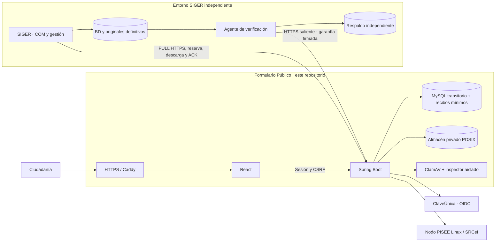
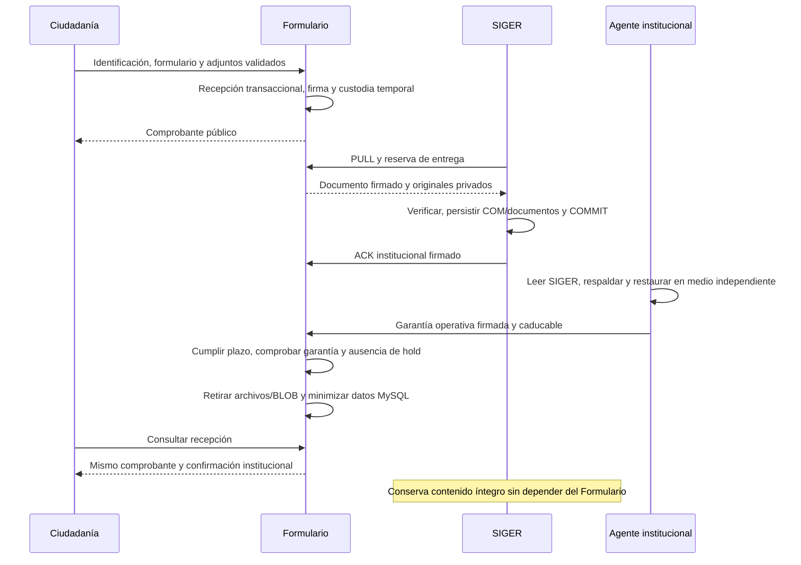

<p align="center">
  
</p>

# Formulario Público · SIGER 2026

Aplicación ciudadana de la **Defensoría de la Niñez**, desarrollada por Nexbyte SpA. Permite a personas adultas, niñas, niños y adolescentes presentar una Comunicación, aportar antecedentes y obtener su comprobante.

**El Formulario es un receptor transitorio. SIGER institucional es el registro y la custodia definitiva.** Este repositorio recibe, valida, conserva temporalmente y entrega información íntegra; después puede retirar sus copias públicas cuando se acreditan las garantías necesarias. No es una segunda base institucional permanente.

**[Arquitectura vigente](docs/ARQUITECTURA_RECEPTOR_TRANSITORIO.md)** · **[Checkpoint técnico y pruebas](docs/CHECKPOINT_RECEPTOR_TRANSITORIO_2026-10-25.md)** · **[Publicación y continuidad](docs/CONSOLIDACION_MAIN_2026-10-25.md)** · **[Contratos](contratos/README.md)** · **[Operación multimedia](docs/OPERACION_MULTIMEDIA.md)**

> **Referencia · 25/10/2026.** Main reúne el baseline funcional, multimedia y receptor transitorio V10. **Publicación de código no significa despliegue:** los laboratorios existentes siguen en V7/V8, con el mantenimiento nuevo y la retirada deshabilitados. La estimación operativa del **96 %** no es cobertura de pruebas, certificación, aceptación definitiva ni autorización productiva. El baseline sigue siendo evolutivo.

## 1. Qué resuelve y dónde termina su responsabilidad

El Formulario implementa recorridos de adultos con/sin ClaveÚnica y de NNA con RUN voluntario/sin RUN; consultas, promoción y vulneración de derechos; personas relacionadas, instituciones, territorio y contacto seguro. Incluye identificación por sesión, preguntas condicionales, validaciones, revisión, envío idempotente, adjuntos privados y comprobante. La interfaz soporta móvil, teclado, temas claro/oscuro/alto contraste, escala de texto y reducción de movimiento.

[SIGER institucional](https://github.com/chashmdai/sistema-de-requerimientos) registra COM, conserva la Comunicación y sus originales, y administra su gestión posterior. Sus bases, sesiones y despliegue son independientes. **El comprobante público acredita recepción temporal; no sustituye el folio ni el ACK institucional.**

La validación institucional puede ajustar redacciones, opciones, campos o presentación. Estos cambios no congelan la integración ni justifican reescribir originales históricos; su efecto contractual debe evaluarse explícitamente. Ver [baseline funcional evolutivo](docs/BASELINE_FORMULARIO_PUBLICO_2026-10-24.md).

## 2. Arquitectura y límites de confianza



React se empaqueta en el JAR de Spring Boot y llama únicamente a su backend. ClaveÚnica y PISEE/SRCeI se integran en servidor: **ClaveÚnica autentica; un RUN declarado o una respuesta SRCeI no autentican**. La procedencia se conserva por atributo. Los valores registrales obtenidos para un RUN declarado no se revelan indiscriminadamente al navegador; se solicitan solo los faltantes.

SIGER inicia las conexiones privadas de recuperación. El agente institucional también conecta hacia el Formulario. **No se expone un servicio entrante en SIGER, ni se monta su archivo o consulta su BD desde la VM pública.** Caddy/HTTPS, callbacks, certificados y secretos son configuración del ambiente, fuera de Git.

## 3. Ciclo completo de una Comunicación



La entrega completa se realiza por **`/integracion/v3/formulario-completo/entregas`**, separada de la ruta V3 histórica. SIGER verifica firma, contenido/procedencia y tamaño/SHA-256 de originales, deduplica y confirma después del COMMIT.

| Documento | Compatibilidad |
|---|---|
| `1.0` | Representación y firma originales intactas; versión por defecto al reclamar sin opt-in |
| `1.1` | Nuevas capturas FILE; requiere `X-Formulario-Versiones: 1.0,1.1` para incluirlas |

**ACK no equivale a permiso de borrado.** La retirada exige además garantía independiente vigente, retención técnica cumplida, integridad y ausencia de bloqueo. Pendientes, cuarentenas o discrepancias se conservan. Detalles: [custodia completa](docs/CUSTODIA_FORMULARIO_COMPLETO.md), [contrato multimedia 1.1](contratos/formulario-completo-multimedia-v1.1.md) y [arquitectura transitoria](docs/ARQUITECTURA_RECEPTOR_TRANSITORIO.md).

## 4. Persistencia y evolución V1–V10

Las migraciones Flyway están duplicadas por motor en [`db/publico/h2`](formulario-publico/backend/src/main/resources/db/publico/h2) y [`db/publico/mysql`](formulario-publico/backend/src/main/resources/db/publico/mysql). **No se editan migraciones aplicadas**; la cuenta de aplicación no es la cuenta migradora.

| Versión | Evolución |
|---|---|
| V1–V3 | Recepción transaccional histórica, auditoría/controles y registro institucional |
| V4–V6 | Sesión NNA, recorridos/personas e historial de identificación |
| V7 | Comunicación completa y adjuntos históricos BLOB en MySQL |
| V8 | Cargas multimedia por bloques, originales/derivadas privados, metadatos y reservas |
| V9 | Intención durable de retirada, bloqueo de conservación, marcas de bytes retirados y liberación recuperable |
| V10 | Recibos mínimos, retirada de payloads/identidad MySQL, garantías independientes y lease de mantenimiento |

Mientras la Comunicación está pendiente se mantiene íntegra. Después de satisfacer los controles, se retiran originales, derivadas, bloques y BLOB; se pone `citizen_submission.body` a NULL, se eliminan personas/historiales y se limpian nombres ciudadanos. El camino histórico también minimiza `public_delivery`, sustituyendo el RUN de propiedad por HMAC. Las reservas se liberan una sola vez.

Se conservan UUID, folio/COM, estado/fechas, comprobantes y ACK originales, hashes de solicitud/contenido y un **recibo mínimo sellado**, sin relato, contactos ni datos registrales. La firma original sigue siendo verificable sobre el documento íntegro en SIGER. Los metadatos restantes son seudonimizados; no se presentan como anonimización universal.

El formulario completo mantiene consulta y reintento exacto idempotentes tras minimizar. El POST ciudadano histórico que devolvía el sobre personal responde **410 tras retirada**, sin duplicar el ingreso; su GET autorizado conserva estado/comprobante. No se reconstruyen datos retirados. Las áreas históricas del backend y sus contratos deben conservarse.

## 5. Multimedia y agente institucional

Los archivos nuevos usan identificadores internos y almacenamiento privado persistente; MySQL conserva propiedad, referencias, hashes, estado y cuota. No hay URL estática de originales. La carga fragmentada permite reanudación, progreso, cancelación y reintentos; verifica SHA-256, antivirus del archivo completo e inspector local aislado antes de aceptar. Los binarios grandes se transfieren por buffers. Las derivadas nunca sustituyen originales.

El perfil multimedia admite hasta **12 archivos / 250 MiB por Comunicación**, con límites por tipo. El soporte efectivo depende de la validación y los codecs: **DOC binario y HEIC/HEIF están deshabilitados**; Office ofrece descarga controlada y PDF muestra primera página. Consultar [formatos/cuotas](docs/POLITICA_MULTIMEDIA_2026-10-24.md), [decisión multimedia](docs/ADR_MULTIMEDIA_2026-10-24.md) y [visor institucional](docs/VISOR_INSTITUCIONAL_MULTIMEDIA.md). Documentos ciudadanos y documentos posteriores de gestión son orígenes distintos determinados por servidor.

El agente [`EmisorGarantiaCustodia`](formulario-publico/backend/src/main/java/cl/nexbyte/siger/custodia/EmisorGarantiaCustodia.java) se distribuye en el mismo JAR, pero **se ejecuta en el entorno privado institucional**. Con una cuenta SELECT local sobre SIGER verifica COM, documento, ACK y originales; publica un paquete del ingreso en medio independiente y lo restaura/revalida automáticamente. No modifica SIGER ni necesita credenciales de la BD pública. El paquete no sustituye el respaldo general de Casos y gestión institucional.

Firma una garantía mínima con clave Ed25519 propia, distinta de las claves de custodia y ACK. El público recibe solo su clave pública confiada. La garantía vence en un máximo de 24 h; renovarla exige verificar nuevamente. No se acepta una firma de otra Comunicación, huella o cola.

Plantilla privada: [`infra/garantia-custodia.properties.example`](infra/garantia-custodia.properties.example). Ejecución, **solo en host institucional compatible y previamente configurado**:

```bash
java -Dloader.main=cl.nexbyte.siger.custodia.EmisorGarantiaCustodia \
  -cp /opt/siger-verificador/formulario-publico.jar \
  org.springframework.boot.loader.launch.PropertiesLauncher \
  --config /etc/siger-verificador/garantia.properties --enviar
```

Las plantillas [`service`](infra/systemd/siger-garantia-custodia.service) y [`timer`](infra/systemd/siger-garantia-custodia.timer) ejecutan lotes cada 15 min. No están instaladas ni activadas. El destino debe ser durable e independiente: el CLI rechaza el mismo filesystem del origen y tmpfs/ramfs/overlay. El agente y sus permisos están probados en Linux/POSIX; no se declara calificación nativa Windows.

## 6. Seguridad y mantenimiento online

Sesión propietaria, CSRF, privacidad, límites y cuotas protegen los recorridos ciudadanos. Las interfaces institucionales exigen TLS y token de integración; las operativas, un token separado. Ninguna sesión ciudadana ni el token de integración habilitan el control operativo de conservación. Las firmas Ed25519 y SHA-256 vinculan documentos y recibos; la garantía y el sello mínimo usan dominios criptográficos separados, sin cambiar contratos 1.0/1.1.

| Recurso operativo | Propósito |
|---|---|
| `GET /integracion/v3/custodia/candidatos` | IDs/colas a verificar, sin atributos ciudadanos |
| `POST /integracion/v3/custodia/garantias` | Recibir evidencia firmada adicional al ACK |
| `GET /operacion/v1/custodia` | Estado agregado del mantenimiento y payloads |
| `POST /operacion/v1/custodia/conservacion` | Activar/retirar hold por Comunicación, con auditoría |

El programador Spring usa delay fijo de cinco minutos, lotes acotados, exclusión de solapamiento y lease persistido recuperable. Guardias por recorrido coordinan cargas, análisis, lecturas y retirada: un recurso ocupado se pospone sin detener la recepción de otros. Las garantías ausentes/vencidas o un hold conservan las copias. La selección rota para evitar que bloqueados impidan revisar el resto.

Una intención de retirada durable precede a borrar bytes. La liberación contable y las marcas se confirman transaccionalmente; la minimización del payload/personas/recibo es otra transacción. Los fallos conservan lo necesario y permiten reintentar sin descontar reservas dos veces. El CLI offline V9 sigue disponible para diagnóstico; **no es el mecanismo periódico normal**.

No incluir secretos, RUN autorizados DEV, originales, dumps, cookies o evidencias privadas en Git, imágenes ni logs. No usar simuladores activos en producción, consultar proveedores en regresiones o retirar datos reales sin respaldo/restore y controles comprobados.

## 7. Repositorio, dependencias y configuración

```text
formulario-publico/
  front/src/              React: formulario/, ui/, recursos institucionales en prototipo/
  backend/src/main/java/cl/nexbyte/siger/
    formulario/           Recepción completa, identificación por recorrido y validación
    identidad/, srcei/    ClaveÚnica y cliente PISEE/SRCeI
    multimedia/           Cargas, análisis, almacenamiento y motor V9
    custodia/             Garantías, agente, programador y minimización V10
    robustez/             JDBC, controles técnicos y firmas históricas
  backend/src/main/resources/db/publico/{h2,mysql}/
  backend/src/test/        Regresiones y dobles controlados
contratos/                Especificaciones y fixtures sintéticos versionados
infra/                    Compose, proxy, workers y plantillas operativas
scripts/linux/            Preparación de laboratorio, arranque, inventario y backup/restore
scripts/qa/               Pruebas sintéticas, integración y verificaciones de navegador
docs/                     Arquitectura, procedimientos e informes históricos
```

Requisitos: **Java 25, Maven 3.9+, Node 24.15+ y npm, Python 3**; versiones en [pom.xml](formulario-publico/backend/pom.xml) y [package.json](formulario-publico/front/package.json). Docker/Compose para MySQL, Caddy, Nodo PISEE y workers según el ambiente. Multimedia necesita filesystem Linux/POSIX privado durable, sockets Unix y aislamiento; el inspector requiere Landlock ABI ≥ 3. No se declara soporte multimedia nativo Windows.

La configuración se inyecta mediante archivos privados externos (`SPRING_CONFIG_ADDITIONAL_LOCATION`) y secretos; nunca se copia una configuración real a Git. Fuentes: [`application.yml`](formulario-publico/backend/src/main/resources/application.yml), [`perfil JDBC`](formulario-publico/backend/src/main/resources/application-jdbc-reception.yml) y clases de configuración de cada módulo.

| Grupo | Variables o propiedades principales |
|---|---|
| JDBC | Perfil `jdbc-reception`; `PUBLIC_DB_URL`, `PUBLIC_DB_USER`, `PUBLIC_DB_PASSWORD`; TLS verificado fuera del laboratorio local explícito |
| Firma y confianza | `RECEIPT_KEY_ID`, `RECEIPT_PRIVATE_KEY_PATH`, `RECEIPT_TRUSTED_KEYS_PATH`, `SIGER_RECEIPT_TRUSTED_KEYS_PATH` |
| Integración/operación | `PUBLIC_INTEGRATION_TOKEN`, `PUBLIC_OPERATIONS_TOKEN`; valores distintos |
| Recorridos | `formulario.habilitado`, `formulario.recepcion.habilitada`, `formulario.adultos.habilitado`, avisos validados y `formulario.abuso-key-path` |
| ClaveÚnica | `CU_ENVIRONMENT`, `CU_CLIENT_ID`, `CU_CLIENT_SECRET`, origen y callbacks aprobados; ver [HTTPS Sandbox](docs/SANDBOX_HTTPS_WSL_2026-10-23.md) |
| SRCeI | Configuración privada del Nodo/cliente y `PISEE_ALLOWED_RUNS_PATH`; DEV solo con allowlist autorizada; ver [informe RUN/SRCeI](docs/RUN_SRCEI_AUTOMATICO_2026-10-24.md) |
| Multimedia | `formulario.multimedia.habilitada`, directorio, sockets/configuración de AV e inspector; [manual](docs/OPERACION_MULTIMEDIA.md) |
| Retirada | `ciclo-vida.online-habilitado`, `ciclo-vida.eliminacion.habilitada`, confianza de garantías y retenciones; [perfil candidato](infra/capacidad-25gb.properties.example) |

Esta tabla orienta, no es una configuración ejecutable completa. Las claves y callbacks existentes deben conservarse; no regenerarlos al retomar un laboratorio. Los Compose de `infra/` tienen fines y montajes distintos: no combinar ni levantar todos indiscriminadamente. [Linux/Docker](docs/LINUX_DOCKER.md) describe la preparación histórica; [operación multimedia](docs/OPERACION_MULTIMEDIA.md) y la [arquitectura vigente](docs/ARQUITECTURA_RECEPTOR_TRANSITORIO.md) describen condiciones actuales.

## 8. Compilar, probar y operar

En un clon nuevo o checkout existente, desde su raíz y con Bash Linux/WSL:

```bash
git status --short --branch
npm --prefix formulario-publico/front ci
npm --prefix formulario-publico/front run lint
npm --prefix formulario-publico/front test -- --maxWorkers=2
npm --prefix formulario-publico/front run build

# Salida aislada: no sobrescribir un JAR que pueda estar ejecutándose.
mvn -B -ntp -f formulario-publico/backend/pom.xml \
  -Dsiger.build.directory="$(pwd)/.local/desarrollo-target" \
  '-Dtest=*Test,!Carga*Test' verify

python3 scripts/qa/test_media_archive.py
python3 scripts/qa/test_media_storage_report.py
python3 scripts/qa/modelar-receptor-transitorio.py
```

H2 y frontend no requieren credenciales gubernamentales ni SIGER. Las pruebas crean/migran sus bases y algunos servidores locales controlados. Para MySQL, provisionar **un esquema sintético dedicado** y configurar `ROBUST_DB_URL`, `ROBUST_DB_USER`, `ROBUST_DB_PASSWORD`, `ROBUST_DB_MIGRATION_USER` y `ROBUST_DB_MIGRATION_PASSWORD` desde el entorno privado; repetir Maven con esas variables. Nunca apuntarlas al esquema ciudadano. El [checkpoint](docs/CHECKPOINT_RECEPTOR_TRANSITORIO_2026-10-25.md) conserva resultados y omisiones; no ejecutar carga ni proveedores reales como parte de esta batería.

**Compilar no despliega ni migra la base del servicio.** La aplicación usa una cuenta limitada; las migraciones son una operación explícita anterior al arranque, con respaldo/restore comprobados y las variables privadas `MIGRATION_DB_URL`, `MIGRATION_DB_USER`, `MIGRATION_DB_PASSWORD`. Los comandos siguientes ilustran un ambiente **ya preparado**, no deben ejecutarse sobre los laboratorios existentes durante una publicación:

```bash
# MIGRATION_DB_* suministradas por el operador; no escribir secretos en el historial.
java -jar /opt/formulario/formulario-publico.jar --migrate

# Configuración propia del ambiente, con guardas y banderas verificadas.
java -jar /opt/formulario/formulario-publico.jar \
  --spring.profiles.active=jdbc-reception \
  --spring.config.additional-location=file:/etc/formulario/application.properties
```

`--migrate` usa [`MigrarDatos`](formulario-publico/backend/src/main/java/cl/nexbyte/siger/robustez/MigrarDatos.java), sin iniciar el servidor web. No hacer downgrade de esquema ni arrancar código anterior sobre datos V10 minimizados. Para UI, Vite (`npm --prefix formulario-publico/front run dev`) no sustituye HTTPS/callbacks oficiales. Los lanzadores Windows son históricos; el laboratorio Linux tiene sus propios procesos.

Respaldar y restaurar **base y almacén coherentes**, conservando aparte claves históricas, confianza, secreto HMAC y configuración. [`media-archive.py`](scripts/linux/media-archive.py) valida V8/V9/V10; su procedimiento de laboratorio es offline para esa aplicación, mediante lock exclusivo, y restaura solo en esquema/directorio nuevos. **Esto no vuelve offline el mantenimiento normal de retirada.** Ver [procedimiento y comandos de backup/restore](docs/OPERACION_MULTIMEDIA.md). El respaldo institucional independiente del agente no reemplaza el respaldo de pendientes públicos ni el backup general de SIGER.

## 9. Operación dentro de 25 GB

25 GB decimales equivalen a ~23,28 GiB. El perfil candidato conserva las capacidades de recepción y distribuye **22 GiB**: SO/actualizaciones 6, runtime 3, MySQL/binlogs 3, multimedia 6 y margen libre 4. La reserva contable no se suma de nuevo a los mismos archivos físicos. No guardar builds ni respaldos completos en ese SSD.

| Parámetro candidato | Valor / condición |
|---|---|
| Cuota multimedia reservada | 6 GiB; el valor previo de laboratorio es 10 GiB |
| Piso libre | 4 GiB; protege también nuevas recepciones sin adjuntos |
| Retención tras observación válida | 24 h; después sigue conservando si falta garantía vigente |
| Borradores | Vencimiento +48 h para contenido; siete días para metadatos abandonados |
| Temporales huérfanos / auditoría técnica | >24 h / 30 días, con exclusiones de activos y evidencias finales |
| Alertas | Cuota preventiva 80 % / crítica 95 %; espacio preventivo bajo piso+1 GiB / crítico bajo piso |

Inventario agregado de solo lectura, en host y esquema autorizados; ajustar argumentos al ambiente y usar privilegios locales para consultar Docker/MySQL:

```bash
python3 scripts/linux/media-storage-report.py \
  --store /srv/formulario/almacen --database esquema_autorizado \
  --quota-gib 6 --min-free-gib 4
```

El inventario exige nombre de esquema SQL en minúsculas; sustituir el marcador anterior por el real autorizado. Informa bytes físicos/lógicos, reservados y disponibles, discrepancias y alertas; no elimina ni valida por sí solo custodia/ACK. El overlay [`compose.mysql-25gb.yml`](infra/compose.mysql-25gb.yml) propone binlogs MINIMAL/72 h, segmentos 64 MiB y rotación de logs: **no está aplicado**. NULL/DELETE permiten reutilizar páginas InnoDB; no prometen encoger `.ibd` ni borrado forense inmediato.

El [modelo reproducible](scripts/qa/modelar-receptor-transitorio.py) supone llegadas uniformes, entrega/restauración en 24 h y retención 24 h. Calcula picos de **0,488 GiB para 300×20 MiB/mes** y **5,596 GiB para 300×250 MiB/mes**, con margen menor en el extremo. Es cálculo, no carga ni medición de la futura VM. Los recibos crecen lentamente (~0,11 GiB/año con el presupuesto documentado). Si SIGER/garantías se retrasan o hay ráfagas, la admisión se frena antes de comprometer lo recibido; no se descartan pendientes para cumplir cuota. Ver [hipótesis y activación](docs/ARQUITECTURA_RECEPTOR_TRANSITORIO.md).

## 10. Evidencia, despliegue y continuidad

Resultados **de la unidad de implementación anterior**, conservados en esta publicación; no se presentan como regresiones ejecutadas nuevamente:

| Batería | Resultado verificado |
|---|---|
| Frontend | 160 correctas, 18 archivos; lint y build correctos |
| Backend H2 / MySQL aislado | En cada motor: 245 descubiertas, 243 correctas, dos omisiones opcionales, cero fallos/errores |
| Backup/restore e inventario Python | Nueve + siete correctas |
| Programador/HTTP Spring | Motor y timer reales con datos sintéticos; MockMvc con TLS simulado, no handshake de infraestructura |
| Artefacto SIGER existente | Clases reales sobre H2 en disco, documentos 1.0/1.1, COM/ACK, respaldo/restauración y lectura íntegra tras retirada/cierre de BD pública |
| Restore público MySQL V10 | Dos recibos minimizados restaurados y firmas verificadas |

Las dos omisiones son workers reales (`MEDIA_REAL_CHECK`) y recuperación de proceso opcional (`recuperacion.real`). El [checkpoint](docs/CHECKPOINT_RECEPTOR_TRANSITORIO_2026-10-25.md) separa esas pruebas de la evidencia multimedia anterior. Los máximos físicos de 150/250 MiB, trayecto publicado y continuidad de borrador entre sesiones tras reinicio siguen pendientes de calificación. [CI](.github/workflows/ci.yml) ejecuta pruebas aisladas en Ubuntu; no se afirma que un run remoto haya pasado sin comprobarlo.

| Estado de infraestructura al consolidar | Situación |
|---|---|
| Laboratorio integrado | `robust_public_local`, V7; multimedia apagada; integraciones Sandbox/DEV existentes conservadas |
| Laboratorio multimedia | `robust_public_media_lab`, V8; multimedia activa solo allí |
| Código publicado | Migraciones V1–V10, agente, motor y pruebas incluidos; publicar no aplica migraciones |
| Mantenimiento / retirada nuevos | `ciclo-vida.online-habilitado=false` y `ciclo-vida.eliminacion.habilitada=false` —o ausentes— en ambos laboratorios |
| Producción | No habilitada; guardas existentes de recorridos Sandbox/perfiles de laboratorio intactas |

La puesta en operación requiere calificar presupuesto real y respaldo/restore, instalar el agente privado con medio independiente y claves separadas, migrar V10 por procedimiento, observar primero con retirada cerrada y habilitarla solo tras verificar requisitos. No es desarrollo pendiente del ciclo transitorio: son instalación, configuración y pruebas del ambiente de destino. Levantar las guardas productivas y el [hardening final de ambos aplicativos](docs/PLAN_HARDENING_PRODUCCION_DIFERIDO.md) pertenecen a una unidad posterior explícita.

Para continuar: leer [arquitectura](docs/ARQUITECTURA_RECEPTOR_TRANSITORIO.md), [checkpoint](docs/CHECKPOINT_RECEPTOR_TRANSITORIO_2026-10-25.md) y [consolidación en main](docs/CONSOLIDACION_MAIN_2026-10-25.md); revisar rama/status/diff antes de editar, conservar datos/commits y no modificar contratos, claves ni migraciones aplicadas por cambios de UI. Los informes fechados del 23–24/10 y V9 conservan evidencia histórica; prevalece esta arquitectura V10 para retención y operación. **No iniciar nuevas funcionalidades ni habilitar retiradas por el solo hecho de publicar código.**
