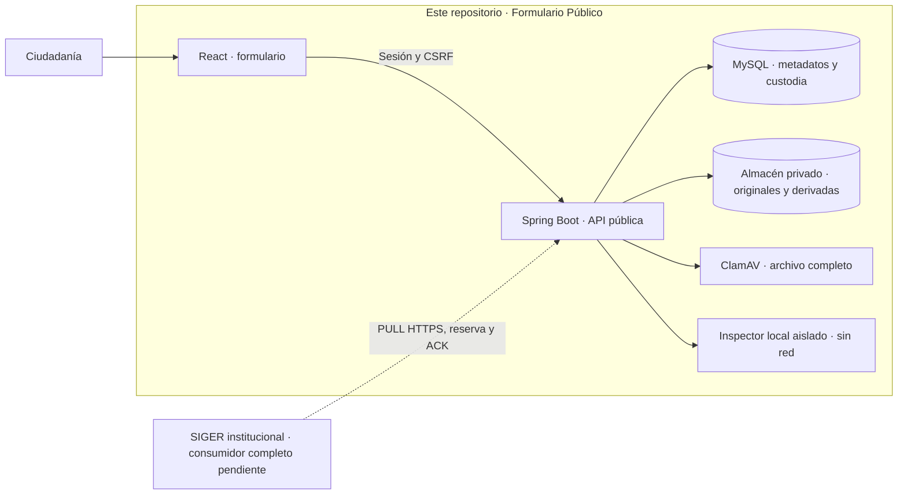

<p align="center">
  
</p>

# Formulario Público · SIGER 2026

Aplicación ciudadana de la **Defensoría de la Niñez**, desarrollada por Nexbyte SpA. Permite a personas adultas, niñas, niños y adolescentes presentar una Comunicación, aportar antecedentes y obtener su comprobante de recepción.

Este repositorio contiene **React, el backend público y la custodia de recepción**. SIGER institucional administra el registro y la gestión posterior en [su propio repositorio](https://github.com/chashmdai/sistema-de-requerimientos). Sus bases, sesiones y despliegues son independientes.

**[Cierre y checkpoint de main](docs/CIERRE_CICLO_MAIN_2026-10-24.md)** · **[Baseline para integrar SIGER](docs/BASELINE_FORMULARIO_PUBLICO_2026-10-24.md)** · **[Contratos](contratos/README.md)** · **[Operación multimedia](docs/OPERACION_MULTIMEDIA.md)**

> **Estado al cierre del ciclo · 24/10/2026.** Código consolidado en main para integración y laboratorio. El avance aproximado del **96 %** es una evaluación operativa del proyecto: no es cobertura, certificación ni autorización productiva. Publicar código no despliega servicios ni habilita multimedia fuera del laboratorio.

## Si llegas por primera vez

| Lo que necesitas hacer | Empieza aquí |
|---|---|
| Entender qué está entregado y qué queda pendiente | [Cierre del ciclo y resultados](docs/CIERRE_CICLO_MAIN_2026-10-24.md) |
| Desarrollar el consumidor SIGER | [Baseline evolutivo](docs/BASELINE_FORMULARIO_PUBLICO_2026-10-24.md) → [custodia completa](docs/CUSTODIA_FORMULARIO_COMPLETO.md) → [documentos 1.0/1.1](contratos/formulario-completo-multimedia-v1.1.md) |
| Entender almacenamiento, cargas y antivirus | [Decisión arquitectónica](docs/ADR_MULTIMEDIA_2026-10-24.md) → [formatos/cuotas](docs/POLITICA_MULTIMEDIA_2026-10-24.md) → [operación y respaldos](docs/OPERACION_MULTIMEDIA.md) |
| Operar con 25 GB y conservar solo copias transitorias | [Ciclo de vida implementado, garantías y pruebas](docs/CICLO_VIDA_CUSTODIA_TRANSITORIA_2026-10-25.md) → [inventario de capacidad](docs/CAPACIDAD_Y_RETENCION_2026-10-25.md) |
| Preparar el futuro visor institucional | [Contrato del visor y separación documental](docs/VISOR_INSTITUCIONAL_MULTIMEDIA.md) |
| Reutilizar el entorno Linux/WSL existente | [Checkpoint de cierre](docs/CIERRE_CICLO_MAIN_2026-10-24.md) y [operación](docs/OPERACION_MULTIMEDIA.md); no repetir preparación ni regenerar claves |
| Consultar instalaciones o decisiones anteriores | [Linux/Docker](docs/LINUX_DOCKER.md), [manual Windows histórico](docs/MANUAL_REPOSITORIOS.md), [HTTPS local](docs/SANDBOX_HTTPS_WSL_2026-10-23.md) |
| Conocer el trabajo futuro de producción | [Plan de hardening diferido — no ejecutado](docs/PLAN_HARDENING_PRODUCCION_DIFERIDO.md) |

Los informes y lanzadores históricos conservan sus condiciones originales. Para el **formulario completo actual**, usa como referencia el cierre y los contratos anteriores; una demostración antigua de recepción no acredita al consumidor SIGER completo.

## Qué hace la aplicación

- Recorridos de adultos con/sin ClaveÚnica y de NNA con RUN voluntario o sin RUN.
- Consultas, promoción y vulneración de derechos; preguntas condicionales, personas relacionadas, instituciones, territorio y contacto seguro.
- Identificación por sesión y procedencia individual: **ClaveÚnica autentica; el RUN declarado y SRCeI no autentican**. Los datos registrales de un RUN declarado no se revelan al navegador.
- Navegación por pasos o vista completa, validación, revisión, envío idempotente y comprobante de custodia. Teléfonos y correos normalizados en nuevas capturas.
- Adjuntos privados, ClamAV e inspección aislada, carga por bloques, progreso/reintentos y previsualización según el perfil permitido.
- Interfaz institucional responsive, temas claro/oscuro/alto contraste, escala de texto, teclado y reducción de movimiento.

La recepción pública y el registro institucional son hechos distintos: **el comprobante público no es un folio SIGER**. El registro y su confirmación firmada dependen del consumidor institucional.

## Cómo se conectan las piezas



React solo llama a su backend. Las integraciones ClaveÚnica y PISEE/SRCeI pertenecen al backend público y se configuran fuera de Git en ambientes autorizados. El navegador no accede a MySQL, al almacén ni a la VM institucional. SIGER inicia la recuperación privada de Comunicaciones y originales.

Los adjuntos históricos permanecen en MySQL; los nuevos del perfil multimedia usan archivos privados con referencias UUID y SHA-256 en MySQL. Las derivadas no reemplazan originales. No hay eliminación automática después del ACK.

## Mapa del código

```text
formulario-publico/
  front/src/
    formulario/           Recorridos, reglas, identificación y clientes de API
    ui/                   Componentes compartidos, adjuntos, revisión y accesibilidad
    prototipo/            Recursos de identidad visual y estilos institucionales
  backend/src/
    main/java/cl/nexbyte/siger/
      formulario/         DTO, validación, persistencia, custodia y entrega completa
      identidad/          ClaveÚnica y sesión autenticada
      srcei/              Cliente Java PISEE/SRCeI
      multimedia/         Cargas, almacenamiento, análisis y streaming privado
      robustez/           JDBC, controles, límites y firmas
    main/resources/db/publico/{h2,mysql}/   Migraciones Flyway
    test/                 Regresiones y dobles controlados
contratos/                Especificaciones y fixtures sintéticos versionados
docs/                     Baseline, decisiones, informes, operación y cierre
infra/                    Docker/Compose, proxy y workers multimedia
scripts/linux/            Herramientas de laboratorio, capacidad y respaldos
scripts/qa/               Verificaciones sintéticas y de navegador
```

Las áreas `comunicaciones`, `entrega` y `nna` del backend también conservan contratos anteriores. No eliminarlas ni sustituir sus modelos por el agregado nuevo: existe compatibilidad histórica que debe preservarse.

## Compilar y probar sin activar servicios

Requisitos: **Java 25**, Maven 3.9+, **Node 24.15+** y npm; versiones exactas en los manifiestos. Python 3 para las utilidades. La batería multimedia y los workers reales se validan en Linux/WSL sobre filesystem POSIX; el inspector exige Landlock ABI ≥ 3. No se declara soporte multimedia nativo de Windows. Las pruebas H2 y el build no requieren credenciales de ClaveÚnica/SRCeI ni el repositorio institucional.

En un clon nuevo, o desde la raíz del checkout existente, con terminal Bash Linux/WSL:

```bash
# Conservar cambios previos antes de trabajar.
git status --short --branch

npm --prefix formulario-publico/front ci
npm --prefix formulario-publico/front run lint
npm --prefix formulario-publico/front test -- --maxWorkers=2
npm --prefix formulario-publico/front run build

# Salida aislada: no sobreescribe un JAR que pueda estar ejecutándose.
mvn -B -ntp -f formulario-publico/backend/pom.xml \
  -Dsiger.build.directory="$(pwd)/.local/desarrollo-target" \
  '-Dtest=*Test,!Carga*Test' verify

python3 scripts/qa/test_media_archive.py
```

React se empaqueta dentro del JAR. **El build no despliega ni migra las bases del servicio.** Las pruebas sí crean y migran sus bases de prueba; algunos tests inician servidores locales controlados que se cierran al terminar. La ejecución requiere configuración privada, claves/confianza y la base del ambiente correspondiente. La prueba MySQL necesita su esquema de pruebas dedicado: nunca apuntarla a una base con datos que deban conservarse. Las pruebas opcionales de carga y las de integración real no se activan con estos comandos.

Para editar UI puede usarse `npm --prefix formulario-publico/front run dev` en un entorno preparado. Vite no sustituye el origen HTTPS ni los callbacks oficiales de ClaveÚnica. En Windows, usa WSL/Linux para esta batería multimedia. Los manuales/lanzadores Windows describen el camino histórico; no mezcles esos procesos con los laboratorios Linux ya preparados.

### Laboratorios existentes al cierre

| Entorno local | Aplicación / datos | Habilitación multimedia |
|---|---|---|
| Integrado · HTTPS 443 → Spring 18443 | Formulario conocido, `robust_public_local`, V7 | Apagada; se conservan sus integraciones Sandbox/DEV y custodias |
| Multimedia · HTTPS 19443 | Instancia aislada, `robust_public_media_lab`, V8 | Activa solo aquí; callback CU y PISEE deshabilitados |

Los puertos y bases identifican **laboratorios**, no servicios públicos. El JAR nuevo de main no se instaló sobre el proceso integrado. V8 forma parte del código, pero no se aplicó a su base V7 en este cierre. Ver el [estado de las banderas](docs/CIERRE_CICLO_MAIN_2026-10-24.md) antes de utilizar un lanzador; no crear otro almacén o base para resolver un fallo de arranque.

## Integrar SIGER sobre un contrato conocido

La base es **`/integracion/v3/formulario-completo/entregas`**. La ruta V3 histórica se mantiene separada.

| Documento | Comportamiento |
|---|---|
| `1.0` | Se conserva su representación y firma; es la versión entregada por defecto al reclamar sin opt-in. |
| `1.1` | Nuevas capturas con originales FILE; requiere `X-Formulario-Versiones: 1.0,1.1` para incluirlas. |

El consumidor debe verificar firma y ambas huellas, recuperar originales bajo reserva, comprobar tamaño/SHA-256, persistir la Comunicación íntegra y confirmar **después de su COMMIT**. Debe deduplicar por operación pública y conciliar confirmaciones ambiguas. La versión del documento no se confunde con el número HTTP V3 ni con la versión del comprobante institucional por canal.

**SIGER aún debe adaptar su consumidor completo y probar E2E.** Puede comenzar con este baseline: las observaciones institucionales pendientes —principalmente redacciones, opciones y eventuales eliminaciones de campos— no lo congelan ni bloquean esa integración. Si un cambio altera la semántica contractual, debe documentarse y coordinarse. Los históricos nunca se reescriben para ajustarlos a preguntas nuevas.

## Pruebas y límites comprobados

[El workflow de CI](.github/workflows/ci.yml) ejecuta estas comprobaciones aisladas sobre Ubuntu 24.04, con permisos de lectura y sin despliegues ni credenciales de proveedores. Se alinea con el filesystem POSIX del almacenamiento multimedia; los resultados locales siguientes no se presentan como un estado remoto de CI sin comprobarlo.


| Batería de cierre sobre main | Resultado |
|---|---|
| Frontend | 160 correctas; lint y build correctos |
| Backend H2 | 199 descubiertas: 197 correctas y dos omisiones opcionales |
| Backend MySQL aislado | 199 descubiertas: 197 correctas y dos omisiones opcionales |
| Utilidades de respaldo | Cinco pruebas Python correctas |

La [unidad multimedia](docs/INFORME_MULTIMEDIA_2026-10-24.md) documenta además inspector/ClamAV reales, navegador, custodia sintética y restauración comprobada. No se reinterpretan esas pruebas como cobertura porcentual o certificación.

Límites pendientes de calificación: máximos físicos de 150/250 MiB, trayecto publicado y continuidad de borrador entre sesiones tras reinicio. DOC binario y HEIC/HEIF permanecen deshabilitados; Office ofrece descarga controlada y PDF muestra primera página. El [perfil de formatos](docs/POLITICA_MULTIMEDIA_2026-10-24.md) detalla restricciones, incluidas las de XLSX y codecs.

## Reglas para continuar el trabajo

1. Leer el cierre y el encargo vigente; revisar rama, `git status`, diff e historial antes de modificar. Conservar los cambios ajenos y los datos del laboratorio.
2. Mantener separados autenticación, información registral y declaración ciudadana; usar dobles en pruebas automatizadas. Las consultas reales a proveedores requieren autorización específica.
3. No editar migraciones aplicadas, canonicalización, firmas, UUID o datos históricos para acomodar cambios de interfaz. Evolucionar contratos de forma explícita.
4. Mantener fuera de Git e imágenes secretos, certificados privados, RUN autorizados DEV, bases, cookies, logs y evidencias privadas. Los fixtures publicados son sintéticos.
5. Usar salidas de build aisladas y respaldos consistentes. No borrar volúmenes, regenerar claves ni ejecutar limpiezas para resolver incompatibilidades.
6. Documentar pruebas, decisiones y límites. Las decisiones técnicas pertenecen a desarrollo; las validaciones funcionales menores se gestionan sin imponer una congelación artificial.

**Ciclo actual cerrado.** Después de esta consolidación no se continúan implementaciones del Formulario Público sin un nuevo encargo explícito. El [hardening final](docs/PLAN_HARDENING_PRODUCCION_DIFERIDO.md) queda documentado, sin ejecutar, para una unidad posterior a la integración y las pruebas E2E de ambos aplicativos.
