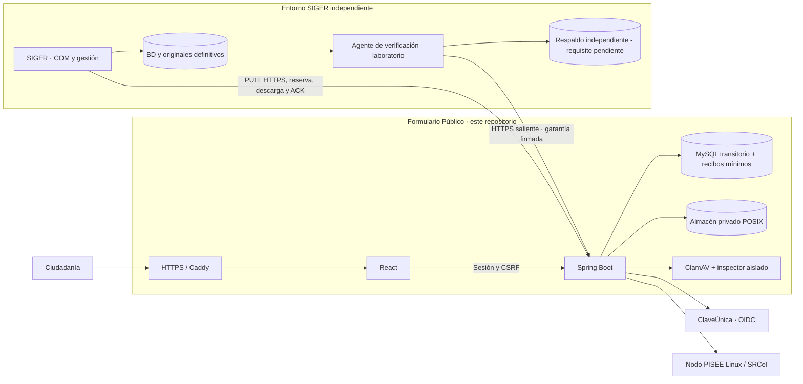
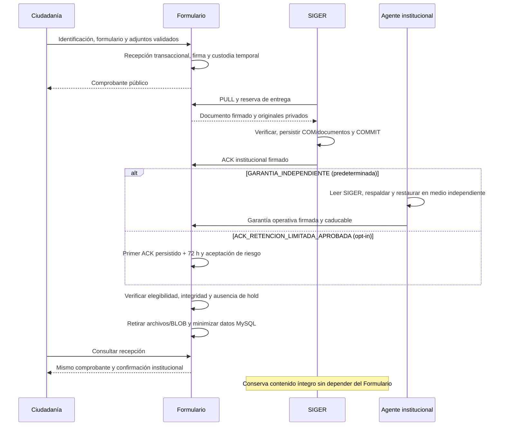
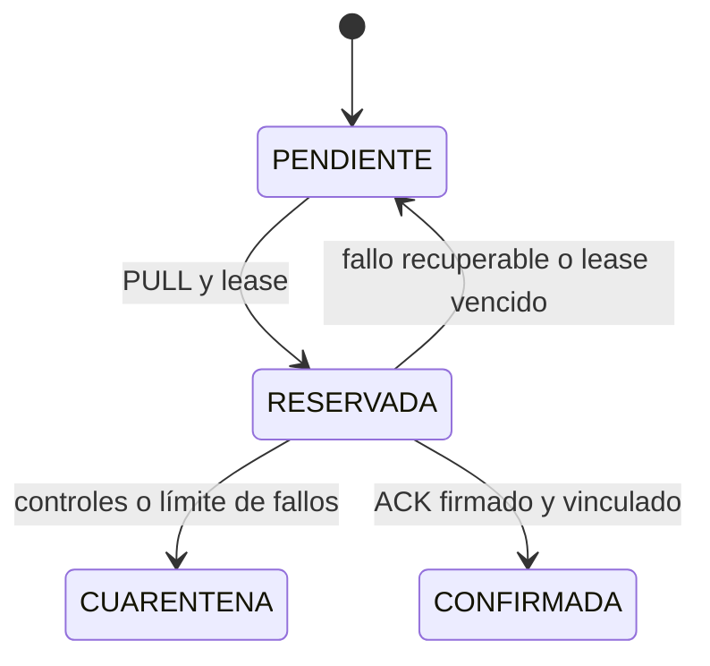
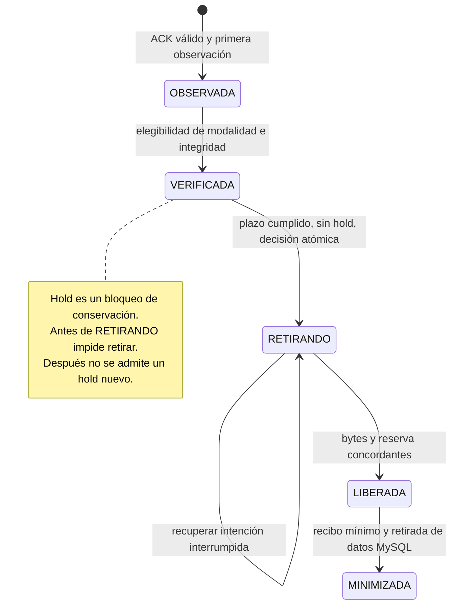

<p align="center">
  
</p>

# Formulario Público · SIGER 2026

**EL FORMULARIO PÚBLICO NO SE ENCUENTRA HABILITADO PARA PRODUCCIÓN.**

[](https://github.com/chashmdai/formulario-web/actions/workflows/ci.yml)

Aplicación ciudadana de la **Defensoría de la Niñez**, desarrollada por Nexbyte SpA. Permite a personas adultas, niñas, niños y adolescentes presentar una Comunicación, aportar antecedentes y obtener su comprobante.

**El Formulario es un receptor transitorio. SIGER institucional es el registro y la custodia definitiva.** Este repositorio recibe, valida, conserva temporalmente y entrega información íntegra; después puede retirar sus copias públicas cuando se acreditan las garantías necesarias. No es una segunda base institucional permanente.

**[Retención 72 h · V12](docs/RETENCION_ACK_72H_2026-10-26.md)** · **[Cierre de ingeniería](docs/CIERRE_INGENIERIA_FORMULARIO_PUBLICO_2026-10-25.md)** · **[Agente Windows nativo · laboratorio](agente-custodia/README.md)** · **[Cierre técnico y observabilidad](docs/CIERRE_TECNICO_V10_2026-10-25.md)** · **[Arquitectura vigente](docs/ARQUITECTURA_RECEPTOR_TRANSITORIO.md)** · **[Checkpoint técnico y pruebas](docs/CHECKPOINT_RECEPTOR_TRANSITORIO_2026-10-25.md)** · **[Publicación y continuidad](docs/CONSOLIDACION_MAIN_2026-10-25.md)** · **[Contratos](contratos/README.md)** · **[Operación multimedia](docs/OPERACION_MULTIMEDIA.md)**

> **Actualización · 26/10/2026.** V12 implementa una [alternativa de 72 h por ACK](docs/RETENCION_ACK_72H_2026-10-26.md), deshabilitada por defecto, sin exigir respaldo individual. La política independiente sigue siendo predeterminada. Código local, sin despliegue, retiradas ni push.

> **Referencia histórica · 25/10/2026.** Este cierre reúne el baseline funcional, multimedia, receptor transitorio V10/V11 y agente Windows 1.1. Las verificaciones del cierre están en el [registro de ingeniería](docs/CIERRE_INGENIERIA_FORMULARIO_PUBLICO_2026-10-25.md). **Publicación de código no significa despliegue:** los laboratorios existentes siguen en V7/V8, con el mantenimiento nuevo y la retirada deshabilitados. La estimación operativa del **96 %** no es cobertura de pruebas, certificación, aceptación definitiva ni autorización productiva. El baseline sigue siendo evolutivo.

## Índice

- [1. Qué resuelve y dónde termina su responsabilidad](#s1)
- [2. Arquitectura y límites de confianza](#s2)
- [3. Ciclo completo de una Comunicación](#s3)
- [4. Persistencia y evolución V1–V12](#s4)
- [5. Multimedia y agente institucional](#s5)
- [6. Seguridad y mantenimiento online](#s6)
- [7. Repositorio, dependencias y configuración](#s7)
- [8. Compilar, probar y operar](#s8)
- [9. Operación dentro de 25 GB](#s9)
- [10. Evidencia, despliegue y continuidad](#s10)
- [11. Frontend: recorridos, estado y mantenimiento](#s11)
- [12. Operación Linux, despliegue y recuperación](#s12)
- [13. Backend, recursos HTTP y persistencia](#s13)
- [14. Identidad, interoperabilidad y confianza criptográfica](#s14)
- [15. Agente institucional Windows y preparación operativa](#s15)
- [16. Diagnóstico y continuidad sin exponer datos](#s16)
- [17. Escenarios de despliegue futuros — propuestas no aprobadas](#s17)
- [18. Preparación real para producción](#s18)
- [19. Validación institucional y mantenimiento posterior](#s19)

<a id="s1"></a>

## 1. Qué resuelve y dónde termina su responsabilidad

El Formulario implementa recorridos de adultos con/sin ClaveÚnica y de NNA con RUN voluntario/sin RUN; consultas, promoción y vulneración de derechos; personas relacionadas, instituciones, territorio y contacto seguro. Incluye identificación por sesión, preguntas condicionales, validaciones, revisión, envío idempotente, adjuntos privados y comprobante. La interfaz soporta móvil, teclado, temas claro/oscuro/alto contraste, escala de texto y reducción de movimiento.

[SIGER institucional](https://github.com/chashmdai/sistema-de-requerimientos) registra COM, conserva la Comunicación y sus originales, y administra su gestión posterior. Sus bases, sesiones y despliegue son independientes. **El comprobante público acredita recepción temporal; no sustituye el folio ni el ACK institucional.**

La validación institucional puede ajustar redacciones, opciones, campos o presentación. Estos cambios no congelan la integración ni justifican reescribir originales históricos; su efecto contractual debe evaluarse explícitamente. Ver [baseline funcional evolutivo](docs/BASELINE_FORMULARIO_PUBLICO_2026-10-24.md).

Una Comunicación es el ingreso inicial con antecedentes y documentos aportados por la ciudadanía. No equivale por sí sola a una Solicitud, Requerimiento, Caso o Tarea: su clasificación y gestión posterior pertenecen a SIGER conforme a sus reglas. Este repositorio no implementa el ingreso manual de funcionarios, decisiones de admisibilidad, gestión de Casos ni un repositorio definitivo duplicado.

| Componente / actor | Responsabilidad | Frontera |
|---|---|---|
| Formulario Público | Recibir y validar, emitir comprobante, custodiar temporalmente, entregar por PULL y minimizar con garantías | No gestiona casos ni consulta la base institucional |
| SIGER institucional | Registro COM, gestión y custodia definitiva de Comunicación/originales | Aplicación y operación independientes; el agente no ejecuta su negocio |
| Agente institucional | Lectura controlada, integridad, respaldo/restauración y garantía operativa | Sin INSERT/UPDATE/DELETE de registros institucionales; no sustituye backup global SIGER |
| Nexbyte / desarrollo | Implementación, decisiones técnicas, contratos, pruebas y documentación dentro del encargo | No otorga aceptación institucional ni habilitación productiva |
| Contraparte institucional / TI | Validación funcional, infraestructura, identidades, certificados, custodia y autorización operativa | Las propuestas técnicas no se presentan como decisiones institucionales ya aprobadas |

<a id="s2"></a>

## 2. Arquitectura y límites de confianza



React se empaqueta en el JAR de Spring Boot y llama únicamente a su backend. ClaveÚnica y PISEE/SRCeI se integran en servidor: **ClaveÚnica autentica; un RUN declarado o una respuesta SRCeI no autentican**. La procedencia se conserva por atributo. Los valores registrales obtenidos para un RUN declarado no se revelan indiscriminadamente al navegador; se solicitan solo los faltantes.

SIGER inicia las conexiones privadas de recuperación. El agente institucional también conecta hacia el Formulario. **No se expone un servicio entrante en SIGER, ni se monta su archivo o consulta su BD desde la VM pública.** Caddy/HTTPS, callbacks, certificados y secretos son configuración del ambiente, fuera de Git.

<a id="s3"></a>

## 3. Ciclo completo de una Comunicación



La entrega completa se realiza por **`/integracion/v3/formulario-completo/entregas`**, separada de la ruta V3 histórica. SIGER verifica firma, contenido/procedencia y tamaño/SHA-256 de originales, deduplica y confirma después del COMMIT.

| Documento | Compatibilidad |
|---|---|
| `1.0` | Representación y firma originales intactas; versión por defecto al reclamar sin opt-in |
| `1.1` | Nuevas capturas FILE; requiere `X-Formulario-Versiones: 1.0,1.1` para incluirlas |

**ACK no equivale por sí solo a permiso de borrado.** El modo predeterminado exige garantía independiente vigente; la alternativa, política explícita de riesgo y 72 h desde el primer ACK válido persistido. Ambas conservan integridad, holds y controles: [configuración/riesgos V12](docs/RETENCION_ACK_72H_2026-10-26.md). Pendientes, cuarentenas o discrepancias se conservan. Detalles: [custodia completa](docs/CUSTODIA_FORMULARIO_COMPLETO.md), [contrato multimedia 1.1](contratos/formulario-completo-multimedia-v1.1.md) y [arquitectura transitoria](docs/ARQUITECTURA_RECEPTOR_TRANSITORIO.md).

### Estados de entrega y retirada

Las dos máquinas tienen finalidades distintas. CONFIRMADA registra el ACK institucional; todavía no significa que se hayan retirado copias públicas.





Los estados/leases se validan en transacciones y con condiciones del servidor; los diagramas no autorizan saltos por actualización SQL manual. En errores se conserva o reanuda el estado recuperable. La cola histórica tiene su propia transición transaccional compatible; no se reutiliza como si fuera citizen_submission.

<a id="s4"></a>

## 4. Persistencia y evolución V1–V12

Las migraciones Flyway están duplicadas por motor en [`db/publico/h2`](formulario-publico/backend/src/main/resources/db/publico/h2) y [`db/publico/mysql`](formulario-publico/backend/src/main/resources/db/publico/mysql). **No se editan migraciones aplicadas**; la cuenta de aplicación no es la cuenta migradora.

| Versión | Evolución |
|---|---|
| V1–V3 | Recepción transaccional histórica, auditoría/controles y registro institucional |
| V4–V6 | Sesión NNA, recorridos/personas e historial de identificación |
| V7 | Comunicación completa y adjuntos históricos BLOB en MySQL |
| V8 | Cargas multimedia por bloques, originales/derivadas privados, metadatos y reservas |
| V9 | Intención durable de retirada, bloqueo de conservación, marcas de bytes retirados y liberación recuperable |
| V10 | Recibos mínimos, retirada de payloads/identidad MySQL, garantías independientes y lease de mantenimiento |
| V11 | Solo índices operativos para selección y observabilidad; V1–V10 y documentos intactos |
| V12 | Primer ACK y modalidad/referencia de retirada; alternativa de 72 h, sin alterar documentos ni migraciones anteriores |

Mientras la Comunicación está pendiente se mantiene íntegra. Después de satisfacer los controles, se retiran originales, derivadas, bloques y BLOB; se pone `citizen_submission.body` a NULL, se eliminan personas/historiales y se limpian nombres ciudadanos. El camino histórico también minimiza `public_delivery`, sustituyendo el RUN de propiedad por HMAC. Las reservas se liberan una sola vez.

Se conservan UUID, folio/COM, estado/fechas, comprobantes y ACK originales, hashes de solicitud/contenido y un **recibo mínimo sellado**, sin relato, contactos ni datos registrales. La firma original sigue siendo verificable sobre el documento íntegro en SIGER. Los metadatos restantes son seudonimizados; no se presentan como anonimización universal.

El formulario completo mantiene consulta y reintento exacto idempotentes tras minimizar. El POST ciudadano histórico que devolvía el sobre personal responde **410 tras retirada**, sin duplicar el ingreso; su GET autorizado conserva estado/comprobante. No se reconstruyen datos retirados. Las áreas históricas del backend y sus contratos deben conservarse.

<a id="s5"></a>

## 5. Multimedia y agente institucional

Los archivos nuevos usan identificadores internos y almacenamiento privado persistente; MySQL conserva propiedad, referencias, hashes, estado y cuota. No hay URL estática de originales. La carga fragmentada permite reanudación, progreso, cancelación y reintentos; verifica SHA-256, antivirus del archivo completo e inspector local aislado antes de aceptar. Los binarios grandes se transfieren por buffers. Las derivadas nunca sustituyen originales.

El perfil multimedia, separado del canal clásico, admite hasta **12 archivos / 250 MiB por Comunicación**, con límites por tipo. El soporte efectivo depende de la validación y los codecs: **DOC binario y HEIC/HEIF están deshabilitados**; Office ofrece descarga controlada y PDF muestra primera página. Consultar [formatos/cuotas](docs/POLITICA_MULTIMEDIA_2026-10-24.md), [decisión multimedia](docs/ADR_MULTIMEDIA_2026-10-24.md) y [visor institucional](docs/VISOR_INSTITUCIONAL_MULTIMEDIA.md). Documentos ciudadanos y documentos posteriores de gestión son orígenes distintos determinados por servidor.

El agente [`EmisorGarantiaCustodia`](formulario-publico/backend/src/main/java/cl/nexbyte/siger/custodia/EmisorGarantiaCustodia.java) conserva un entrypoint Linux en el JAR y dispone de un JAR auxiliar independiente para Windows; **se ejecuta en el entorno privado institucional**. Con una cuenta SELECT local sobre SIGER verifica COM, documento, ACK y originales; publica un paquete del ingreso en medio independiente y lo restaura/revalida automáticamente. No modifica SIGER ni necesita credenciales de la BD pública. El paquete no sustituye el respaldo general de Casos y gestión institucional.

Firma una garantía mínima con clave Ed25519 propia, distinta de las claves de custodia y ACK. El público recibe solo su clave pública confiada. La garantía vence en un máximo de 24 h; renovarla exige verificar nuevamente. No se acepta una firma de otra Comunicación, huella o cola.

Plantilla privada: [`infra/garantia-custodia.properties.example`](infra/garantia-custodia.properties.example). Ejecución, **solo en host institucional compatible y previamente configurado**:

```bash
java -Dloader.main=cl.nexbyte.siger.custodia.EmisorGarantiaCustodia \
  -cp /opt/siger-verificador/formulario-publico.jar \
  org.springframework.boot.loader.launch.PropertiesLauncher \
  --config /etc/siger-verificador/garantia.properties --enviar
```

Las plantillas [`service`](infra/systemd/siger-garantia-custodia.service) y [`timer`](infra/systemd/siger-garantia-custodia.timer) ejecutan lotes cada 15 min. No están instaladas ni activadas. El destino debe ser durable e independiente: el CLI rechaza el mismo filesystem del origen y tmpfs/ramfs/overlay. El camino Linux/POSIX se conserva. La [adaptación nativa Windows Server 2022](agente-custodia/README.md) está validada en laboratorio con artefacto separado, DPAPI y pruebas sintéticas. El [cierre Windows/MySQL TLS](docs/CIERRE_WINDOWS_MYSQL_TLS_2026-10-25.md) valida sesiones nativas VERIFY_IDENTITY y MySQL sintético 1.0/1.1. La emisión Windows permanece deshabilitada y sin independencia acreditada; requiere evidencia TI, topología y restauración verificadas, activación explícita y calificación física. Esto no modifica el requisito Linux del Formulario multimedia.

<a id="s6"></a>

## 6. Seguridad y mantenimiento online

Sesión propietaria, CSRF, privacidad, límites y cuotas protegen los recorridos ciudadanos. Las interfaces institucionales exigen TLS y token de integración; las operativas, un token separado. Ninguna sesión ciudadana ni el token de integración habilitan el control operativo de conservación. Las firmas Ed25519 y SHA-256 vinculan documentos y recibos; la garantía y el sello mínimo usan dominios criptográficos separados, sin cambiar contratos 1.0/1.1.

| Recurso operativo | Propósito |
|---|---|
| `GET /integracion/v3/custodia/candidatos` | IDs/colas a verificar, sin atributos ciudadanos |
| `POST /integracion/v3/custodia/garantias` | Recibir evidencia firmada adicional al ACK |
| `GET /operacion/v1/custodia` | Estados/edad por cola, garantías, holds, retención, recuperación, minimización y capacidad |
| `POST /operacion/v1/custodia/conservacion` | Activar/retirar hold por Comunicación, con auditoría |

El programador Spring usa delay fijo de cinco minutos, lotes acotados, exclusión de solapamiento y lease persistido recuperable. Guardias por recorrido coordinan cargas, análisis, lecturas y retirada: un recurso ocupado se pospone sin detener la recepción de otros. En modo independiente, garantías ausentes/vencidas conservan las copias. Un hold conserva en ambos modos. La selección rota para evitar que bloqueados impidan revisar el resto.

Hold y decisión irreversible se serializan mediante filas bloqueadas en BD: un hold confirmado antes impide pasar a `RETIRANDO`; después, activarlo devuelve **409**. Verificar no retrocede `RETIRANDO`, `LIBERADA` ni `MINIMIZADA`. Las operaciones largas de filesystem quedan fuera de la transacción. Ver [máquina de estados, métricas y regresiones](docs/CIERRE_TECNICO_V10_2026-10-25.md).

Una intención de retirada durable precede a borrar bytes. La liberación contable y las marcas se confirman transaccionalmente; la minimización del payload/personas/recibo es otra transacción. Los fallos conservan lo necesario y permiten reintentar sin descontar reservas dos veces. El CLI offline V9 sigue disponible para diagnóstico; **no es el mecanismo periódico normal**.

No incluir secretos, RUN autorizados DEV, originales, dumps, cookies o evidencias privadas en Git, imágenes ni logs. No usar simuladores activos en producción, consultar proveedores en regresiones o retirar datos reales sin respaldo/restore y controles comprobados.

<a id="s7"></a>

## 7. Repositorio, dependencias y configuración

```text
formulario-publico/
  front/src/              React: formulario/, ui/, recursos institucionales en prototipo/
  backend/src/main/java/cl/nexbyte/siger/
    formulario/           Recepción completa, identificación por recorrido y validación
    identidad/, srcei/    ClaveÚnica y cliente PISEE/SRCeI
    multimedia/           Cargas, análisis, almacenamiento y motor V9
    custodia/             Garantías, agente, programador y minimización V10
    robustez/             JDBC, controles técnicos y firmas históricas
  backend/src/main/resources/db/publico/{h2,mysql}/
  backend/src/test/        Regresiones y dobles controlados
contratos/                Especificaciones y fixtures sintéticos versionados
infra/                    Compose, proxy, workers y plantillas operativas
scripts/linux/            Preparación de laboratorio, arranque, inventario y backup/restore
scripts/qa/               Pruebas sintéticas, integración y verificaciones de navegador
docs/                     Arquitectura, procedimientos e informes históricos
```

Requisitos: **Java 25, Maven 3.9+, Node 24.15+ y npm, Python 3**; versiones en [pom.xml](formulario-publico/backend/pom.xml) y [package.json](formulario-publico/front/package.json). Docker/Compose para MySQL, Caddy, Nodo PISEE y workers según el ambiente. Multimedia necesita filesystem Linux/POSIX privado durable, sockets Unix y aislamiento; el inspector requiere Landlock ABI ≥ 3. No se declara soporte multimedia nativo Windows.

La configuración se inyecta mediante archivos privados externos (`SPRING_CONFIG_ADDITIONAL_LOCATION`) y secretos; nunca se copia una configuración real a Git. Fuentes: [`application.yml`](formulario-publico/backend/src/main/resources/application.yml), [`perfil JDBC`](formulario-publico/backend/src/main/resources/application-jdbc-reception.yml) y clases de configuración de cada módulo.

| Grupo | Variables o propiedades principales |
|---|---|
| JDBC | Perfil `jdbc-reception`; `PUBLIC_DB_URL`, `PUBLIC_DB_USER`, `PUBLIC_DB_PASSWORD`; TLS verificado fuera del laboratorio local explícito |
| Firma y confianza | `RECEIPT_KEY_ID`, `RECEIPT_PRIVATE_KEY_PATH`, `RECEIPT_TRUSTED_KEYS_PATH`, `SIGER_RECEIPT_TRUSTED_KEYS_PATH` |
| Integración/operación | `PUBLIC_INTEGRATION_TOKEN`, `PUBLIC_OPERATIONS_TOKEN`; valores distintos |
| Recorridos | `formulario.habilitado`, `formulario.recepcion.habilitada`, `formulario.adultos.habilitado`, avisos validados y `formulario.abuso-key-path` |
| ClaveÚnica | `CU_ENVIRONMENT`, `CU_CLIENT_ID`, `CU_CLIENT_SECRET`, origen y callbacks aprobados; ver [HTTPS Sandbox](docs/SANDBOX_HTTPS_WSL_2026-10-23.md) |
| SRCeI | Configuración privada del Nodo/cliente y `PISEE_ALLOWED_RUNS_PATH`; DEV solo con allowlist autorizada; ver [informe RUN/SRCeI](docs/RUN_SRCEI_AUTOMATICO_2026-10-24.md) |
| Multimedia | `formulario.multimedia.habilitada`, directorio, sockets/configuración de AV e inspector; [manual](docs/OPERACION_MULTIMEDIA.md) |
| Retirada | `ciclo-vida.online-habilitado`, `ciclo-vida.eliminacion.habilitada`, modalidad, aceptación/referencia de riesgo, confianza de garantías cuando corresponda y retenciones; [perfil candidato](infra/capacidad-25gb.properties.example) |

Esta tabla orienta, no es una configuración ejecutable completa. Las claves y callbacks existentes deben conservarse; no regenerarlos al retomar un laboratorio. Los Compose de `infra/` tienen fines y montajes distintos: no combinar ni levantar todos indiscriminadamente. [Linux/Docker](docs/LINUX_DOCKER.md) describe la preparación histórica; [operación multimedia](docs/OPERACION_MULTIMEDIA.md) y la [arquitectura vigente](docs/ARQUITECTURA_RECEPTOR_TRANSITORIO.md) describen condiciones actuales.

<a id="s8"></a>

## 8. Compilar, probar y operar

Para obtener un clon nuevo (autenticación Git ya preparada); no repetir sobre un checkout con trabajo pendiente:

```bash
git clone https://github.com/chashmdai/formulario-web.git
cd formulario-web
java -version
mvn -version
node --version
npm --version
python3 --version
```

Comprobar JDK 25, Maven 3.9+ y Node 24.15+ antes de instalar nada. En Windows el agente usa java.exe 25 por ruta absoluta; no cambia JAVA_HOME global de aplicaciones Java 21. El Formulario multimedia exige Linux/POSIX. No hay un único .env público con secretos: preparar la configuración externa y las dependencias del ambiente mediante las plantillas y manuales enlazados.

Desde la raíz y con Bash Linux/WSL:

```bash
git status --short --branch
npm --prefix formulario-publico/front ci
npm --prefix formulario-publico/front run lint
npm --prefix formulario-publico/front test -- --maxWorkers=2
npm --prefix formulario-publico/front run build

# Salida aislada: no sobrescribir un JAR que pueda estar ejecutándose.
mvn -B -ntp -f formulario-publico/backend/pom.xml \
  -Dsiger.build.directory="$(pwd)/.local/desarrollo-target" \
  '-Dtest=*Test,!Carga*Test' verify

python3 scripts/qa/test_media_archive.py
python3 scripts/qa/test_media_storage_report.py
python3 scripts/qa/modelar-receptor-transitorio.py
```

H2 y frontend no requieren credenciales gubernamentales ni SIGER. Las pruebas crean/migran sus bases y algunos servidores locales controlados. Para MySQL, provisionar **un esquema sintético dedicado** y configurar `ROBUST_DB_URL`, `ROBUST_DB_USER`, `ROBUST_DB_PASSWORD`, `ROBUST_DB_MIGRATION_USER` y `ROBUST_DB_MIGRATION_PASSWORD` desde el entorno privado; repetir Maven con esas variables. Nunca apuntarlas al esquema ciudadano. El [checkpoint](docs/CHECKPOINT_RECEPTOR_TRANSITORIO_2026-10-25.md) conserva resultados y omisiones; no ejecutar carga ni proveedores reales como parte de esta batería.

**Compilar no despliega ni migra la base del servicio.** La aplicación usa una cuenta limitada; las migraciones son una operación explícita anterior al arranque, con respaldo/restore comprobados y las variables privadas `MIGRATION_DB_URL`, `MIGRATION_DB_USER`, `MIGRATION_DB_PASSWORD`. Los comandos siguientes ilustran un ambiente **ya preparado**, no deben ejecutarse sobre los laboratorios existentes durante una publicación:

```bash
# MIGRATION_DB_* suministradas por el operador; no escribir secretos en el historial.
java -jar /opt/formulario/formulario-publico.jar --migrate

# Configuración propia del ambiente, con guardas y banderas verificadas.
java -jar /opt/formulario/formulario-publico.jar \
  --spring.profiles.active=jdbc-reception \
  --spring.config.additional-location=file:/etc/formulario/application.properties
```

`--migrate` usa [`MigrarDatos`](formulario-publico/backend/src/main/java/cl/nexbyte/siger/robustez/MigrarDatos.java), sin iniciar el servidor web. No hacer downgrade de esquema ni arrancar código anterior sobre datos V10 minimizados. Para UI, Vite (`npm --prefix formulario-publico/front run dev`) no sustituye HTTPS/callbacks oficiales. Los lanzadores Windows son históricos; el laboratorio Linux tiene sus propios procesos.

Respaldar y restaurar **base y almacén coherentes**, conservando aparte claves históricas, confianza, secreto HMAC y configuración. [`media-archive.py`](scripts/linux/media-archive.py) valida V8/V9/V10; su procedimiento de laboratorio es offline para esa aplicación, mediante lock exclusivo, y restaura solo en esquema/directorio nuevos. **Esto no vuelve offline el mantenimiento normal de retirada.** Ver [procedimiento y comandos de backup/restore](docs/OPERACION_MULTIMEDIA.md). El respaldo institucional independiente del agente no reemplaza el respaldo de pendientes públicos ni el backup general de SIGER.

<a id="s9"></a>

## 9. Operación dentro de 25 GB

25 GB decimales equivalen a ~23,28 GiB. El perfil candidato conserva las capacidades de recepción y distribuye **22 GiB**: SO/actualizaciones 6, runtime 3, MySQL/binlogs 3, multimedia 6 y margen libre 4. La reserva contable no se suma de nuevo a los mismos archivos físicos. No guardar builds ni respaldos completos en ese SSD.

| Parámetro candidato | Valor / condición |
|---|---|
| Cuota multimedia reservada | 6 GiB; el valor previo de laboratorio es 10 GiB |
| Piso libre | 4 GiB; protege también nuevas recepciones sin adjuntos |
| Retención | Independiente: 24 h desde observación, configurable y con garantía. Alternativa: 72 h desde primer ACK persistido, opt-in y riesgo validado |
| Borradores | Vencimiento +48 h para contenido; siete días para metadatos abandonados |
| Temporales huérfanos / auditoría técnica | >24 h / 30 días, con exclusiones de activos y evidencias finales |
| Alertas | Cuota preventiva 80 % / crítica 95 %; espacio preventivo bajo piso+1 GiB / crítico bajo piso |

Inventario agregado de solo lectura, en host y esquema autorizados; ajustar argumentos al ambiente y usar privilegios locales para consultar Docker/MySQL:

```bash
python3 scripts/linux/media-storage-report.py \
  --store /srv/formulario/almacen --database esquema_autorizado \
  --quota-gib 6 --min-free-gib 4
```

El inventario exige nombre de esquema SQL en minúsculas; sustituir el marcador anterior por el real autorizado. Informa bytes físicos/lógicos, reservados y disponibles, discrepancias y alertas; no elimina ni valida por sí solo custodia/ACK. El overlay [`compose.mysql-25gb.yml`](infra/compose.mysql-25gb.yml) propone binlogs MINIMAL/72 h, segmentos 64 MiB y rotación de logs: **no está aplicado**. NULL/DELETE permiten reutilizar páginas InnoDB; no prometen encoger `.ibd` ni borrado forense inmediato.

El [modelo reproducible](scripts/qa/modelar-receptor-transitorio.py), en la política original, supone llegadas uniformes, entrega/restauración en 24 h y retención 24 h. Calcula picos de **0,488 GiB para 300×20 MiB/mes** y **5,596 GiB para 300×250 MiB/mes**, con margen menor en el extremo. Es cálculo, no carga ni medición de la futura VM. Los recibos crecen lentamente (~0,11 GiB/año con el presupuesto documentado). Si SIGER/garantías se retrasan o hay ráfagas, la admisión se frena antes de comprometer lo recibido; no se descartan pendientes para cumplir cuota. Ver [hipótesis y activación](docs/ARQUITECTURA_RECEPTOR_TRANSITORIO.md). Con 72 h alternativas, 300×20 MiB/mes modelan 0,957 GiB y 300×100 MiB/mes 4,160 GiB; 300×250 MiB exceden cuota (10,947 GiB). [Límites V12](docs/RETENCION_ACK_72H_2026-10-26.md).

<a id="s10"></a>

## 10. Evidencia, despliegue y continuidad

Cierre local V12: **309 pruebas H2 y 309 MySQL aisladas** (307 correctas y dos omisiones opcionales por motor), 25 casos nuevos incluidos, V12 desde cero/desde V11 verificadas, frontend/lint/build y 16 Python correctos. [Evidencia y checkpoint vigentes](docs/RETENCION_ACK_72H_2026-10-26.md). Sin despliegue ni CI remota nueva.

Resultados históricos del [cierre de ingeniería](docs/CIERRE_INGENIERIA_FORMULARIO_PUBLICO_2026-10-25.md), que amplían el [cierre técnico V10](docs/CIERRE_TECNICO_V10_2026-10-25.md); la evidencia SIGER/restore indicada como anterior no se repitió:

| Batería | Resultado verificado |
|---|---|
| Frontend | 162 correctas, 18 archivos; lint y build correctos |
| Backend H2 / MySQL aislado | En cada motor: 284 descubiertas, 282 correctas, dos omisiones opcionales, cero fallos/errores |
| Backup/restore e inventario Python | Nueve + siete correctas |
| Windows nativo | 39 comprobaciones por versión 1.0/1.1; MySQL80 nativo con VERIFY_IDENTITY y restauración; detalles en [manual Windows](docs/CIERRE_WINDOWS_MYSQL_TLS_2026-10-25.md) |
| TLS/HTTPS QA | Cinco comprobaciones TLS, 21 de configuración sin conexiones, nueve de protocolo HTTPS sintético |
| Dependencias | Consulta OSV de 102 coordenadas Maven y npm audit completo tras parches, sin avisos en el momento de revisión; no equivale a ausencia universal de vulnerabilidades |
| Programador/HTTP Spring | Motor y timer reales con datos sintéticos; MockMvc con TLS simulado, no handshake de infraestructura |
| Artefacto SIGER existente — evidencia anterior | Clases reales sobre H2 en disco, documentos 1.0/1.1, COM/ACK, respaldo/restauración y lectura íntegra tras retirada/cierre de BD pública |
| Restore público MySQL V10 — evidencia anterior | Dos recibos minimizados restaurados y firmas verificadas |

Las dos omisiones son workers reales (`MEDIA_REAL_CHECK`) y recuperación de proceso opcional (`recuperacion.real`). El [checkpoint](docs/CHECKPOINT_RECEPTOR_TRANSITORIO_2026-10-25.md) separa esas pruebas de la evidencia multimedia anterior. Los máximos físicos de 150/250 MiB, trayecto publicado y continuidad de borrador entre sesiones tras reinicio siguen pendientes de calificación. [CI](.github/workflows/ci.yml) ejecuta pruebas aisladas en Ubuntu y un job nativo Windows Server 2022 sin secretos. El badge/enlace muestra el estado de main en GitHub; para asociarlo al checkout verificar HEAD y el head_sha del run. La [lista de ejecuciones de main](https://github.com/chashmdai/formulario-web/actions?query=branch%3Amain) y el informe final distinguen CI remota de pruebas locales. Publicar no ejecuta despliegue.

| Estado de infraestructura al consolidar | Situación |
|---|---|
| Laboratorio integrado | `robust_public_local`, V7; multimedia apagada; integraciones Sandbox/DEV existentes conservadas |
| Laboratorio multimedia | `robust_public_media_lab`, V8; multimedia activa solo allí |
| Código publicado / local | V1–V11 publicados; V12/pruebas locales revisables, sin despliegue o push; publicar no aplica migraciones |
| Mantenimiento / retirada nuevos | `ciclo-vida.online-habilitado=false` y `ciclo-vida.eliminacion.habilitada=false` —o ausentes— en ambos laboratorios |
| Producción | No habilitada; guardas existentes de recorridos Sandbox/perfiles de laboratorio intactas |

La puesta en operación requiere calificar presupuesto real y respaldo/restore, aplicar las migraciones pendientes hasta V12 y observar con retirada cerrada antes de autorizarla. En la modalidad independiente requiere agente/medio independiente y claves separadas; en ACK de 72 h requiere aceptación y referencia de riesgo explícitas y las comprobaciones del [procedimiento V12](docs/RETENCION_ACK_72H_2026-10-26.md). La minimización y el mecanismo periódico están implementados. Además de la instalación/configuración, las guardas deliberadas de producción requieren revisión y cambio autorizado con pruebas; no se levantan como efecto de publicar este código. Levantar las guardas productivas y el [hardening final de ambos aplicativos](docs/PLAN_HARDENING_PRODUCCION_DIFERIDO.md) pertenecen a una unidad posterior explícita.

Para continuar: leer [arquitectura](docs/ARQUITECTURA_RECEPTOR_TRANSITORIO.md), [checkpoint](docs/CHECKPOINT_RECEPTOR_TRANSITORIO_2026-10-25.md) y [consolidación en main](docs/CONSOLIDACION_MAIN_2026-10-25.md); revisar rama/status/diff antes de editar, conservar datos/commits y no modificar contratos, claves ni migraciones aplicadas por cambios de UI. Los informes fechados del 23–24/10 y V9 conservan evidencia histórica; prevalecen la arquitectura vigente y su extensión V12 para retención y operación. **No iniciar nuevas funcionalidades ni habilitar retiradas por el solo hecho de publicar código.**

<a id="s11"></a>

## 11. Frontend: recorridos, estado y mantenimiento

El cliente es React/TypeScript y se compila con Vite. La interfaz ciudadana utiliza recursos institucionales locales, componentes propios y fuentes empaquetadas; no necesita un servicio de frontend separado en ejecución cuando sus archivos compilados se integran en el JAR.
La organización de componentes conserva el nombre histórico `prototipo/` para recursos y presentación. Ese nombre de carpeta no implica que la recepción, la identidad o los comprobantes actuales sean simulaciones.

### Entrada y selección de recorrido

[Entry.tsx](formulario-publico/front/src/Entry.tsx) carga las pantallas mediante `lazy` y `Suspense`, mostrando un estado de carga durante la resolución.
Las entradas principales son `?vista=inicio`, `?vista=formulario-adulto&modo=cu`, `?vista=formulario-adulto&modo=manual` y `?vista=formulario-nna`.
El acceso sin vista explícita consulta la sesión y el recorrido actual para retomar el adulto después del callback oficial; no construye una identidad a partir de parámetros de URL.
También permanecen las entradas históricas `?formulario` y `?vista=provisional` para [App.tsx](formulario-publico/front/src/App.tsx); no deben confundirse con la implementación del formulario completo.
[StartPage](formulario-publico/front/src/prototipo/StartPage.tsx) presenta la elección de perfil, el acceso adulto y el aviso institucional.
Antes de abrir un recorrido adulto registra en backend su tipo, la versión vigente del aviso y la elección del canal.
Si el acceso elegido requiere ClaveÚnica y todavía no hay sesión autenticada, dirige al endpoint de autorización del backend.
El acceso NNA no exige ClaveÚnica ni conocimiento del RUN y obtiene la versión de aviso y las capacidades desde el servidor.

| Recorrido | Secuencia implementada | Identificación y condiciones |
|---|---|---|
| Adulto con ClaveÚnica | Identificación → motivo → antecedentes/contacto → revisión → envío | El RUN y los nombres autenticados vienen de sesión; la consulta registral complementaria corresponde al backend |
| Adulto sin ClaveÚnica | Los mismos tres pasos, con RUN y DV separados | Módulo 11; RUN declarado no acredita titularidad; se solicitan solo atributos faltantes o declaración manual |
| NNA | Datos personales/territorio/contacto → relato/adjuntos → revisión → envío | RUN voluntario, opción de continuar sin él; mínimos de identificación y contacto seguro según reglas vigentes |
| Vista completa | Las secciones del mismo recorrido se presentan juntas | Comparte estado, validaciones y envío con la vista por pasos; no es otro formulario |

### Módulos y puntos de modificación

| Módulo | Responsabilidad real | Modificar aquí cuando… |
|---|---|---|
| [AdultPage](formulario-publico/front/src/formulario/AdultPage.tsx) y [NnaPage](formulario-publico/front/src/formulario/NnaPage.tsx) | Capacidades, sesión, recorrido, restauración del recibo, revisión y envío | Cambie la coordinación entre servidor y pantalla |
| [AdultFlow](formulario-publico/front/src/formulario/AdultFlow.tsx) y [NnaFlow](formulario-publico/front/src/formulario/NnaFlow.tsx) | Estado de campos, pasos, errores, adjuntos y preparación de revisión | Cambie una interacción o dependencia entre campos del recorrido |
| [AdultStepOne](formulario-publico/front/src/formulario/AdultStepOne.tsx), [AdultStepTwo](formulario-publico/front/src/formulario/AdultStepTwo.tsx), [AdultStepThree](formulario-publico/front/src/formulario/AdultStepThree.tsx) | Presentación de las tres etapas adultas | Se ajuste una etiqueta, ayuda o disposición adulta |
| [NnaStepOne](formulario-publico/front/src/formulario/NnaStepOne.tsx) y [NnaStepTwo](formulario-publico/front/src/formulario/NnaStepTwo.tsx) | Presentación de las dos etapas NNA | Se ajuste una etiqueta, ayuda o disposición NNA |
| [adultRules](formulario-publico/front/src/formulario/adultRules.ts) y [nnaRules](formulario-publico/front/src/formulario/nnaRules.ts) | Obligatorios, opciones, límites y selección de campos activos para la captura | Cambie una regla funcional validada; debe concordar con la validación backend |
| [IdentificationControls](formulario-publico/front/src/formulario/IdentificationControls.tsx) | Identificación del presentador y proyección de atributos permitidos | Cambie la interacción de identidad, sin trasladar confianza al navegador |
| [PersonIdentity](formulario-publico/front/src/formulario/PersonIdentity.tsx) y [AdultPersonCard](formulario-publico/front/src/formulario/AdultPersonCard.tsx) | Personas relacionadas, NNA afectados y personas señaladas | Se ajuste una tarjeta o sus antecedentes declarados |
| [GeoFields](formulario-publico/front/src/formulario/GeoFields.tsx) y [territorio](formulario-publico/front/src/formulario/territorio.ts) | Opciones de región/comuna compartidas | Cambie el catálogo territorial, coordinado con backend |
| [contacts](formulario-publico/front/src/formulario/contacts.ts) y [MobileInput](formulario-publico/front/src/ui/MobileInput.tsx) | Formato y normalización de contactos | Se ajuste el control de escritura, sin confundir formato con titularidad |
| [submission](formulario-publico/front/src/formulario/submission.ts) y [API de recorridos](formulario-publico/front/src/formulario/api.ts) | Cliente HTTP, CSRF, captura, identificación, adjuntos clásicos y consulta de recepción | Evolucione una operación API de forma compatible |
| [ReviewAdult](formulario-publico/front/src/formulario/ReviewAdult.tsx), [ReviewNna](formulario-publico/front/src/formulario/ReviewNna.tsx) y [ReceiptPanel](formulario-publico/front/src/ui/ReceiptPanel.tsx) | Revisión previa y estados/comprobantes reales de recepción | Cambie la presentación de respuestas o evidencias del servidor |

Cambiar un texto visible no autoriza renombrar la clave persistida del campo.
Las reglas filtran las respuestas de ramas inactivas antes de preparar la captura; el backend vuelve a validar y decide qué identidad/procedencia incorporar.
Una modificación de opciones o eliminación de campos necesita revisar el contrato y los consumidores, aunque la disposición visual siga siendo evolutiva.

### Motivos y preguntas condicionales

El motivo adulto puede ser consulta, vulneración de derechos o promoción/difusión.
En consulta se presenta orientación y se exige confirmación de lectura antes de continuar.
La consulta general, la solicitud de entrevista y los antecedentes estadísticos no publicados tienen campos distintos.
La entrevista pregunta por el perfil y, cuando corresponde, otro perfil o entidad; el envío no agenda una entrevista ni confirma disponibilidad.
Estadísticas exige revisar el material disponible y confirmar esa revisión.
La opción empleo remite a Empleos Públicos y no permite enviar esa selección como una Comunicación por este recorrido.
Vulneración incorpora riesgo, relación con el NNA, relato y antecedentes de lugar/tiempo.
Permite NNA afectados, adultos relacionados y personas o instituciones señaladas.
Si no se conocen los antecedentes del NNA puede declararse expresamente esa circunstancia, sin fabricar identidad.
Promoción consulta organización, actividad, público y relato, y pide nombre/tipo de organización cuando se declara que existe.
Las opciones y redacciones siguen sujetas a validación institucional; esta descripción refleja el comportamiento implementado.
NNA ofrece contacto por celular, correo, red social o la declaración de que no es seguro contactar.
Un canal secundario es opcional; sus campos solo se validan y envían cuando se activa.
La región es requerida y la comuna es opcional en ese recorrido.
Al cambiar de región se limpia la comuna anterior para evitar una asociación territorial inválida.
El relato admite hasta 5000 caracteres; las reglas de cada campo y las validaciones backend son la autoridad sobre los demás límites.

### Identificación y contactos

El presentador adulto sin ClaveÚnica escribe número de RUN y DV por separado y puede pegar el RUN completo.
El disparador automático espera 650 ms después de una combinación válida; no consulta por cada tecla.
Antes de consultar, restaura la proyección existente mediante GET para evitar repetir una consulta registral al recargar.
La generación de la operación y la invalidación de identidad impiden adoptar respuestas tardías del RUN anterior.
Las consultas todavía en curso se consultan por estado; los errores de sesión, cuotas o concurrencia se presentan sin revelar atributos registrales.
El navegador solo muestra las declaraciones propias y los datos de ClaveÚnica permitidos.
Para un RUN únicamente declarado, el backend entrega campos faltantes/estados permitidos, no valores registrales recuperados.
Las tarjetas de terceros no reutilizan el disparador automático del presentador y mantienen la naturaleza declarada de sus datos.
NNA puede continuar sin RUN; cuando aporta uno voluntariamente se aplican validación y controles de privacidad del recorrido.
Los móviles utilizan un prefijo separado `+56 9` y ocho dígitos locales; [contacts.ts](formulario-publico/front/src/formulario/contacts.ts) prepara la representación canónica E.164.
El control permite escribir, borrar, reemplazar y pegar variantes con prefijo, sin reintroducirlo al borrar.
Los correos eliminan espacios exteriores, admiten alias con `+` y subdominios y no cambian injustificadamente la parte local.
Formato válido no acredita existencia ni titularidad de un teléfono o correo.

### Adjuntos, revisión y continuidad de pantalla

[MediaAttachments](formulario-publico/front/src/ui/MediaAttachments.tsx) aparece cuando el backend anuncia capacidad multimedia.
La política de formatos, tamaños y cantidad procede del servidor; el navegador no habilita formatos por decisión propia.
La interfaz ofrece selección/arrastre, cola, progreso individual/global, pausa, reintento, cancelación y retirada individual.
[mediaApi](formulario-publico/front/src/formulario/mediaApi.ts) calcula SHA-256 incremental en [WebWorker](formulario-publico/front/src/formulario/mediaHash.worker.ts), transfiere bloques y reconcilia su estado después de errores.
Los PUT tienen hasta tres intentos controlados; el análisis se consulta con espera y plazo acotado.
Para reanudar tras recargar hay que volver a seleccionar el archivo; la coincidencia de nombre/tamaño ayuda a la interfaz, pero la integridad se decide por hash en servidor.
El manifiesto utiliza revisión optimista y conserva el lote anterior si una sustitución falla.
[MediaPreview](formulario-publico/front/src/ui/MediaPreview.tsx) presenta imágenes derivadas o primera página PDF, audio/video compatibles, o una descarga controlada.
Una representación no sustituye el original.
La ruta clásica conserva límites de cinco archivos, 10 MiB por archivo y 25 MiB por lote; nuevas cargas clásicas admiten PDF, PNG, JPG/JPEG, WebP y TXT.
DOC/DOCX nuevos se rechazan en esa ruta; DOCX multimedia requiere el inspector aislado y los documentos históricos siguen recuperables.
El fallo de un adjunto conserva las otras respuestas en la pantalla, y bloquea la revisión hasta resolver o retirar la carga pendiente.

La revisión precede al envío y no fabrica un comprobante.
Después de un intento de recepción incierto se conserva el mismo UUID y cuerpo para reintentar; se impide editar ese intento mientras su resultado no se ha aclarado.
El recibo distingue custodia pública pendiente del registro institucional confirmado y solo muestra folio cuando el servidor lo proporciona.
El ciudadano puede descargar los comprobantes JSON, copiar la referencia y volver a consultar el estado dentro de su ámbito de sesión.

La identificación, los adjuntos y una recepción confirmada pueden restaurarse desde backend cuando la sesión/recorrido siguen vigentes.
**Los campos de relato y las demás respuestas todavía no enviadas viven en memoria React: no se promete recuperarlos al cerrar o recargar la página.**
No se guardan identidad, captura o comprobantes en localStorage/IndexedDB.
[preferences](formulario-publico/front/src/formulario/preferences.ts) conserva únicamente tema y escala; [ExitDialog](formulario-publico/front/src/ui/ExitDialog.tsx) advierte al volver al inicio con cambios no enviados.

### Accesibilidad y presentación institucional

[FormChrome](formulario-publico/front/src/ui/FormChrome.tsx) reúne progreso, orientación y vista por pasos/completa.
Hay enlaces de salto, foco visible, errores con resumen enlazado y desplazamiento/foco hacia la etapa o campo que requiere corrección.
[useDialogFocus](formulario-publico/front/src/ui/useDialogFocus.ts) mantiene Tab dentro de los diálogos; los elementos ocultos o deshabilitados quedan fuera de ese recorrido.
Los temas claro, oscuro y alto contraste, la escala 100–130 %, los estilos móviles y `prefers-reduced-motion` están en [experience.css](formulario-publico/front/src/ui/experience.css) y [media.css](formulario-publico/front/src/ui/media.css).
Esto es accesibilidad funcional implementada y probada en laboratorio; no debe presentarse como una certificación formal de accesibilidad.

<a id="s12"></a>

## 12. Operación Linux, despliegue y recuperación

El Formulario Público y el agente institucional tienen destinos distintos: el receptor multimedia requiere Linux/POSIX; el agente dispone de su adaptación nativa Windows.
Los archivos Compose son componentes de laboratorio y plantillas revisables, no evidencia de una instalación productiva.
[Dockerfile](Dockerfile) compila React con Node 24 y backend con Maven/Java 25, integra los recursos y ejecuta el JAR sobre JRE 25 como UID 1000.
No es necesario ejecutar Vite ni Node como servicios del runtime público; sí son herramientas de construcción.

| Archivo o componente | Función y controles presentes | Precondición o límite |
|---|---|---|
| [compose.app-lab.yml](infra/compose.app-lab.yml) | JAR con root filesystem de solo lectura, UID 1000, capacidades retiradas, tmpfs, límites CPU/RAM/PID, logs rotados y healthcheck | Monta configuración privada; no contiene todos los montajes de persistencia/IPC requeridos por multimedia |
| [compose.mysql-lab.yml](infra/compose.mysql-lab.yml) | MySQL 8.4.11, secreto por archivo y volumen persistente; puerto loopback 13306 | Es un laboratorio; el perfil restore usa otro volumen, no reemplaza el original |
| [compose.mysql-25gb.yml](infra/compose.mysql-25gb.yml) | Overlay candidato de binlogs 72 h, archivo 64 MiB y row image MINIMAL | No aplicado al laboratorio; requiere respaldo externo restaurable y calificación |
| [compose.multimedia.yml](infra/compose.multimedia.yml) | Inspector y ClamAV separados, sin red, sin privilegios, rootfs de solo lectura, IPC privado y límites de recursos | Linux/POSIX, UID/permisos consistentes, definiciones antivirus existentes y actualización operada |
| [compose.pisee.yml](infra/compose.pisee.yml) | Nodo independiente, estado privado, salida necesaria y sin puertos publicados al host | Binario/configuración/certificados institucionales fuera de Git; no habilita producción |
| [compose.pisee-loopback.yml](infra/compose.pisee-loopback.yml) | Override DEV para un backend nativo WSL, loopback 18084 hacia Nodo 8084 | No utilizar como exposición pública |
| [compose.sandbox-https.yml](infra/compose.sandbox-https.yml) | Caddy con identidad local, loopback 443, sin CA global ni ACME automático | Plantilla sandbox; su proxy HTTP legado no acredita recorrido completo seguro |
| [Caddyfile.formulario-local](infra/sandbox/Caddyfile.formulario-local) | HTTPS local y upstream HTTPS 18443 con CA y SNI verificados | Reutiliza certificados privados existentes; depende del ambiente local |
| [Caddyfile.bloques](infra/media/Caddyfile.bloques) | Límite de petición de 8 MiB para PUT de bloques | Fragmento para importar en el sitio HTTPS, no un servidor completo |

El backend no confía indiscriminadamente en cabeceras Forwarded y las operaciones ciudadanas requieren una petición segura.
El [Caddyfile sandbox legado](infra/sandbox/Caddyfile) utiliza upstream HTTP; no debe presentarse, por sí solo, como receta de despliegue completo funcional.
El ejemplo local con upstream HTTPS preserva las verificaciones.
Un ingreso diferente exige diseño y calificación de TLS/proxy; no corregir esa diferencia desactivando controles o confiando cabeceras de cualquier origen.

### Persistencia, recursos y traslado

MySQL conserva metadatos/custodia y el almacén privado conserva originales, derivados, bloques y staging.
Deben persistir fuera del filesystem efímero del contenedor y respaldarse de forma coherente.
No almacenar antecedentes en el directorio público de recursos estáticos ni construir rutas desde nombres ciudadanos.
El inspector utiliza scratch limitado; ClamAV monta definiciones reales de solo lectura y funciona sin red en el Compose.
La disponibilidad y actualización de esas firmas son responsabilidades operativas; ese Compose no implica actualización automática por freshclam.

El laboratorio app expone por defecto solo loopback 18080; el puerto 8080 indicado por Docker es interno al contenedor.
Antes de ejecutar cualquier plantilla hay que verificar puertos, montajes, UID, red, secretos, certificados y perfiles.
En el anfitrión Windows actual 8080/8081 se reservan para SIGER y esta unidad no los ocupa.
No iniciar múltiples laboratorios ni compilar/retener cachés en el SSD de una VM limitada a 25 GB.

El traslado a otro adjudicatario requiere base, originales/derivadas/estado de custodia, claves históricas y activas, confianza, secretos, versiones y configuración, con restauración comprobada.
Copiar imágenes o el JAR no transfiere por sí solo el sistema.
El cambio de proveedor no debe publicar MySQL, el Nodo PISEE o el archivo institucional ni convertir al receptor público en cliente de la base de SIGER.

### Herramientas de operación y diagnóstico

| Herramienta | Propósito y condiciones |
|---|---|
| [compilar.sh](scripts/linux/compilar.sh) | Validación de herramientas, npm ci/lint/test/build y Maven; construcción sin despliegue automático |
| [probar-mysql.sh](scripts/linux/probar-mysql.sh) | Regresión explícita del esquema loopback robust_public_test con credenciales privadas; no receta de TLS productivo |
| [media-archive.py](scripts/linux/media-archive.py) | Backup/restore consistente, destinos y esquemas nuevos, hashes y verificación de referencias; exige aplicación detenida y lock POSIX exclusivo |
| [media-storage-report.py](scripts/linux/media-storage-report.py) | Inventario agregado de solo lectura; distingue bytes físicos, reservas y metadatos; no cambia cuotas ni autoriza borrados |
| [media-capacity.py](scripts/linux/media-capacity.py) | Consulta HTTPS autenticada de /operacion/multimedia con CA explícita y salida agregada; sin información ciudadana |
| [capacidad-25gb.properties.example](infra/capacidad-25gb.properties.example) | Cuota/piso y retenciones candidatos, con mantenimiento y eliminación cerrados por defecto |
| [manual multimedia](docs/OPERACION_MULTIMEDIA.md) | Procedimientos detallados, respaldo, restore y tratamiento de fallos |

El mantenimiento online de custodia no exige detener la recepción; el respaldo coherente del script sí utiliza una ventana offline.
No confundir ambos procedimientos ni desactivar locks para copiar archivos mientras mutan.
La limpieza `clean-incoming` del script exige al menos 24 h y solo reconoce temporales propios `carga-*.part`; inventaría por defecto y requiere `--apply` explícito.
No elimina originales, paquetes recibidos o datos de SIGER y no sustituye al motor de retención.

El inventario alerta por reservas al 80/95 % y por espacio libre al piso+1 GiB/piso; sus parámetros comparan umbrales, no reconfiguran el servidor.
Devuelve 0 sin alertas, 2 si requiere atención y 1 si el inventario no pudo completarse.
Sin consulta MySQL no conoce las reservas contables y lo informa expresamente.
La capacidad debe diagnosticarse antes del agotamiento, sin equiparar cuota reservada con espacio físico ocupado.

El modelo de 25 GB es un cálculo condicionado: 25 GB decimales equivalen a aproximadamente 23,28 GiB nominales; el presupuesto propuesto suma 22 GiB.
La cuota reservada candidata es 6 GiB y el piso libre 4 GiB, distintos del límite histórico 10 GiB que pueda tener una instancia.
La estabilidad depende de la distribución real de archivos, entrega institucional/restauración dentro del presupuesto, retención acotada y disponibilidad del mantenimiento.
No se acreditaron ráfagas arbitrarias, caída indefinida de SIGER, rendimiento máximo ni capacidad física de una VM definitiva.
Los detalles y el modelo reproducible están en la [arquitectura transitoria](docs/ARQUITECTURA_RECEPTOR_TRANSITORIO.md); nunca recuperar capacidad borrando originales a mano, recreando volúmenes o ejecutando Docker prune sobre datos persistentes.

<a id="s13"></a>

## 13. Backend, recursos HTTP y persistencia

Spring Boot organiza el código por responsabilidad, con JDBC explícito, transacciones cortas y Flyway ejecutado por separado. No hay una conexión desde la VM pública a la base institucional. H2 se utiliza en pruebas; la persistencia operacional prevista es MySQL. Los perfiles y banderas de laboratorio no equivalen a habilitación productiva.

| Paquete | Responsabilidad y puntos de entrada |
|---|---|
| identidad | Spring Security, OAuth/OIDC ClaveÚnica, validación de token/UserInfo y proyección de sesión. [SecurityConfiguration](formulario-publico/backend/src/main/java/cl/nexbyte/siger/identidad/SecurityConfiguration.java) |
| srcei | Cliente backend hacia Nodo PISEE, XML seguro, timeouts, saturación y respuestas completas/parciales. [ClientePisee](formulario-publico/backend/src/main/java/cl/nexbyte/siger/srcei/ClientePisee.java) |
| formulario | Recorridos, personas y procedencia; validaciones adultas/NNA, territorios, contactos y custodia completa. [RecorridosJdbc](formulario-publico/backend/src/main/java/cl/nexbyte/siger/formulario/RecorridosJdbc.java), [RecepcionFormularioJdbc](formulario-publico/backend/src/main/java/cl/nexbyte/siger/formulario/RecepcionFormularioJdbc.java) |
| multimedia | Cargas por bloques, reservas, antivirus, inspector aislado, originales/derivadas, Range y liberación de bytes. [CargasMultimedia](formulario-publico/backend/src/main/java/cl/nexbyte/siger/multimedia/CargasMultimedia.java) |
| custodia | Garantías independientes, recibo mínimo, minimización online, observabilidad y agente institucional. [CustodiaTransitoria](formulario-publico/backend/src/main/java/cl/nexbyte/siger/custodia/CustodiaTransitoria.java) |
| robustez | JDBC/transacciones, firma y registro institucional, cola histórica V3, límites, contingencia y controles operativos. [BaseJdbc](formulario-publico/backend/src/main/java/cl/nexbyte/siger/robustez/BaseJdbc.java) |
| entrega, comunicaciones, nna | APIs y sobre histórico; canales anteriores preservados y separación respecto del formulario completo. [RecepcionPublica](formulario-publico/backend/src/main/java/cl/nexbyte/siger/entrega/RecepcionPublica.java) |

### Autenticación y límites HTTP

**C** indica sesión ciudadana propietaria del recorrido/recurso, HTTPS y CSRF en POST/PUT/DELETE; no exige ClaveÚnica para adulto declarado o NNA. **CU** añade identidad autenticada de ClaveÚnica. **I** exige HTTPS y Bearer técnico de integración; **O**, HTTPS y token operativo distinto. I/O son stateless y no aceptan una sesión ciudadana como credencial. Las excepciones HTTP requieren perfil y bind loopback explícitos y pertenecen al laboratorio.

Spring Security mantiene CSRF para los flujos ciudadanos y POST /auth/logout, cambia el ID de sesión tras autenticación y usa cookies HttpOnly, Secure por defecto, SameSite=Lax, timeout de 20 minutos. SecurityConfiguration deniega rutas no enumeradas. IntegracionSecurity y OperacionSecurity tienen cadenas separadas y no-store. El backend no confía en cabeceras reenviadas por defecto; el proxy debe mantener un trayecto TLS calificado y no basta con enviar X-Forwarded-Proto.

[LimitesCarga](formulario-publico/backend/src/main/java/cl/nexbyte/siger/robustez/LimitesCarga.java) acota admisión/JSON antes del parser: 64 concurrentes por defecto y límite general 8192 B configurable hasta 65536 B; recepción completa 65536 B, multipart legacy 26 MiB, bloques 8 MiB y dos uploads/bloques simultáneos. [JsonEstricto](formulario-publico/backend/src/main/java/cl/nexbyte/siger/robustez/JsonEstricto.java) rechaza claves duplicadas, profundidad >16 y strings >5000 caracteres. No son pruebas de capacidad física ni sustituyen controles del proxy.

### API ciudadana vigente: formulario completo

| Método | Ruta | Propósito | Acceso | Implementación |
|---|---|---|---|---|
| GET | /api/session | Estado de sesión e identidad propia CU, disponibilidad del login | Sesión propia; público si anónimo | [SessionController](formulario-publico/backend/src/main/java/cl/nexbyte/siger/identidad/SessionController.java) |
| GET | /api/csrf | Obtener token y nombre de cabecera CSRF | Sesión propia | [SessionController](formulario-publico/backend/src/main/java/cl/nexbyte/siger/identidad/SessionController.java) |
| GET | /oauth2/authorization/claveunica; /redirect | Inicio y callback OAuth/OIDC; controlados por Spring | Autorización OAuth y estado/nonce de sesión | [SecurityConfiguration](formulario-publico/backend/src/main/java/cl/nexbyte/siger/identidad/SecurityConfiguration.java) |
| POST | /auth/logout | Invalidar sesión y redirigir al cierre del proveedor | CSRF; sesión propia | [SecurityConfiguration](formulario-publico/backend/src/main/java/cl/nexbyte/siger/identidad/SecurityConfiguration.java) |
| GET | /logout; /auth/session-expired | Retorno de proveedor y cierre tras expiración; 409 si CU sigue activa | Sesión propia | [SessionController](formulario-publico/backend/src/main/java/cl/nexbyte/siger/identidad/SessionController.java) |
| GET | /api/identidad/atributos | Atributos propios CU proyectados | CU | [AtributosIdentidadController](formulario-publico/backend/src/main/java/cl/nexbyte/siger/identidad/AtributosIdentidadController.java) |
| GET | /api/formulario/capacidades; /api/formulario/recepcion/capacidades | Disponibilidad y avisos; banderas de recepción | Público; sin datos de personas | [FormularioController](formulario-publico/backend/src/main/java/cl/nexbyte/siger/formulario/FormularioController.java), [RecepcionFormularioController](formulario-publico/backend/src/main/java/cl/nexbyte/siger/formulario/RecepcionFormularioController.java) |
| POST | /api/formulario/recorridos | Crear recorrido adulto CU/declarado o NNA y registrar aviso | C | [FormularioController](formulario-publico/backend/src/main/java/cl/nexbyte/siger/formulario/FormularioController.java) |
| GET | /api/formulario/actual | Restaurar referencia del recorrido de la sesión | C | [FormularioController](formulario-publico/backend/src/main/java/cl/nexbyte/siger/formulario/FormularioController.java) |
| DELETE | /api/formulario/recorridos/{id} | Cancelar borrador propio | C | [FormularioController](formulario-publico/backend/src/main/java/cl/nexbyte/siger/formulario/FormularioController.java) |
| GET | /api/formulario/recorridos/{id}/personas/{persona} | Estado y campos faltantes; no valores registrales | C | [FormularioController](formulario-publico/backend/src/main/java/cl/nexbyte/siger/formulario/FormularioController.java) |
| POST, DELETE | /api/formulario/recorridos/{id}/personas/{persona}/identificacion | Identificar o invalidar por cambio de RUN; backend deriva fuente/consulta | C; CU cuando el tipo exige autenticación | [FormularioController](formulario-publico/backend/src/main/java/cl/nexbyte/siger/formulario/FormularioController.java) |
| POST | /api/formulario/recorridos/{id}/personas/{persona}/declaracion | Registrar solo atributos editables/faltantes | C | [FormularioController](formulario-publico/backend/src/main/java/cl/nexbyte/siger/formulario/FormularioController.java) |
| GET, POST, DELETE | /api/formulario/recorridos/{id}/adjuntos | Listar, reemplazar lote legacy o vaciar lote; POST multipart solo sin multimedia | C | [RecepcionFormularioController](formulario-publico/backend/src/main/java/cl/nexbyte/siger/formulario/RecepcionFormularioController.java) |
| GET, HEAD | /api/formulario/recorridos/{id}/adjuntos/{adjunto} | Recuperar original propio, privado y verificado | C | [RecepcionFormularioController](formulario-publico/backend/src/main/java/cl/nexbyte/siger/formulario/RecepcionFormularioController.java) |
| POST | /api/formulario/recorridos/{id}/comunicaciones | Validar/congelar recorrido y custodiar; Idempotency-Key UUID | C | [RecepcionFormularioController](formulario-publico/backend/src/main/java/cl/nexbyte/siger/formulario/RecepcionFormularioController.java) |
| GET | /api/formulario/recorridos/{id}/comunicacion | Estado de recepción de un recorrido propio | C | [RecepcionFormularioController](formulario-publico/backend/src/main/java/cl/nexbyte/siger/formulario/RecepcionFormularioController.java) |
| GET | /api/formulario/comunicaciones/{id} | Comprobante público/registro institucional cuando existe; sin relato/identidad | C | [RecepcionFormularioController](formulario-publico/backend/src/main/java/cl/nexbyte/siger/formulario/RecepcionFormularioController.java) |

### Multimedia, integración y operación

Las rutas multimedia dependen de habilitación e infraestructura POSIX/antivirus/inspector; no son capacidades productivas activadas por existir el controlador. Todas las rutas de la tabla multimedia se implementan en [MultimediaController](formulario-publico/backend/src/main/java/cl/nexbyte/siger/multimedia/MultimediaController.java); las transferencias aplican autorización, no-store, nosniff, CSP sandbox y streaming/Range único mediante [TransferenciaPrivada](formulario-publico/backend/src/main/java/cl/nexbyte/siger/multimedia/TransferenciaPrivada.java).

| Método | Ruta | Propósito | Acceso |
|---|---|---|---|
| GET | /api/formulario/recorridos/{id}/multimedia/politica | Límites y formatos habilitados/deshabilitados | C |
| GET, POST | /api/formulario/recorridos/{id}/cargas | Listar cargas o reservar una nueva | C |
| GET, DELETE | /api/formulario/recorridos/{id}/cargas/{carga} | Consultar reanudación o cancelar carga no incluida | C |
| PUT | /api/formulario/recorridos/{id}/cargas/{carga}/bloques/{index} | Bloque octet-stream con X-SHA256 | C |
| POST | /api/formulario/recorridos/{id}/cargas/{carga}/finalizar | Hash completo, análisis asíncrono y estado 202 | C |
| GET, POST | /api/formulario/recorridos/{id}/multimedia/manifiesto | Consultar o sustituir selección con revisión optimista | C |
| GET | /api/formulario/recorridos/{id}/adjuntos/{adjunto}/vista | Contrato privado de visualización y origen derivado del servidor | C |
| GET, HEAD | /api/formulario/recorridos/{id}/adjuntos/{adjunto}/representacion | Derivada segura o audio/video compatible; 415 sin vista (original por /adjuntos) | C |
| POST | /integracion/v3/formulario-completo/entregas/reclamar | Reserva y sobre completo; X-Formulario-Versiones opt-in 1.1, defecto 1.0 | I |
| POST | /integracion/v3/formulario-completo/entregas/{id}/confirmacion | Validar ACK institucional y reserva; duplicados idénticos idempotentes | I |
| POST | /integracion/v3/formulario-completo/entregas/{id}/fallo | Reportar fallo, backoff o cuarentena | I |
| GET, HEAD | /integracion/v3/formulario-completo/entregas/{id}/adjuntos/{adjunto} | Original con X-Reserva vigente, tamaño/hash y Range | I |
| GET | /integracion/v3/custodia/candidatos | IDs/cola candidatos a garantía, lote acotado | I |
| POST | /integracion/v3/custodia/garantias | Recibir garantía Ed25519 independiente | I y firma operativa confiada |
| GET | /operacion/v1/custodia | Métricas agregadas de cola completa/histórica, garantías, retenciones y capacidad | O |
| POST | /operacion/v1/custodia/conservacion | Hold por cola/ID; 409 después de frontera irreversible | O |
| GET | /operacion/multimedia | Reservas, cuota, espacio y alertas locales | O |
| POST | /operacion/multimedia/temporales | Vista previa/aplicación de limpieza de temporales vencidos no recibidos | O |

Implementaciones: [IntegracionFormularioController](formulario-publico/backend/src/main/java/cl/nexbyte/siger/formulario/IntegracionFormularioController.java), [GarantiasCustodiaController](formulario-publico/backend/src/main/java/cl/nexbyte/siger/custodia/GarantiasCustodiaController.java), [CustodiaTransitoriaController](formulario-publico/backend/src/main/java/cl/nexbyte/siger/custodia/CustodiaTransitoriaController.java), [OperacionMultimediaController](formulario-publico/backend/src/main/java/cl/nexbyte/siger/multimedia/OperacionMultimediaController.java). No hay endpoint que convierta SRCeI en un servicio de búsqueda pública general.

### Compatibilidad histórica y controles técnicos

Los canales anteriores se conservan separados: GET /api/comunicaciones/capacidades, POST /api/comunicaciones y GET /api/comunicaciones/{id} y /comprobante requieren CU; POST /api/comunicaciones/preview es una previsualización autenticada. /api/nna/capacidades y /api/nna/comunicaciones con sus GET de estado/comprobante usan la habilitación NNA y propiedad de sesión anteriores. No son el agregado completo de /api/formulario. [ComunicacionesPublicasController](formulario-publico/backend/src/main/java/cl/nexbyte/siger/entrega/ComunicacionesPublicasController.java), [NnaController](formulario-publico/backend/src/main/java/cl/nexbyte/siger/nna/NnaController.java).

La cola histórica V3 expone POST /integracion/v3/entregas/reclamar, /{id}/confirmacion y /{id}/fallo con I; la ruta V2 devuelve 410. V1 pertenece al mecanismo demo opt-in conservado, no a la integración vigente. [IntegracionV3Controller](formulario-publico/backend/src/main/java/cl/nexbyte/siger/robustez/IntegracionV3Controller.java), [IntegracionV2Controller](formulario-publico/backend/src/main/java/cl/nexbyte/siger/robustez/IntegracionV2Controller.java).

Los controles operativos históricos incluyen GET/PUT /operacion/v1/control (If-Match/revisión), GET /eventos, /controles-historial, /entregas, /entregas-pendientes, /resumen y /externas; POST /externas, PUT /externas/{id} y POST /entregas/{id}/reintentar. Requieren O. Sus vistas técnicas pueden contener IDs operativos; no se deben publicar ni confundir con el agregado sin identificadores de /custodia. [OperacionController](formulario-publico/backend/src/main/java/cl/nexbyte/siger/robustez/OperacionController.java), [ReintentosController](formulario-publico/backend/src/main/java/cl/nexbyte/siger/robustez/ReintentosController.java).

### Familias de tablas y Flyway

La aplicación normal no ejecuta migraciones automáticas. [MigrarDatos](formulario-publico/backend/src/main/java/cl/nexbyte/siger/robustez/MigrarDatos.java) utiliza una cuenta de migración separada, con clean deshabilitado; [ConfiguracionDatos](formulario-publico/backend/src/main/java/cl/nexbyte/siger/robustez/ConfiguracionDatos.java) exige destinos/TLS apropiados y limita las excepciones al laboratorio loopback enumerado. Las migraciones H2 y MySQL de V1–V11 son históricas y no se reescriben.

| Evolución | Familia | Relación y finalidad |
|---|---|---|
| V1–V4 | public_delivery | Cola histórica; UUID, propietario RUN/sesión, hash de solicitud, sobre, reserva, intentos y ACK; incorporación de registro institucional y sesión NNA |
| V1–V2 | operation_control, control_audit, operational_event, external_operation | Contingencia/recepción/PULL, revisión optimista, auditoría técnica y estados externos |
| V5 | citizen_journey, citizen_person, citizen_abuse_bucket | Recorrido por sesión, personas y procedencia, leases de consulta SRCeI y cuotas HMAC sin IP en claro |
| V6 | citizen_identity_history | Versiones retiradas al cambiar RUN, privadas y minimizadas con el recorrido |
| V7 | citizen_submission, citizen_attachment | Comunicación completa firmada y anexos; relación por journey_id, hash, ownership, estado de entrega y BLOB histórico |
| V8 | media_capacity, media_upload, media_chunk, media_access | Reserva global/individual, cargas y bloques, estado/leases y auditoría de lecturas; originales privados externos; versión documental y storage_kind |
| V9 | custody_lifecycle, storage_retirement | Hold, observación/plazo/verificación, frontera RETIRANDO e intenciones/finalizaciones recuperables; bytes_retired |
| V10 | custody_guarantee, transient_maintenance; columnas minimal_receipt/content_retired | Garantías mínimas independientes, lease multiinstancia, recibos mínimos y retirada del payload/identidad público |
| V11 | Índices de retención, hold/fase y retirada | Mejora las consultas operativas sin cambiar contratos ni contenido firmado |

Fuentes completas: [migraciones MySQL](formulario-publico/backend/src/main/resources/db/publico/mysql), [migraciones H2](formulario-publico/backend/src/main/resources/db/publico/h2), [arquitectura transitoria](docs/ARQUITECTURA_RECEPTOR_TRANSITORIO.md). Los objetos del laboratorio del agente institucional son fixtures aparte; no pertenecen a estas migraciones públicas ni se aplican a SIGER.

<a id="s14"></a>

## 14. Identidad, interoperabilidad y confianza criptográfica

### ClaveÚnica: autenticación de la persona que presenta

[SecurityConfiguration](formulario-publico/backend/src/main/java/cl/nexbyte/siger/identidad/SecurityConfiguration.java) registra un cliente OAuth/OIDC `authorization_code` con scopes `openid run name`, autenticación `client_secret_post` y callback configurado. Spring conserva la solicitud en sesión y valida su correlación/state y el nonce OIDC; no se inventa identidad en React. El cliente agrega el state también al intercambio de código según la integración implementada. No se anuncia PKCE: el registro actual tiene `requireProofKey(false)`.

Los endpoints implementados pertenecen a `accounts.claveunica.gob.cl`: authorize, token, userinfo y JWKS. Sandbox se selecciona por configuración y credenciales de cliente; no se debe inventar otro hostname proveedor para separar ambientes. El secreto y los identificadores de cliente son externos a Git.

[ClaveUnicaJwtDecoderFactory](formulario-publico/backend/src/main/java/cl/nexbyte/siger/identidad/ClaveUnicaJwtDecoderFactory.java) fija el algoritmo por configuración: RS256 con JWKS por defecto, o HS256 explícito con secreto de al menos 256 bits. No confía en el alg sin verificar de un JWT. Valida firma, tiempos e ID token conforme al registro OIDC. [ClaveUnicaOidcUserService](formulario-publico/backend/src/main/java/cl/nexbyte/siger/identidad/ClaveUnicaOidcUserService.java) obtiene UserInfo mediante POST/Bearer, exige sub consistente con el ID token y valida la estructura de la identidad. Las llamadas tienen conexión/lectura acotadas y no siguen redirecciones.

Tras autenticar se cambia el identificador de sesión, se sustituye el principal OIDC por una identidad backend reducida y una evidencia de autenticación. [DiscardingAuthorizedClientRepository](formulario-publico/backend/src/main/java/cl/nexbyte/siger/identidad/DiscardingAuthorizedClientRepository.java) evita conservar el cliente autorizado/tokens de proveedor. No se serializan tokens a MySQL ni se entregan al formulario para decidir procedencia. La sesión HTTP sigue en memoria; reiniciar el servidor invalida su continuidad y no habilita una recuperación por RUN.

`CU_REDIRECT_URI` debe corresponder al callback aprobado `/redirect` y `CU_LOGOUT_URI` al retorno `/logout`. El POST `/auth/logout` exige CSRF, invalida sesión/cookie y redirige al logout del proveedor. El retorno GET no cierra por sí solo una sesión CU todavía activa: devuelve 409; `/auth/session-expired` sirve para cerrar el proveedor cuando la sesión local ya expiró.

[ClaveUnicaProperties](formulario-publico/backend/src/main/java/cl/nexbyte/siger/identidad/ClaveUnicaProperties.java) valida URIs, secretos y cookie Secure. PRODUCTION exige HTTPS, dominios institucionales .gob.cl y callback aprobado. **Esto no elimina la guarda adicional de FormularioConfiguration que restringe los recorridos nuevos a SANDBOX.** La habilitación productiva futura exige revisar y probar esas guardas de código, además de credenciales y registro de dominio. No se ejecutó en este cierre.

La evidencia real Sandbox anterior comprende autorización → callback → intercambio → identidad → sesión → logout, sin saltar TLS/OIDC: [informe HTTPS](docs/SANDBOX_HTTPS_WSL_2026-10-23.md), [cierre adulto](docs/CIERRE_ADULTOS_2026-10-24.md). No se repitió contra Gobierno en esta auditoría. El hostname local autorizado no equivale a DNS público ni a habilitación de producción.

### PISEE/SRCeI: información registral, no autenticación

[ClientePisee](formulario-publico/backend/src/main/java/cl/nexbyte/siger/srcei/ClientePisee.java), [XmlSrcei](formulario-publico/backend/src/main/java/cl/nexbyte/siger/srcei/XmlSrcei.java) y [RecorridosJdbc](formulario-publico/backend/src/main/java/cl/nexbyte/siger/formulario/RecorridosJdbc.java) forman el límite servidor. React no consulta Nodo ni Registro Civil. El XML se construye/parsea con restricciones de entidades/DTD y tamaño; los estados distinguen completo, parcial, vacío, negativa, red, timeout, autorización y fallos de formato/disponibilidad. Saturación y tiempos son acotados; una respuesta HTTP exitosa sin atributos no se convierte en identificación completa.

| Origen del RUN | Regla aplicada |
|---|---|
| Adulto CU | Se obtiene de la sesión autenticada; la fuente CU sigue siendo prioritaria |
| Adulto declarado | RUN/DV separados y módulo 11, aviso y sesión/recorrido válidos; no se acredita titularidad |
| NNA | Voluntario; si no lo conoce no se consulta y puede continuar |
| Terceros relacionados | Declaración y RUN opcional según su rol; no se habilita búsqueda registral general |

Un resultado completo incorpora internamente los atributos disponibles; uno parcial permite completar exclusivamente faltantes. Ante vacío/negativa/error/indisponibilidad se habilita declaración manual conforme al mínimo del recorrido. Los atributos tienen fuente y evidencia individuales. El frontend no puede afirmar que un dato lo verificó CU o SRCeI, ni recibir indiscriminadamente nombres/otros valores registrales para un RUN declarado.

La consulta se asocia a recorrido/persona y se persiste; los leases, revisiones e invalidación por cambio de RUN evitan aplicar respuestas tardías. Se deduplica al restaurar una sesión; se aplican cuotas, allowlist DEV y controles anti-enumeración. La declaración ciudadana se conserva como tal y no se reemplaza silenciosamente por un atributo de otra fuente. [Informe RUN automático](docs/RUN_SRCEI_AUTOMATICO_2026-10-24.md).

El Nodo PISEE Linux es un servicio separado en red privada, con estado/certificados institucionales montados fuera de la imagen. El backend utiliza su interfaz local autorizada, no los certificados del Nodo para firmar comprobantes. La correspondencia de su par X.509, rutas y configuración forma parte del procedimiento PISEE; no regenerar certificados o copiar backups arbitrarios. [Preparación Linux](docs/LINUX_DOCKER.md) y [manual de repositorios](docs/MANUAL_REPOSITORIOS.md).

[PiseeConfiguration](formulario-publico/backend/src/main/java/cl/nexbyte/siger/srcei/PiseeConfiguration.java) exige autorización explícita DEV y SANDBOX, rechaza prod/production y otros ambientes no validados. `PISEE_ALLOWED_RUNS_PATH` es una lista privada acotada; no se publica su contenido. `PISEE_BASE_URL` apunta a la red local autorizada, con timeout/concurrencia configurables. Producción SRCeI requiere habilitación, certificados, conectividad y revisión del adaptador/guardas con evidencia del ambiente de destino; no basta cambiar un booleano.

### Inventario de confianza: no intercambiar certificados y firmas

| Familia | Finalidad / consumidor | Configuración y estado |
|---|---|---|
| TLS web público | Autenticar hostname HTTPS del Formulario a navegadores/SIGER/agente | Certificado, cadena y clave del proxy/servidor; Sandbox local validado; dominio/cadena productivos pendientes |
| TLS MySQL público | Autenticar base al backend y cifrar JDBC | URL/truststore y cuenta separada; excepción HTTP/TLS local de pruebas nunca es receta productiva |
| TLS MySQL80 Windows | Autenticar localhost/127.0.0.1 ante Connector/J del agente | CA privada de laboratorio, SAN y truststore de aplicación comprobados; sin instalar CA global. [Manual TLS Windows](docs/CIERRE_WINDOWS_MYSQL_TLS_2026-10-25.md) |
| X.509 PISEE | Interoperabilidad del Nodo con servicios autorizados | Material institucional externo a Git/imagen, por ambiente; DEV verificado anteriormente, producción no habilitada |
| JWT/OIDC CU | Autenticar sesión e identidad del proveedor | RS256/JWKS o HS256 configurado; el secreto OAuth no es una clave Ed25519 del Formulario |
| Ed25519 público | Firmar contenido/recibo de custodia pública | key-id, privada local y mapa de públicas históricas; no se comparte privada con SIGER |
| Ed25519 institucional | Validar ACK/COM institucional | En este repositorio solo confianza pública configurada; su privada pertenece al entorno institucional |
| Ed25519 agente | Firmar garantía operativa independiente, máximo 24 h | Privada del emisor institucional separada; pública confiada por el receptor; emisión Windows actual deshabilitada |
| Ed25519 TI | Acreditar topología/dominio/recuperación de almacenamiento Windows | Dominio distinto, pública TI previamente confiada y referencia firmada; ninguna acreditación real instalada |
| Bearer técnico | Autorizar recuperación/ACK o control operativo | Integración y operación usan valores distintos, externos al código; no sustituyen las firmas documentales |
| HMAC antiabuso/propiedad | Seudonimizar referencias y preservar controles tras minimizar | Clave privada persistente del ambiente; custodiar y restaurar, no sustituir por SHA enumerable |

Un truststore contiene certificados públicos confiados; un keystore puede contener también privadas y exige otra custodia. TLS acredita un canal/nombre, no el COMMIT de una Comunicación. OAuth/OIDC acredita la autenticación; SHA-256 detecta cambios de bytes; Ed25519 vincula un documento a la clave confiada. Ninguno sustituye a los otros.

Las firmas/documentos utilizan las implementaciones existentes [ComprobanteDigital](formulario-publico/backend/src/main/java/cl/nexbyte/siger/robustez/ComprobanteDigital.java), [CanonFormulario](formulario-publico/backend/src/main/java/cl/nexbyte/siger/formulario/CanonFormulario.java), [ComprobanteInstitucional](formulario-publico/backend/src/main/java/cl/nexbyte/siger/robustez/ComprobanteInstitucional.java), [GarantiaCustodia](formulario-publico/backend/src/main/java/cl/nexbyte/siger/custodia/GarantiaCustodia.java) y [ReciboMinimo](formulario-publico/backend/src/main/java/cl/nexbyte/siger/custodia/ReciboMinimo.java). Sus dominios separan contenido, procedencia, ACK, garantía y recibo mínimo. La acreditación TI agrega su dominio propio sin modificar los anteriores.

Rotar implica asignar key-id nuevo y mantener públicas históricas para validar recibos/documentos ya emitidos; no reescribir ni volver a firmar históricos. Ante una clave comprometida se debe cerrar la operación afectada, preservar evidencia y coordinar la confianza/revocación con ambos extremos. No existe aquí una PKI productiva automática ni se ha certificado un procedimiento institucional de revocación. La renovación TLS de laboratorio MySQL sí dispone de respaldo, recarga y rollback probados; la renovación productiva del dominio/Nodo depende de TI y del proveedor elegido.

<a id="s15"></a>

## 15. Agente institucional Windows y preparación operativa

El [manual del agente](agente-custodia/README.md) y su [cierre Windows/MySQL](docs/CIERRE_WINDOWS_MYSQL_TLS_2026-10-25.md) son las referencias de instalación/rollback. El artefacto auxiliar reutiliza contratos y criptografía del backend; no inicia Spring, servidor web ni migraciones. SIGER no depende del agente para gestionar sus operaciones.

El agente Java 25 nativo usa NTFS/ACL, Java NIO y Kernel32 para validar rutas, rechazar reparse/junction/hardlinks, escribir con exclusión, forzar archivos y sincronizar directorios. No sobreescribe paquetes históricos. Un fallo de API de durabilidad falla cerrado; éxito de FlushFileBuffers no certifica el hardware ante pérdida de energía.

Credenciales: PowerShell importa el PSCredential DPAPI bajo su identidad original y entrega una trama acotada por pipe anónimo al proceso Java. No se almacenan contraseñas en argumentos, variables, propiedades o logs. La identidad Windows de servicio definitiva debe disponer de su propio perfil y credencial protegida: mover un XML a otro usuario/equipo no lo habilita.

MySQL80 se probó con Java 25/Connector-J y VERIFY_IDENTITY, CA de aplicación, SAN localhost/IP y TLS 1.3, sin reiniciar el servicio ni reemplazar Java 21 global. Fixtures usan exclusivamente siger_custodia_lab; el agente utiliza sesiones read-only y SELECT. Las tablas sintéticas y preparadores no son una base auxiliar productiva ni un cambio a SIGER.

La preparación de independencia exige evidencia firmada TI, topología local vigente y dominios de fallo diferentes; la compuerta añade autorización referenciada y restauración efectiva por ingreso. C: y D: del laboratorio comparten disco: se rechazan. La ruta Linux heredada distingue FileStore y rechaza medios temporales en el CLI, pero **también requiere calificación física de TI**: otro filesystem no demuestra por sí solo otro dominio de fallo.

El proveedor acreditable implementado es NTFS local. Los respaldos remotos requieren el adaptador/evidencia específica del destino aprobado; no se habilitan UNC o cualquier FileStore como sustituto de esa calificación. El contrato documental no cambia por el destino de respaldo.

Task Scheduler tiene XML deshabilitado, sin registro ni activación: IgnoreNew, lock de archivo entre procesos, 15 minutos, tres reintentos/5 minutos y timeout. Se probó proceso pwsh no interactivo bajo la identidad original; no se probó todavía un logon de tarea del principal definitivo. El launcher rota únicamente JSON propios, con límites/edad mínima y sin tocar documentos; mensajes genéricos/códigos 0/12/20/30/40/42 permiten diagnosticar sin imprimir datos personales.

El ensayo realiza respaldo/restauración y devuelve un resultado sin firma. Las garantías sintéticas de QA tienen claves efímeras no confiadas por un Formulario; el receptor HTTPS de QA escucha loopback/puerto efímero y no es SIGER ni el Formulario. **No hay emisión institucional ni tarea operativa activa en el laboratorio.**

<a id="s16"></a>

## 16. Diagnóstico y continuidad sin exponer datos

El primer diagnóstico es agregado: estado/edad de colas, garantías y mantenimiento en `/operacion/v1/custodia`; cuota y espacio en `/operacion/multimedia` o los scripts de inventario. Exigen credencial operativa separada y no-store. No pegar tokens en tickets, URLs, comandos publicados o capturas.

| Señal | Interpretación / respuesta segura |
|---|---|
| Falla JDBC/TLS | Verificar servicio, CA, SAN/nombre, caducidad, cuenta y permisos del truststore; conservar VERIFY_IDENTITY; no resetear base ni desactivar TLS |
| Falla CU/callback | Revisar origen/callback registrado, sesión/state/nonce, reloj, algoritmo y confianza; usar código de error saneado, no tokens ni UserInfo |
| SRCeI vacío/indisponible | Conservar estado y procedencia; permitir declaración faltante; no repetir consultas masivas ni convertir un error en autenticación |
| SIGER inaccesible/ACK perdido | Conservar la Comunicación íntegra, reintentar según reserva/backoff y reconciliar; no inventar ACK ni borrar por timeout |
| Garantía ausente/vencida/falsa | En modalidad independiente: conservar y diagnosticar agente/restauración/confianza. En alternativa ACK: no es requisito; exigir política aprobada, 72 h e integridad/holds. Nunca cambiar modo automáticamente |
| Hold o 409 al conservar | Hold anterior protege; tras RETIRANDO no prometer conservación de bytes que ya pueden faltar; revisar auditoría y recuperación |
| RETIRANDO interrumpido | Reanudar intención durable y marcas; no borrar filas/reservas a mano ni retroceder fase |
| Espacio/cuota cerca del límite | Distinguir reserva contable, suma de reservas no liberadas, espacio físico y cuota; revisar pendientes/garantías/temporales; preservar recibidos |
| AV/inspector caído o firmas caducas | Cerrar aceptación de archivos afectados; no convertir scanner unavailable en limpio |
| Formato o hash discrepante | Rechazar/conservar lote anterior; no regenerar original ni corregir la huella esperada |
| Sesión perdida/borrador no enviado | La propiedad falla cerrada; no recuperar por RUN. El relato en memoria no tiene garantía de autoguardado |
| Agente 12/30/40/42 | Solapamiento/timeout/TLS/custodia no acreditada; reintentar dentro del procedimiento, sin abrir la compuerta por conveniencia |
| Restore o actualización fallida | Mantener original/respaldos, restaurar solo a destinos nuevos y comprobar claves, hashes, referencias y firmas antes de cambiar tráfico |

`completo` e `historico` son métricas distintas. «Vigente por vencimiento» no significa que cada GET haya recalificado físicamente la copia; la decisión de retirada valida la evidencia correspondiente. Las métricas no incluyen RUN, nombres, contacto, relatos o documentos. Algunas vistas operativas históricas contienen IDs técnicos: no deben difundirse ni confundirse con el agregado de custodia.

La falta de espacio no autoriza purgar pendientes/cuarentenas, ejecutar Docker prune indiscriminado, truncar BLOB, borrar paquetes o resetear Flyway. Un rollback de binario no revierte una migración ni reconstruye datos minimizados. Cerrar admisión o PULL es una operación auditada, no un UPDATE manual. Diagnosticar con códigos/contadores y evidencia privada acotada.

<a id="s17"></a>

## 17. Escenarios de despliegue futuros — propuestas no aprobadas

Ninguna opción siguiente constituye una infraestructura, presupuesto, SLA o decisión aprobada por la Defensoría. Conservan el receptor en Linux y SIGER/agente en infraestructura institucional independiente.

| Escenario | Componentes y responsabilidades | Ventajas, riesgos y validaciones |
|---|---|---|
| VM Linux institucional | Runtime Java/React, MySQL, almacén POSIX, proxy HTTPS, antivirus/inspector, Nodo autorizado, respaldos externos; TI opera red/certificados/capacidad | Control institucional; exige medir 25 GB reales, memoria, permisos y actualización/alertas. Restaurar en otro dominio y acordar RPO/RTO |
| Linux de adjudicatario | Mismos componentes con persistencia exportable, identidades y secretos bajo acuerdos de custodia; endpoint HTTPS estable para PULL saliente institucional | Portabilidad de proveedor sin cambiar documento; verificar ubicación/acceso a datos, acceso operativo, egreso seguro, respaldos y reversión |
| Servidor transitorio institucional | Ambiente Linux aislado y autorizado, dominio/cadena, servicios privados y operación limitada por recursos disponibles | Solo si se evalúan aislamiento, continuidad y capacidad; el laboratorio Windows/WSL actual no equivale a ese despliegue |
| Migración posterior | Transferir base/almacén coherentes, claves y confianza históricas, configuración y estado de recepción; verificar restore antes del cambio | No basta mover imágenes/JAR. Coordinar callbacks, DNS/TLS, PULL y reservas; evitar dos escritores sobre el mismo almacén |

En todos: MySQL/IPC/Nodo no se publican; SIGER nunca recibe conexiones entrantes de la VM pública. El dominio público y los callbacks deben conservar identidad o pasar por aprobación/cambio formal. Los originales/recibos históricos no se regeneran al trasladarlos. La tecnología de respaldo remoto se decide con evidencia del destino y no se presume compatible por tener una ruta de red.

<a id="s18"></a>

## 18. Preparación real para producción

**EL FORMULARIO PÚBLICO NO SE ENCUENTRA HABILITADO PARA PRODUCCIÓN.**

«Cierre de ingeniería» significa que el núcleo versionado y sus contratos permiten concentrar el desarrollo en SIGER; no levanta guardas ni sustituye las pruebas/decisiones de puesta en marcha. La estimación antigua del 96 % no es una certificación ni una condición de aceptación.

| Área | Clasificación del estado | Requisito antes de habilitar |
|---|---|---|
| Recorridos, validaciones, custodia e idempotencia | Implementado/comprobado con pruebas y laboratorio | Incorporar observaciones funcionales compatibles y aceptación del recorrido de destino |
| Guardas production/prod y SANDBOX | **Bloqueo real de producción, deliberado en código** | Revisión y cambio autorizado con pruebas del ambiente; no existe una bandera que certifique o salte esa revisión |
| Dominio/HTTPS/ingreso público | Preparado parcialmente, no desplegado públicamente | TI aprueba red, dominio, cadena, proxy y operación/renovación; comprobar trayecto real |
| ClaveÚnica | Sandbox real validado anteriormente | Cliente/callback/secretos/algoritmo de producción y pruebas autorizadas de login/logout |
| PISEE/SRCeI | DEV autorizado validado; producción bloqueada | Habilitación/certificados/conectividad y revisión del adaptador/guardas sin reutilizar DEV |
| Contrato y consumidor SIGER | Contrato 1.0/1.1 y evidencia sintética/artefacto previo | Confirmar la versión realmente instalada y E2E de ambos entornos, COMMIT/ACK, duplicados y documentos |
| Multimedia | Perfil acotado probado en laboratorio | Calificar máximos físicos, firmas AV, aislamiento y capacidad; nuevas cargas del despliegue deben usar el perfil inspeccionado |
| Canal de adjuntos clásico | Compatibilidad/BLOB históricos conservados; validación básica+AV | No presentarlo como análisis profundo de PDF/imágenes; con multimedia habilitada el POST multipart nuevo devuelve 409 |
| Almacenamiento de 25 GB | Modelo y protecciones implementados; no VM física calificada | Medir SO/imágenes/MySQL/binlogs/temporales, ráfagas y latencias reales; no guardar backups/builds en el SSD público |
| Custodia independiente | Mecanismo implementado; **medio físico pendiente** | TI acredita dominio de fallo, restauración y permisos, firma/refiere evidencia; no basta C:/D: |
| Agente Windows | Nativo/MySQL TLS y fixtures comprobados | Cuenta SELECT, principal no interactivo, medio independiente, confianza y autorización; emisión permanece false |
| Retención/minimización | Implementada y probada; banderas cerradas | Restore comprobado, claves/evidencia/holds y activación operacional acotada; nunca borrar solo por ACK |
| Alertas/continuidad | Métricas/scripts preparados; respuesta productiva no acreditada | Responsables, monitorización, notificación/atención, renovación, RPO/RTO y recuperación conjunta |
| Carga/resiliencia física | Baterías funcionales y modelo; campaña intensiva pendiente | Ejecutar en infraestructura estable/autorizada, sin carga contra proveedores gubernamentales |
| Privacidad/seguridad operacional | Controles y separación implementados | Avisos/configuración aprobados, privilegios y manejo de incidentes verificados; revisión del entorno completo |
| Aceptación/puesta en marcha | Pendiente institucional y operativa | Aprobación explícita del responsable y habilitaciones aplicables; push/CI no las otorgan |

El [plan de hardening diferido](docs/PLAN_HARDENING_PRODUCCION_DIFERIDO.md) conserva las dependencias conjuntas. Este cierre ejecuta auditoría de código y correcciones acotadas, **no** el despliegue productivo ni pruebas destructivas o de carga. Las mejoras opcionales (HA, dashboards externos, más codecs o conversión Office) no son condiciones para comenzar el consumo SIGER sobre el contrato conocido.

<a id="s19"></a>

## 19. Validación institucional y mantenimiento posterior

Las decisiones técnicas del receptor transitorio, contratos y separación de aplicaciones están implementadas. Los resultados de laboratorio describen comportamiento observado, no una aprobación formal de todos los textos/preguntas. La contraparte puede revisar redacciones, ayudas, opciones, campos prescindibles, condiciones y experiencia móvil. No se atribuyen reuniones, aprobaciones o certificaciones que no consten en evidencia.

| Responsable / ámbito | Pendiente concreto |
|---|---|
| Área funcional institucional | Revisar avisos, lenguaje, opciones/condicionales y eventuales eliminaciones de campos; registrar observaciones y aceptación |
| TI / operación | Infraestructura, certificados/proveedores, cuentas, almacenamiento independiente, respaldo/restore, monitorización y continuidad |
| Equipos de integración | Verificar versión de SIGER instalada y E2E completo sin truncar campos/documentos; coordinar cambios compatibles |
| Responsable del proyecto | Autorizar activación de servicios, emisión/retirada y puesta en marcha tras evidencia suficiente |

Mantenimiento menor: textos, ayudas, etiquetas visibles, disposición, estilo institucional, accesibilidad y ajustes funcionales acotados validados que no cambien contratos ni reinterpreten históricos. Cambiar un identificador de campo, obligatoriedad o significado exige revisar validadores/persistencia/consumidor, aunque el cambio visual parezca pequeño.

Reevaluación técnica: documentos/canonicalización firmados, semántica API, nuevos formatos/almacenamiento, reglas de identidad/autorización, custodia/retención o integraciones. Exige análisis de compatibilidad, pruebas y coordinación entre repositorios; no editar migraciones aplicadas ni re-firmar originales para ocultar diferencias. Los documentos 1.0 siguen recuperables y 1.1 requiere opt-in.

El siguiente desarrollador debe comenzar por status/diff/historial y este README, después la [arquitectura transitoria](docs/ARQUITECTURA_RECEPTOR_TRANSITORIO.md), [contratos](contratos/README.md), [custodia completa](docs/CUSTODIA_FORMULARIO_COMPLETO.md) y [cierre de ingeniería](docs/CIERRE_INGENIERIA_FORMULARIO_PUBLICO_2026-10-25.md). Los informes 23–24/10 y la primera adaptación Windows son evidencia histórica identificada. No reiniciar trabajo, regenerar claves ni limpiar volúmenes para comenzar.

El núcleo de ingeniería puede cerrarse conservando esta evolución institucional. La habilitación productiva sigue siendo una intervención técnica y operativa explícita y comprobable; no se infiere de que solo queden observaciones menores del formulario.
