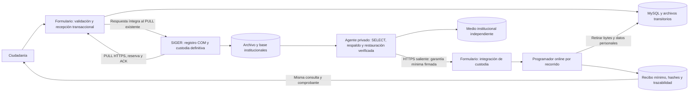

# Formulario Público: receptor transitorio integral

**Decisión definitiva del proyecto · 25/10/2026.** SIGER es la única fuente institucional de verdad para la Comunicación íntegra, identidades, contactos, relato, antecedentes y documentos. El Formulario recibe, valida, custodia temporalmente, entrega y retira sus copias. No constituye una segunda base institucional ni un archivo definitivo.

Esta unidad continúa V9 y sustituye el mantenimiento offline como forma normal de operación. Implementa **V10, minimización de MySQL, mantenimiento online y garantías entrantes**. El mecanismo está probado; sus banderas reales permanecen cerradas. No se modificó el repositorio SIGER, no se consultaron proveedores gubernamentales ni se habilitó producción.

## Responsabilidades y flujo



**El servidor público no consulta la base SIGER ni monta su repositorio documental.** El agente se ejecuta en el entorno institucional; lee su base local con una cuenta SELECT y el archivo institucional. Solo envía una prueba técnica pequeña. No publica un servicio en SIGER ni incorpora una dependencia del Formulario para leer los originales definitivos.

## Qué conserva cada fase

| Fase | Información pública necesaria |
|---|---|
| Borrador vigente | Identificación/declaraciones, resultado SRCeI y procedencia; adjuntos y bloques; propiedad de sesión |
| Comunicación pendiente/reservada/cuarentena | Payload original firmado íntegro, personas y antecedentes, archivos/BLOB, idempotencia y estado de entrega |
| Confirmada, con plazo o controles pendientes | Lo anterior; ACK firmado y observación de retención. No basta con tener ACK |
| Garantía independiente vigente y plazo cumplido | Se retiran originales, derivados, bloques y BLOB; después se minimizan payloads y copias de identidad en una transacción |
| Minimizada | UUID, vínculo operativo de sesión, hash de solicitud para idempotencia, estado/fechas, folio/COM, comprobantes originales y recibo mínimo sellado; referencias técnicas de archivos y garantía |

El recibo mínimo contiene solo IDs, tamaños/SHA-256, comprobante público original y ACK institucional. **No contiene nombres, RUN, contactos, relatos, declaraciones, valores SRCeI ni nombres de archivos.** Se sella con un dominio criptográfico distinto; no reemplaza el documento 1.0/1.1 ni su firma. Los hashes y referencias son datos técnicos seudonimizados, no una afirmación de anonimización universal.

### MySQL que se retira efectivamente

- `citizen_submission.body` pasa a NULL solo al completar la minimización. `minimal_receipt` conserva el recibo verificable y `content_retired` distingue una retirada autorizada de una pérdida.
- Se eliminan `citizen_person` y `citizen_identity_history` del recorrido. El recorrido queda MINIMIZADO y ya no permite consultar/reconstruir identidad ni editar.
- Los nombres en `citizen_attachment` y cargas liberadas se sustituyen por el marcador técnico `retirado`. Los bytes ya retirados siguen a NULL; quedan UUID, tamaños, tipos, hashes y registro de retirada.
- En el camino histórico, `public_delivery.body`, `owner_run` y `legacy_ack` pasan a NULL. El RUN de propiedad se sustituye por HMAC con la clave privada de seudonimización existente, nunca por un SHA enumerable de RUN. Se mantienen recibo, ACK y hash de solicitud.
- Las reservas de transporte terminadas no mantienen un token de recuperación activo; se limpian referencias de lease y errores innecesarios al minimizar.

La firma original permanece válida sobre el original en SIGER. Retirar la copia pública no significa modificar su contenido o recalcular su huella. La validación del recibo público posterior utiliza las firmas originales y el sello mínimo, sin necesitar los datos personales retirados.

## Garantía independiente: adicional al ACK

El ACK existente conserva formato, firma, canal y significado: confirma el COMMIT institucional. La garantía operativa nueva acredita además una lectura y recuperación independientes del ingreso completo.

El agente comprueba:

1. Un COM persistido que corresponde al ID público: folio, fecha, canal, hashes y ACK coincidentes.
2. El documento completo y su firma pública; la firma institucional del ACK y su asociación exacta.
3. Todos los originales por tamaño/SHA-256 y su asociación servidor/origen `INGRESO_CIUDADANO`.
4. Un respaldo institucional independiente y una restauración de prueba del contenido, registro y documentos.
5. Que el registro no cambió durante las lecturas.

La prueba contiene IDs público/institucional, cola, hashes de contenido/procedencia/documento íntegro/manifiesto/ACK, fecha de verificación, vencimiento y referencia de restauración. Está firmada con **una clave de verificación operativa separada** de las privadas de SIGER, del Formulario, ClaveÚnica y SSH. El Formulario recibe únicamente su clave pública confiada. No se instala la clave privada del agente en el servidor público.

Validez máxima: 24 horas, con rechazo de pruebas futuras fuera del margen de reloj. No se prolonga la validez al repetir un envío. Una prueba ausente, falsa, vencida, de otra cola/ID/huella o sin restauración no permite retirar. El emisor vuelve a leer y verificar para renovar; no firma simplemente porque existe un ACK.

### Operación automática del agente

La modalidad recomendada (`garantia.respaldo.directorio`) funciona sin una restauración manual previa por lote:

- Lee el COM ya confirmado y los documentos en SIGER, sin escribir sus tablas ni modificar su repositorio.
- Publica un paquete por Comunicación en un **medio institucional independiente**: metadatos del registro, documento original firmado, ACK, descriptores y originales. Usa claves UUID, permisos privados, fsync y publicación atómica. No hay rutas construidas con nombres ciudadanos.
- Un paquete publicado no se sobrescribe si difiere o está corrupto. Repetir reutiliza el mismo paquete; no duplica documentos por Caso.
- Restaura el paquete desde el medio independiente en scratch privado, vuelve a verificar todo y elimina solamente ese scratch creado por la invocación. Después firma la garantía mínima.
- Una interrupción o discrepancia conserva el original SIGER y la copia pública. Un paquete incompleto de esa invocación se limpia; un respaldo publicado nunca se elimina por el ACK.

Los paquetes son **respaldos institucionales del ingreso**, no almacenamiento del servidor público y no documentos de gestión nuevos. No sustituyen el respaldo global de SIGER —Casos, actuaciones y evolución posterior— ni su procedimiento de recuperación de desastre. Se conserva también la modalidad de contraste contra una base SIGER ya restaurada, para diagnóstico/calificación.

El CLI real exige medios independientes; rechaza como respaldo productivo el filesystem del origen, tmpfs/ramfs/overlay y destinos no adecuados. Implementación y plantillas verificadas en Linux/POSIX. No se declara calificación nativa Windows de este agente; su instalación debe utilizar un entorno privado compatible con acceso autorizado al origen, sin mover esa función al servidor público.

## Protocolos y permisos

Los documentos, fixtures y firmas de `/integracion/v3/formulario-completo/entregas` **1.0/1.1 no cambian**. No cambian reservas, ACK, UUID ni canonicalización.

Se agregan recursos operativos separados:

| Ruta | Autorización / datos |
|---|---|
| `GET /integracion/v3/custodia/candidatos?limite=20` | TLS + token de integración existente; solo ID y cola, máximo 100 |
| `POST /integracion/v3/custodia/garantias` | TLS + token de integración **y** firma independiente válida; cuerpo sujeto al límite JSON existente |
| `GET /operacion/v1/custodia` | Token operativo distinto; estado agregado, sin datos ciudadanos |
| `POST /operacion/v1/custodia/conservacion` | Token operativo; hold/liberación de conservación por ID/cola, auditable |

El token de integración no habilita el control de conservación. Una sesión ciudadana tampoco autentica estas rutas. El agente solo inicia conexiones salientes al origen HTTPS del Formulario y no sigue redirecciones.

## Mantenimiento online

`CustodiaTransitoriaConfiguration` instala el programador únicamente con `formulario.habilitado=true`, perfil JDBC y `ciclo-vida.online-habilitado=true`. La retirada exige además `ciclo-vida.eliminacion.habilitada=true`. Los dos valores están cerrados/ausentes en los laboratorios existentes.

La tarea usa delay fijo de cinco minutos, lote acotado, exclusión de solapamiento y lease recuperable. La selección rota por última revisión para que documentos bloqueados no impidan revisar otros. Un error al liberar el lease no deja el programador atascado. No reinicia Spring, no cambia los controles de recepción y no consulta proveedores.

Se coordina por recorrido: escritura/cancelación/análisis/lectura de archivos comparten guardias con la retirada. Una descarga o análisis activo hace posponer ese recorrido; **otra Comunicación puede recibirse durante el trabajo**. Los candados solo existen mientras hay usuarios activos y no se acumulan con el historial de IDs. No hay una pausa general para el mantenimiento normal.

Se reutiliza la secuencia V9: intención durable → retirada de bytes → transacción de reserva/marca final. La minimización de MySQL es otra transacción: recibo mínimo sellado, retirada de personas/historiales/nombres, body=NULL y fase MINIMIZADA se confirman juntos. Si falla, conserva el payload íntegro y reintenta; los archivos ya transferidos no se descuentan dos veces. No se considera una ausencia sin marca/evidencia como éxito.

### Cierre de auditoría: hold y observabilidad

El [cierre técnico V10](CIERRE_TECNICO_V10_2026-10-25.md) corrige la carrera entre conservación y retirada. La transición a RETIRANDO y el hold se serializan mediante filas `citizen_submission`/`custody_lifecycle` bloqueadas en ese orden, también entre instancias. Un hold confirmado antes prevalece; después de la frontera irreversible se rechaza activarlo con HTTP 409. Verificar conserva RETIRANDO/LIBERADA/MINIMIZADA; las operaciones largas de filesystem están fuera de la transacción. La cola histórica resuelve hold y minimización en una única transacción de su fila.

`GET /operacion/v1/custodia` desglosa `completo`/`historico`: estados, edad pendiente, garantías ausentes/vencidas/vigentes por vencimiento, holds, retención, retiradas/recuperación y minimizadas. Incluye ejecución/lease y capacidad, sin proyectar UUID ni datos ciudadanos. Reservas contables, cuota y libre físico son magnitudes distintas. La respuesta operativa sustituye los antiguos grupos de longitud de payload por este esquema; no cambia documentos 1.0/1.1. V11 agrega solo índices, sin reescribir V1–V10. Las banderas existentes siguen cerradas.

### Parámetros técnicos adoptados para 25 GB

- Postconfirmación: **24 horas** desde la primera observación válida, configurables. Históricos no se retrofechan. Antes de cumplir el plazo se conservan; después también se conservan si falta una garantía vigente. No se aplican acortamientos implícitos a plazos ya asignados.
- Borradores: vencimiento de recorrido más 48 horas antes de retirar datos/archivos no enviados.
- Metadatos de borradores sin Comunicación: siete días tras su vencimiento; después se retiran con controles de referencias/archivos, sin afectar recibos de Comunicaciones.
- Temporales incoming huérfanos: >24 horas. El almacén registra temporales activos en memoria; el janitor online nunca los trata como huérfanos aunque su timestamp sea antiguo.
- Auditoría técnica detallada: 30 días para categorías técnicas prescindibles y accesos de archivos retirados. Se preservan eventos finales de retirada, conservación y recepción/registro, así como recibos y evidencias mínimas.
- Los bloqueos, pendientes, cuarentenas y discrepancias se conservan. Una cuota agotada no autoriza descartarlos.

Las retenciones técnicas son configurables y el mantenimiento destructivo permanece cerrado. Se eligieron para la función transitoria definida en este encargo; no se pide otra decisión genérica para desarrollar el mecanismo.

## Comprobantes e idempotencia

En el formulario completo, la misma consulta devuelve el mismo comprobante y ACK después de minimizar. Repetir la misma solicitud/claves/propietario devuelve el mismo estado sin reconstruir la identidad ni el relato; alterar el cuerpo con la misma clave sigue rechazado. Confirmar otra vez el mismo ACK es idempotente.

El camino histórico que devolvía el **sobre personal completo** no puede reconstruirlo después de retirarlo: el POST repetido con la misma clave devuelve 410 y nunca crea otro ingreso; su GET autorizado conserva estado, folio y comprobante. No se inventa una identidad pasada a partir de un login nuevo. Esta distinción no cambia el contrato institucional completo 1.0/1.1.

Las consultas conservan los controles de propiedad existentes. No se introduce una consulta pública por RUN ni un token de recuperación de identidad. La limitación previa de sesiones ciudadanas en memoria tras reinicio no se convierte en un permiso alternativo; el comprobante descargado por la persona sigue siendo verificable.

## Dimensionamiento y límites demostrados

25 GB decimales son aproximadamente 23,28 GiB. Se mantiene el perfil de **12 adjuntos, 250 MiB/lote y los límites por tipo existentes**. Se presupuesta cuota multimedia reservada 6 GiB y piso libre 4 GiB. El piso también cierra nuevas recepciones sin adjuntos, identificaciones/declaraciones y cargas históricas; consultas e idempotencia de lo recibido siguen disponibles.

Presupuesto inicial a comprobar al instalar: SO/actualizaciones 6 GiB, imágenes/runtime/firmas 3 GiB, MySQL/metadatos/binlogs 3 GiB, reserva multimedia 6 GiB y margen libre 4 GiB: **22 GiB**, dentro de 23,28 GiB. Las reservas son contables y conservadoras; no se suman otra vez a los mismos archivos físicos. No guardar caché de compilación ni respaldos completos en ese SSD.

Modelo reproducible: `scripts/qa/modelar-receptor-transitorio.py`. Supone llegadas uniformes, entrega/restauración verificables dentro de 24 h, retención pública 24 h y mantenimiento horario —más conservador que el programador de cinco minutos—. Incluye staging y margen de derivadas por archivo. Es cálculo de capacidad, no carga ni prueba de procesamiento de máximos.

| Web/mes | MiB/ingreso | Archivos | Pico binario/reservado | Originales/año sin retirada |
|---:|---:|---:|---:|---:|
| 90 | 20 | 2 | 0,160 GiB | 21,387 GiB |
| 300 | 20 | 2 | 0,488 GiB | 71,289 GiB |
| 90 | 100 | 2 | 0,707 GiB | 106,934 GiB |
| 300 | 100 | 2 | 2,129 GiB | 356,445 GiB |
| 300 | 250 | 12 | 5,596 GiB | 891,113 GiB |

El extremo uniforme queda dentro de la cuota, con margen menor; no promete absorber ráfagas arbitrarias o indisponibilidad indefinida. Con ocho días hasta entrega/restauración y 300×20 MiB, el modelo da 2,129 GiB. Si las garantías se retrasan más o cambia la carga, se pospone retirada y la admisión aplica cuota/piso: se preserva lo recibido en vez de llenar el SSD y perderlo.

**La solución para 25 GB es el ciclo transitorio completo, no aumentar disco ni recortar formatos.** La proyección exige cumplir tiempos de transferencia, recuperación y mantenimiento y comprobar los tamaños fijos en la VM real. El WSL de prueba tiene otro tamaño; no se declara haber desplegado una VM de 25 GB.

Seis ciclos reales de prueba dejan cero payloads, identidades y reservas/binarios públicos; conservan seis recibos. Estos sumaron **25 650 bytes de recibo+ACK** (4 275 por ingreso de esa muestra), independientes del relato retirado. No incluye índices/otras filas. Presupuestando 32 KiB por Comunicación típica para el conjunto operativo, 300/mes son ~0,11 GiB/año. Los mínimos de trazabilidad crecen lentamente; no se afirma que infinitos recibos ocupen cero espacio. Desaparece el crecimiento dominante de duplicados ciudadanos y se caducan metadatos no necesarios.

### MySQL, binlogs y copias físicas

`infra/compose.mysql-25gb.yml` propone `binlog_row_image=MINIMAL`, expiración 72 h y segmentos 64 MiB; sintaxis verificada con el binario MySQL. No se aplicó. Evita volver a registrar BLOB completos al ponerlos a NULL y acota binlogs, con respaldos externos restaurables/PITR coherentes. El tamaño del segmento no limita por sí solo el total.

NULL/DELETE liberan páginas para reutilización, no garantizan encoger inmediatamente `.ibd` ni borrar forensemente SSD/undo/snapshots. El despliegue debe proteger el disco y respaldos, aplicar su caducidad técnica y verificar recuperación. Para la copia pública se fija una ventana de respaldo operativo acotada —referencia inicial siete días, más binlogs 72 h— mediante el agente de respaldo institucional, nunca conservación ilimitada de volcados públicos. Los respaldos definitivos de SIGER mantienen sus propias reglas; esta unidad no los purga.

## Configuración y puesta en operación

Plantillas: `infra/capacidad-25gb.properties.example`, `infra/garantia-custodia.properties.example` y `infra/systemd/siger-garantia-custodia.{service,timer}`. No se instalaron ni activaron servicios.

1. En el entorno institucional, preparar un destino de respaldo independiente y durable, scratch privado, cuenta SQL SELECT local y confianza pública/institucional. Crear la clave **del verificador**, custodiar su privada allí y registrar solo su pública en el Formulario. El agente Java/POSIX no necesita clonar ni cambiar SIGER.
2. Probar respaldo/restauración de un ingreso sintético. El modo automático crea paquetes y los restaura por sí mismo; no requiere que una persona exporte cada Comunicación. Instalar el timer privado de 15 min en un entorno compatible, sin exponer SIGER. Es un agente adicional de verificación, no un cambio al consumidor.
3. Respaldar el Formulario y aplicar V10 con la cuenta de migración por el procedimiento existente. No alterar V1–V9, recrear bases ni bajar el esquema. Mantener claves históricas y la clave de seudonimización para validar recibos/propiedad después de restaurar.
4. Habilitar `online-habilitado=true` con `eliminacion.habilitada=false`: observar plazos y probar llegada/renovación de garantías, estados y holds. Calificar almacenamiento real, respaldo de pendientes, TLS/relojes, configuración y controles. No son casillas que reemplacen la prueba por documento.
5. Solo después, habilitar retiradas de forma acotada y verificar recuperación y consultas. La recepción no se detiene para este mantenimiento. No se levantan guardas previas de producción/ClaveÚnica/SRCeI como efecto secundario de esta unidad.

Agente, desde un host institucional autorizado:

```bash
java -Dloader.main=cl.nexbyte.siger.custodia.EmisorGarantiaCustodia \
  -cp /opt/siger-verificador/formulario-publico.jar \
  org.springframework.boot.loader.launch.PropertiesLauncher \
  --config /etc/siger-verificador/garantia.properties --enviar
```

No colocar ese archivo privado ni la clave del verificador en el servidor público, Git o imágenes. El Formulario solo necesita la lista de claves públicas confiadas y su almacén propio. El agente no recibe credenciales de la BD pública.

La restauración de laboratorio `media-archive.py` reconoce V8/V9/V10 y bloquea payloads ausentes sin recibo/fase coherentes o identidades residuales. Conserva su modo offline para respaldo/restore de laboratorio; **no es el mecanismo periódico de retirada**. La operación de respaldo en infraestructura debe estar configurada y automatizada con la estrategia correspondiente; no se instaló sobre datos reales en esta unidad.

## Publicación del código y activación independiente

La [consolidación en main del 25/10](CONSOLIDACION_MAIN_2026-10-25.md) incorpora el historial completo V9/V10. Es publicación de software, no despliegue: no modifica los laboratorios, aplica V10 ni habilita banderas. El checkpoint técnico conserva los resultados de implementación y su contexto previo al push.

## Evidencia y estado de entrega

Resultados finales y commit se registran en el [checkpoint de esta unidad](CHECKPOINT_RECEPTOR_TRANSITORIO_2026-10-25.md). Las pruebas distinguen dobles controlados, integración Spring HTTP/programador, MySQL real y clases reales de SIGER.

- Recibir, transferir, registrar, firmar ACK, publicar/restaurar respaldo institucional, firmar garantía, retirar contenido público, consultar comprobante y recuperar en SIGER están implementados.
- El código SIGER y su JAR se mantuvieron idénticos. Se emplearon bases y archivos sintéticos aislados, sin comunicaciones reales ni consultas gubernamentales.
- Los laboratorios existentes conservan 13 custodias/13 adjuntos/V7 en el integrado y V8/almacén multimedia como antes; ambos tienen retirada y programador nuevos cerrados/ausentes. V10 solo en pruebas/restore.
- Queda la activación en infraestructura real: instalar/calificar agente, medio independiente, claves, respaldos, presupuesto y banderas. No falta implementar la minimización o un mecanismo periódico; no se declara habilitación ni certificación productiva.
