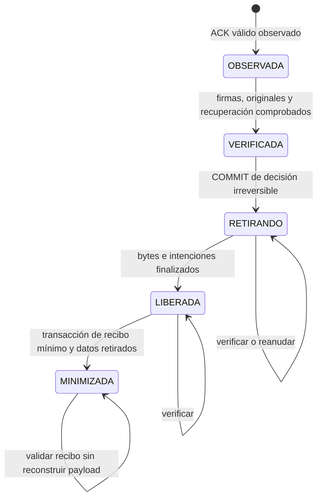

# Cierre técnico V10: concurrencia y observabilidad · 25/10/2026

Baseline: `e8b837e244dd1e0cac825e709348abb9f883fc0f`. Rama de trabajo: `cierre-v10-concurrencia-observabilidad-2026-10-25`. Esta unidad corrige únicamente la frontera de conservación/retirada y sus indicadores. No cambia flujos ciudadanos, contratos documentales 1.0/1.1, ACK, claves o canonicalización.

## Hallazgos corregidos

1. `conservar()` podía afirmar un hold después de iniciar o completar la retirada; el UPDATE no comprobaba fase ni se serializaba con la decisión irreversible.
2. `verificar()` podía convertir `RETIRANDO` a `VERIFICADA`, perdiendo el significado de una retirada interrumpida.
3. La validación independiente podía caducar entre verificar archivos y comenzar la retirada.
4. Los indicadores solo agrupaban payloads y bytes lógicos; no distinguían acumulación, garantías, retención, holds o recuperación. Leer longitudes de todos los payloads no es necesario para ese diagnóstico.

## Frontera transaccional y máquina de estados

`hold_active` es una bandera, no otra fase. Activarla solo se permite en OBSERVADA/VERIFICADA y con contenido vigente. Se necesita la observación previa de ACK; si no existe, la API devuelve 409. Repetir un hold válido es idempotente. Quitar un hold no promete recuperar bytes ni retrocede la fase.

Hold y retirada bloquean filas en el mismo orden mediante transacciones cortas: **`citizen_submission FOR UPDATE` → `custody_lifecycle FOR UPDATE`**. Así se serializan entre hilos, pools y procesos que compartan MySQL; el monitor Java no es el árbitro. `conservar()` ya no espera el monitor del motor durante verificaciones largas.

- Si el hold se confirma primero, la transacción que intenta pasar a RETIRANDO ve la bandera y no comienza.
- Si el COMMIT de RETIRANDO ocurre primero, cualquier nuevo hold devuelve **HTTP 409**, incluso antes de borrar el primer archivo. No existe una respuesta que prometa conservar una copia cuyo retiro ya quedó comprometido.
- Se revalidan documento/ACK, retención y garantía vigente bajo esa frontera. La comprobación entrante de garantía solo consulta BD/firma; el filesystem permanece fuera de la transacción MySQL.
- Las verificaciones posteriores preservan RETIRANDO/LIBERADA/MINIMIZADA. Una minimizada valida su recibo, sin intentar leer un body retirado.
- Los marcadores de archivo, reservas y recibos siguen idempotentes. Una intención simultánea para el mismo archivo reconoce el registro ya creado; no descuenta dos veces.
- El evento `RETIRADA_IRREVERSIBLE_INICIADA` queda auditado y fuera de la caducidad de eventos técnicos prescindibles.

El motor no mantiene una transacción abierta durante unlink, fsync, hash o copia de archivos. La garantía puede volver a bloquear una recuperación si venció: se renueva verificando nuevamente. Nunca se retrocede a una fase donde se puedan aceptar holds falsos.

### Cola histórica

No realiza una retirada de filesystem separada: la minimización del sobre es una única transacción sobre `public_delivery FOR UPDATE`. El hold usa la misma fila y transacción. La minimización vuelve a comprobar plazo y garantía con la fila bloqueada. Un hold confirmado antes impide minimizar; después de `content_retired=true`, activar uno devuelve 409. No se inventan fases filesystem ni pendientes de recuperación para esa cola: si una transacción falla, el contenido permanece y se reintenta.

Las guardias locales del almacén siguen coordinando cargas/lecturas; el lease global limita solapamientos. La corrección SQL protege la decisión frente a otras instancias, pero **no declara una topología HA de múltiples escritores de filesystem**: el almacén conserva sus restricciones de escritor y exclusión ya existentes.

## Indicadores operativos

`GET /operacion/v1/custodia`, HTTPS y token **operativo**, devuelve `Cache-Control: no-store`. El token de integración y una sesión ciudadana no lo autorizan. Mantiene las banderas `eliminacionHabilitada` y `ejecutando`, y añade el desglose siguiente. El recurso existe cuando está configurado el servicio de custodia; para observar sin borrar se habilita el programador con eliminación cerrada, según el procedimiento previo. Esta unidad no activa esas banderas.

| Grupo/campo | Interpretación |
|---|---|
| `completo`, `historico` | Métricas separadas; no sumar arbitrariamente estados de ambas colas |
| `porEstado` | PENDIENTE, RESERVADA, CONFIRMADA, CUARENTENA y OTROS. CONFIRMADA incluye minimizadas |
| `pendienteMasAntiguaEdadSegundos` | Edad desde recepción de la PENDIENTE más antigua; no incluye reservadas/cuarentena; NULL si no hay |
| `confirmadasEsperandoGarantia` | Confirmadas no minimizadas con garantía ausente o vencida |
| `garantias.vigentesPorVencimiento/vencidas/ausentes` | Vigencia temporal de evidencias previamente aceptadas. No revalida criptografía ni lee payloads al consultar métricas; la retirada siempre vuelve a validarlas |
| `bajoHold` | Copias no minimizadas con bloqueo de conservación |
| `esperandoRetencionTecnica` | Confirmadas observadas cuyo plazo efectivo aún no venció; respeta un aumento configurado de la retención |
| `sinObservacionRetencion` | Confirmadas pendientes de primera observación; no se les inventa vencimiento pasado |
| `verificacionesNoSatisfechas` | Fases completas con error técnico de verificación; puede incluir hold o integridad/garantía, no solo expiración |
| `retiradas.iniciadasAcumuladas` | Comunicaciones en RETIRANDO/LIBERADA/MINIMIZADA |
| `retiradas.retirando` | Frontera irreversible confirmada; trabajo de bytes aún sin finalizar |
| `retiradas.bytesLiberados` | LIBERADA + MINIMIZADA; finalización de retirada de bytes |
| `retiradas.pendientesRecuperacion` | RETIRANDO + LIBERADA pendiente de minimizar; incluye trabajo activo, no demuestra por sí solo una caída |
| `minimizadas` | Contenido público efectivamente retirado y recibo mínimo persistido |
| `mantenimiento` | Fecha de última ejecución, edad en segundos —NULL si nunca—, resultado acotado y lease vigente |
| `ejecutando` | Actividad en esta instancia; `mantenimiento.leaseVigente` complementa la visión compartida |
| `capacidadMultimedia.reservadosBytes` | Reserva contable durable; no es uso físico |
| `sumaReservasNoLiberadasBytes/contabilidadConcordante` | Contraste agregado con el contador de capacidad |
| `cuotaConfiguradaBytes/disponibleCuotaBytes` | Política multimedia efectiva; NULL si no hay política configurada disponible |
| `filesystemDisponibleBytes` | Libre utilizable del filesystem del almacén, incluyendo usos de otros componentes en ese mismo disco; no es cuota ni medición total de originales |

En histórico, retirada iniciada/finalizada coincide con minimización atómica; no hay fase RETIRANDO durable ni recuperación intermedia. Hold y retención pueden coincidir; los indicadores de controles **no son una partición para sumar como total**. Las consultas son una fotografía diagnóstica entre varias lecturas, no una instantánea transaccional del filesystem y BD.

La respuesta tiene categorías fijas y no proyecta UUID, RUN, nombres, historias, contactos, sesiones, tokens, cuerpos ni garantías firmadas. Estados inesperados se agregan como OTROS, sin devolver su valor literal. Se reemplaza el antiguo detalle `payloads/historicos` y su SUM de longitud de bodies por los grupos anteriores; es una evolución del endpoint operativo, no del contrato institucional firmado.

### Lectura operacional para 25 GB

- Si crecen PENDIENTE/edad, revisar PULL y disponibilidad del consumidor.
- Si crecen confirmadas sin garantía, revisar agente, respaldo/restore y renovación; el ACK no habilita retirada.
- Si crecen pendientes de recuperación y la edad de mantenimiento, revisar el resultado/lease y reintentos, sin borrar registros ni liberar reservas manualmente.
- Comparar reservas con cuota y libre físico por separado. Se mantienen umbrales documentados 80/95 % y piso libre +1 GiB/piso mediante inventario; no se instala ninguna plataforma externa.

## Esquema y consultas

**V11 `indices_observabilidad_custodia`**, para H2 y MySQL, agrega únicamente índices de selección y agregación: `ix_submission_retention`, `ix_delivery_retention`, `ix_custody_hold_phase`, `ix_retirement_phase`. Complementan los índices de estado/fecha y las PK de ciclo/garantía ya existentes. No altera datos, columnas de documentos ni V1–V10.

Los agregados leen estados, fechas, flags y contadores; no bodies, evidencias o binarios. La prueba verifica disponibilidad del índice de selección en ambos motores. No se ejecuta una carga de millones de filas ni se declara un SLA de latencia física.

## Pruebas ejecutadas realmente

| Batería local | Resultado |
|---|---|
| Backend H2 completo, `verify` | **259 descubiertas, 257 correctas, 2 omisiones opcionales**, cero fallos/errores; JAR aislado generado |
| Backend MySQL aislado, `test` | **259 descubiertas, 257 correctas, 2 omisiones opcionales**, cero fallos/errores; únicamente esquema `robust_public_test` |
| Nuevas regresiones | 9 concurrencia/fallo/retención, 3 observabilidad y 2 HTTP adicionales; incluidas en las 259, no sumadas dos veces |
| Frontend | **160 correctas**, 18 archivos; lint/build correctos, sin cambios a UI |
| Python existentes | **9 backup/restore +7 inventario**, todas correctas |
| Documentación/higiene | Referencias locales, secretos/archivos, migraciones anteriores y `git diff --check` revisados antes de commit |

Las dos omisiones existentes son `MultimediaWorkersRealTest` y `RecuperacionProcesoTest`, opt-in. No se deshabilitaron tests para pasar. La evidencia de recuperación nueva usa errores sintéticos en checkpoints y otra instancia/pool JDBC; no se presenta como kill de una VM, un fallo físico de MySQL o una nueva prueba con SIGER.

Las carreras ejecutan **transacciones simultáneas con conexiones/pools separados**: una transacción retiene la fila mientras otra operación espera, y latches controlan las dos caras de la frontera. También se prueba un hold en la misma instancia durante verificación, fallo después de unlink, verificación sobre RETIRANDO, reanudación sin doble descuento, hold tardío/HTTP 409, expiración en la frontera, cuarentena y recibos/idempotencia tras minimizar. Las regresiones previas de garantía ausente/falsa/vencida, pendiente y recepción concurrente se ejecutaron nuevamente en ambas matrices.

H2 y MySQL usaron salida `.local/cierre-v10-target`, no el JAR desplegado. Las evidencias privadas `cierre-v10-*` no se publican. Las cifras locales son independientes de GitHub Actions; el resultado del run de publicación se comprueba por SHA y se comunica al entregar, sin atribuirle automáticamente los resultados locales MySQL.

### Artefacto SIGER previo: solo huella

Se encontró y **solo se leyó para SHA-256** el JAR previamente utilizado, en `sistema-de-requerimientos/siger-institucional/backend/target/siger-institucional-0.1.0-SNAPSHOT.jar`:

`2ed038c567b672e7c7aaab6ac04f83efd22101f0b0ea1f5d4e0a33333be4ca97`.

Coincide con la procedencia conocida y la evidencia sintética de la unidad anterior, referenciada en el [checkpoint V10](CHECKPOINT_RECEPTOR_TRANSITORIO_2026-10-25.md). **No se compiló, modificó, migró, inició ni desplegó SIGER**, ni se repitió el script de integración que ejecutaba sus clases. Este cierre no depende de su disponibilidad futura.

## Estado de despliegue y límites

Las bases integradas V7 y multimedia V8, servicios, volúmenes, configuración y banderas se conservaron. V11 solo fue aplicada a pruebas aisladas; publicarla no migra los laboratorios. `ciclo-vida.online-habilitado` y `ciclo-vida.eliminacion.habilitada` siguen ausentes/false allí.

Permanecen las condiciones operativas previas: instalar/calificar agente, claves y medio independiente, probar recuperación en infraestructura real, medir la VM de 25 GB y activar gradualmente. Continúan sin calificarse máximos físicos de 150/250 MiB, ráfagas prolongadas, trayecto TLS publicado, continuidad de sesión/borrador tras reinicio y hardening productivo de ambos aplicativos. No se habilitaron servicios públicos ni se consultaron proveedores gubernamentales.

La publicación se realiza en main por historial conservado y push normal, después de las regresiones. El SHA final se verifica con HEAD/main/origin y `git ls-remote`; la respuesta final y la evidencia privada guardan el valor exacto, sin autorreferencias de hash en este documento.
