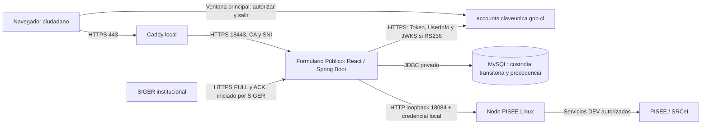
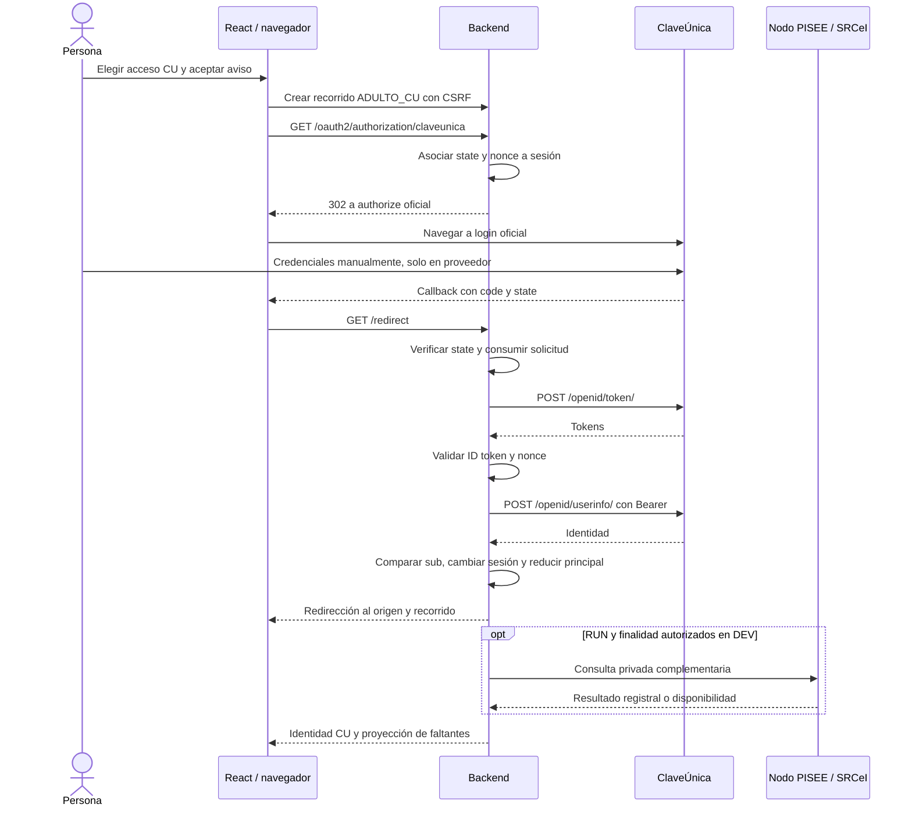

# Expediente técnico de ClaveÚnica y PISEE/SRCeI
## Formulario Público de la Defensoría de la Niñez · Preparación de certificación

## Configuración actual para revisión CU · actualización posterior del 28/10

El integrado utiliza ahora el **par productivo** de ClaveÚnica, con el acceso local habilitado y PISEE conservado en **DEV** por instrucción del responsable. Adultos, NNA y multimedia están habilitados en la URL principal. La habilitación temporal/definitiva del proveedor y la certificación quedan a cargo de SGD.

Se retiraron las restricciones artificiales de ambiente de FormularioConfiguration/PiseeConfiguration; las descripciones y extractos anteriores sobre esas prohibiciones corresponden al commit histórico del encabezado. No se desactivaron TLS/OIDC ni controles documentales. El Nodo productivo se seleccionará por configuración, sin otra modificación del código si mantiene el contrato.

Detalle vigente: [ClaveÚnica productiva y PISEE configurable](CLAVEUNICA_PRODUCCION_PISEE_2026-10-28.md). El hash del JAR instalado es d4395beefb374732e1200a6b504280cfcfe1319a71668e8901e56b867400a91d. Las evidencias históricas de Sandbox, incluidos los resultados originales de este expediente, no se convierten en autenticaciones reales de producción.

## Actualización operacional posterior · 28/10/2026

Después del preflight original de este expediente se actualizaron las dos instancias al commit cb25b641cce0adebe431b6ec9ca3338216a18ae8, con JAR f185af8382efdcce8234ae8f44d5288b4643b8cb5f936b27faa44696ef969ccc y esquemas V12. Se verificaron backup/restore, conservación de datos y firmas, HTTPS y regresión MySQL QA (324 seleccionadas, 322 correctas, dos omisiones).

**La sección 10 y los PID/hashes anteriores describen el estado previo a esa actualización**, conservado por trazabilidad. El candidato instalado ahora sí corresponde al main indicado; el pendiente MySQL territorial quedó resuelto. No se completó un nuevo login real gubernamental ni se concedió certificación. Las guardas de producción del código siguen vigentes.

Detalle vigente: [Actualización del laboratorio a main](ACTUALIZACION_LAB_MAIN_2026-10-28.md).


**Fecha:** 28 de octubre de 2026, America/Santiago.
**Institución:** Defensoría de la Niñez. **Proveedor de desarrollo:** Nexbyte SpA.
**Clasificación:** documento técnico para revisión institucional. Sin credenciales, RUN de pruebas, respuestas personales, cookies, tokens ni claves privadas.

Este documento reúne el botón, el flujo OpenID Connect, código real, conexiones, protección de identidad, relación con PISEE/SRCeI y antecedentes para preparar la solicitud de certificación de ClaveÚnica. **No es una certificación emitida por Gobierno Digital ni una autorización productiva.** Tampoco sustituye las capturas gráficas solicitadas por SGD.

La revisión nueva fue de código, documentación y preflight local. No se completaron autenticaciones contra el proveedor ni consultas a Registro Civil; no se crearon Comunicaciones, migraciones, despliegues o cambios de configuración.

**Código extraído:** [chashmdai/formulario-web](https://github.com/chashmdai/formulario-web), commit [`cb25b641cce0adebe431b6ec9ca3338216a18ae8`](https://github.com/chashmdai/formulario-web/commit/cb25b641cce0adebe431b6ec9ca3338216a18ae8). Los enlaces están fijados a ese commit, no a una rama mutable. `main` y los JAR activos son referencias diferentes, descritas en la sección 10.

## Índice

1. Alcance y datos para la solicitud.
2. Requisitos, fuentes y matriz de certificación.
3. Arquitectura, dominios y conexiones.
4. Botón institucional y navegación.
5. Authorization Code, Token, UserInfo y validación OIDC.
6. Sesión, privacidad, errores y cierre de sesión.
7. PISEE/SRCeI y procedencia.
8. Configuración y secretos.
9. Evidencia y pruebas.
10. Código publicado frente a laboratorio activo.
11. Capturas y guion de certificación.
12. Pendientes y referencias.

## 1. Alcance y datos para la solicitud

El Formulario Público recibe Comunicaciones de personas adultas y NNA. El ingreso adulto con ClaveÚnica autentica al presentador en el proveedor estatal. El ingreso adulto sin CU es una **identificación declarada**, sin contraseña alternativa; NNA dispone de un recorrido independiente, sin ClaveÚnica y con RUN voluntario.

**PISEE/SRCeI no autentica.** Enriquece antecedentes registrales en backend cuando existe autorización. No crea una sesión CU ni convierte un RUN declarado en identidad autenticada.

SIGER institucional recibe las Comunicaciones con su procedencia mediante su contrato de integración. No recibe el Client Secret CU ni los tokens OAuth del ciudadano. El agente de custodia no interviene en el login.

| Dato de solicitud | Información preparada |
|---|---|
| Institución | Defensoría de la Niñez |
| Aplicación | Formulario Público de Comunicaciones |
| Público objetivo | Ciudadanía; ClaveÚnica en el acceso adulto |
| URL del botón | `https://claveunica.formularioadulto.defensorianinez.gob.cl/?vista=inicio` |
| Ubicación | «Soy una persona adulta» → selector de acceso → «Ingresa con tu ClaveÚnica» |
| Callback | `https://claveunica.formularioadulto.defensorianinez.gob.cl/redirect` |
| Retorno de logout | `https://claveunica.formularioadulto.defensorianinez.gob.cl/logout` |
| Client ID productivo | **Completar por la institución en el trámite oficial**; no se extrajo de material reservado |
| Client Secret | **No adjuntar**; solo configuración privada del backend |
| Contactos administrativo/técnico | Completar por la institución; no se inventan nombres o correos |
| Estado actual | Sandbox local Windows/WSL; no una publicación productiva |
| Modalidad de revisión | Coordinar con SGD según accesibilidad y etapa admitida del ambiente |

La resolución local del hostname mediante `hosts` no prueba DNS público ni acceso desde Internet. Las credenciales y URIs del ambiente que examine SGD deben corresponder al registro institucional efectivo.

## 2. Requisitos, fuentes y matriz de certificación

### 2.1 Fuentes consultadas el 28/10/2026

- [Parámetros para certificar mediante Mesa de Servicios](https://gobdigitalcl.freshdesk.com/support/solutions/articles/72000637630-par%C3%A1metros-para-certificar-mediante-mesa-de-servicios).
- [Continuidad de certificación por CeroFilas](https://gobdigitalcl.freshdesk.com/support/solutions/articles/72000637624-proceso-de-continuidad-certificaci%C3%B3n-por-cerofilas).
- [Pasos para integrar ClaveÚnica](https://gobdigitalcl.freshdesk.com/support/solutions/articles/72000637623--cu%C3%A1les-son-los-pasos-para-integrar-el-servicio-de-autenticaci%C3%B3n-de-claveunica-).
- [Portal institucional ClaveÚnica](https://www.claveunica.gob.cl/instituciones) y [CeroFilas](https://gobdigital.cerofilas.gob.cl/).

La Mesa de Servicios solicita la dirección del botón, el identificador productivo de la integración y evidencia gráfica del backend que consume Token y UserInfo. La continuidad por CeroFilas añade evidencia de cómo se obtienen y usan las variables de credenciales. Los valores secretos deben permanecer ocultos en las capturas.

El paquete institucional contiene el **Manual de Integración, portada 6.5, mayo de 2026**, y la **Guía Botón ClaveÚnica 2.0**. El manual incluye una entrada de control 6.6 con fecha anterior a la portada; no se interpreta esa particularidad como una actualización validada. El [PDF público consultado](https://wikiguias.digital.gob.cl/documentos/guia_tecnica_de_integracion_a_claveunica__8.pdf) muestra un control anterior, 5.5: no sustituye automáticamente la copia institucional de 2026. Confirmar con SGD la edición aplicable.

La guía visual referencia [Figma del botón](https://www.figma.com/community/file/1364382371874440380/guia-claveunica); el manual 6.5 también enlaza [otro recurso de Figma](https://www.figma.com/community/file/1494787307175475602). La revisión debe identificar la versión de diseño aceptada por SGD.

### 2.2 Matriz técnica

| Aspecto | Implementación | Evidencia o pendiente |
|---|---|---|
| Botón reconocible | SVG local, Roboto, texto y enlace reales | Código en la sección 4; capturas finales por adjuntar |
| HTTPS | Caddy y backend HTTPS | Preflight local correcto; publicación/certificado definitivos pendientes |
| Login en ventana principal | Ruta backend y redirección al proveedor | Sin iframe ni popup del login |
| State dinámico | Resolver y sesión Spring Security | Dos valores distintos comprobados; regresiones de rechazo y replay |
| Secuencia y endpoints | Authorization Code, `openid run name` | Extractos de Token/UserInfo en la sección 5 |
| Consumo backend | Java intercambia código y consulta UserInfo | React no recibe el Client Secret ni canjea el código |
| Credenciales externas | Variables y propiedades tipadas | Extractos sin valores en la sección 8 |
| Salida explícita | POST con CSRF, invalidación y logout oficial | Sección 6 y pruebas históricas; demostración actual por coordinar |

La aceptación final corresponde a SGD. El porcentaje aproximado de avance del proyecto no mide certificación ni habilitación productiva.

## 3. Arquitectura, dominios y conexiones



| Conexión | Dirección / protocolo | Función |
|---|---|---|
| Navegador → Caddy | `https://claveunica.formularioadulto.defensorianinez.gob.cl:443` | Origen registrado, escucha local |
| Caddy → integrado | `https://127.0.0.1:18443` | TLS verificado con CA local y SNI institucional |
| Navegador → inicio local CU | `GET /oauth2/authorization/claveunica` | Crea solicitud y redirige |
| Navegador → CU | `GET https://accounts.claveunica.gob.cl/openid/authorize/` | Formulario oficial de autenticación |
| CU → navegador → backend | `GET https://claveunica.formularioadulto.defensorianinez.gob.cl/redirect` | Retorno con `code` y `state` |
| Backend → Token | `POST https://accounts.claveunica.gob.cl/openid/token/` | Canje servidor a servidor |
| Backend → UserInfo | `POST https://accounts.claveunica.gob.cl/openid/userinfo/` | Bearer de acceso, servidor a servidor |
| Backend → JWKS | `https://accounts.claveunica.gob.cl/openid/jwks` | Claves públicas para RS256; no usado por HS256 |
| Emisor esperado | `https://accounts.claveunica.gob.cl/openid` | Validación OIDC, no ruta ciudadana |
| Navegador → cierre CU | `https://accounts.claveunica.gob.cl/api/v1/accounts/app/logout` | Después de invalidar sesión local |
| CU → retorno local | `https://claveunica.formularioadulto.defensorianinez.gob.cl/logout` | Finaliza retorno al origen |
| Backend → Nodo | `http://127.0.0.1:18084/srcei/informacionPersonalBasico` | HTTP local con autorización privada; Docker 18084 → 8084 |
| Nodo → catálogo y servicios DEV | Configuración institucional privada | El catálogo observado usa HTTP/8500; no acredita TLS de todos los tramos |
| Backend → MySQL Linux | Loopback 13306, interno Docker 3306 | Identificación/custodia; distinto de MySQL80 Windows |

El navegador no consume el Nodo, Registro Civil ni el endpoint de Token directamente. PISEE usa sus propios certificados y mecanismos de firma/cifrado conforme a su configuración. No se presume que un certificado montado convierta una URL HTTP en HTTPS. La dirección operativa privada del catálogo, autorizaciones y rutas de claves no se adjuntan a CU; TI debe documentar los tramos institucionales que califique.

Puertos que no deben confundirse:

- **443:** URL preferente y origen de callbacks de este Sandbox.
- **18443:** acceso directo al integrado; no reemplaza la URI registrada por una con puerto alternativo.
- **19443:** laboratorio multimedia aislado; su perfil no utiliza CU ni PISEE como proveedores.
- **18080:** aplicación Docker anterior conservada para reversión.
- **8080/8081 Windows:** reservados para SIGER institucional, ajenos a este arranque.
- **8489 Nodo:** no publicado al host para este consumo.

### HTTPS local

El certificado tiene SAN para el hostname exacto y vigencia del **23/10/2026 al 22/11/2026, 22:01:01 UTC**. Huella pública SHA-256: `230B71216A58195BBF3AD14854F5F2CD2E104554E8EA2FFAEA346297A03F922D`. La CA está confiada en el usuario Windows de pruebas: **no es certificado público productivo**.

Caddy limita TLS a 1.2/1.3, exige SNI, elimina `Forwarded` recibido y establece sus cabeceras. El integrado usa TLS nativo y `forward-headers-strategy=none` en el perfil observado.

Fuente: [infra/sandbox/Caddyfile.formulario-local:14](https://github.com/chashmdai/formulario-web/blob/cb25b641cce0adebe431b6ec9ca3338216a18ae8/infra/sandbox/Caddyfile.formulario-local#L14-L34). Extracto literal del commit de referencia, no un archivo autónomo.

```caddyfile
https://claveunica.formularioadulto.defensorianinez.gob.cl {
    bind 127.0.0.1
    tls /run/siger/site.pem /run/siger/site-key.pem {
        protocols tls1.2 tls1.3
    }
    reverse_proxy https://127.0.0.1:18443 {
        header_up Host claveunica.formularioadulto.defensorianinez.gob.cl
        header_up -Forwarded
        header_up X-Forwarded-Proto https
        header_up X-Forwarded-Host claveunica.formularioadulto.defensorianinez.gob.cl
        header_up X-Forwarded-Port 443
        header_up X-Forwarded-For {http.request.remote.host}
        transport http {
            tls_trust_pool file /run/siger/rootCA.pem
            tls_server_name claveunica.formularioadulto.defensorianinez.gob.cl
            keepalive 15s
            response_header_timeout 30s
        }
    }
    # No registrar cookies, códigos del callback, identidades ni cuerpos.
}
```

## 4. Botón institucional y navegación

### 4.1 Componente real

El botón es un enlace HTML con isotipo SVG local y texto HTML, no una captura del botón. Su nombre accesible es «Iniciar sesión con ClaveÚnica» y el texto visible «Iniciar sesión».

Fuente: [formulario-publico/front/src/ClaveUnicaButton.tsx:1](https://github.com/chashmdai/formulario-web/blob/cb25b641cce0adebe431b6ec9ca3338216a18ae8/formulario-publico/front/src/ClaveUnicaButton.tsx#L1-L9). Extracto literal del commit de referencia, no un archivo autónomo.

```tsx
import icon from './assets/cu-blanco.svg';
import type { MouseEventHandler } from 'react';

export function ClaveUnicaButton({onClick}: {onClick?: MouseEventHandler<HTMLAnchorElement>} = {}) {
  return <a className="btn-cu" href="/oauth2/authorization/claveunica" onClick={onClick} aria-label="Iniciar sesión con ClaveÚnica">
    
    <span aria-hidden="true">Iniciar sesión</span>
  </a>;
}
```

Recurso: [cu-blanco.svg](https://github.com/chashmdai/formulario-web/blob/cb25b641cce0adebe431b6ec9ca3338216a18ae8/formulario-publico/front/src/assets/cu-blanco.svg). SHA-256: `8beff229841efdc3a68fd7ed611782cef1b3fc0a921da3f396d0d0373782747d`. Roboto 400/700 se carga localmente en [main.tsx](https://github.com/chashmdai/formulario-web/blob/cb25b641cce0adebe431b6ec9ca3338216a18ae8/formulario-publico/front/src/main.tsx); no depende de una CDN tipográfica.

### 4.2 Estilos aplicados

| Propiedad | Valor de `.btn-cu` |
|---|---|
| Isotipo | 24 × 24 px, sin deformación |
| Tipografía | Roboto, 1 rem, peso 700 |
| Texto e isotipo | Blanco |
| Fondo normal / hover / presionado | `#0F69C4` / `#0B4E91` / `#07305A` |
| Foco | Fondo `#0B4E91`, contorno 4 px `#FFBE5C` |
| Relleno / separación | 8 px vertical, 14 px horizontal, gap 4 px |
| Altura mínima | `calc(2rem + 16px)`, 48 px con raíz de 16 px |
| Bordes | Radio 0 |

Se utiliza el botón estándar también en móvil; no se afirma que sea la variante compacta de cabecera. `.btn-cu` mantiene azul estándar. Las reglas históricas `.claveunica-button` del prototipo no son el selector de este componente. Capturar contraste, zoom, foco y móvil sobre la versión que examine SGD.

Fuente: [formulario-publico/front/src/prototipo/inicio.css:3](https://github.com/chashmdai/formulario-web/blob/cb25b641cce0adebe431b6ec9ca3338216a18ae8/formulario-publico/front/src/prototipo/inicio.css#L3-L7). Extracto literal del commit de referencia, no un archivo autónomo.

```css
.btn-cu { display: inline-flex; align-items: center; justify-content: center; gap: 4px; padding: 8px 14px; min-height: calc(2rem + 16px); line-height: 2rem; font-family: Roboto, sans-serif; font-size: 1rem; font-weight: 700; color: #fff; background: #0f69c4; text-decoration: none; border: 0; border-radius: 0; white-space: nowrap; }
.btn-cu img { width: 24px; height: 24px; flex-shrink: 0; }
.btn-cu:hover { background: #0b4e91; color: #fff; }
.btn-cu:active { background: #07305a; color: #fff; }
.btn-cu:focus { background: #0b4e91; outline: 4px solid #ffbe5c; outline-offset: 0; color: #fff; }
```

### 4.3 Ubicación, privacidad y ventana principal

La portada permite elegir el acceso adulto. El botón CU abre primero el aviso local de privacidad/canal; tras aceptarlo se crea el recorrido y se navega al backend. El diálogo de selección/privacidad **no contiene el login CU**: ese login se muestra en la ventana principal del dominio oficial, con su barra de direcciones.

El contexto «Ingresa con tu ClaveÚnica» acompaña al botón «Iniciar sesión». Se explica que la contraseña se ingresa solo en el sitio oficial. El acceso declarado no es un segundo sistema de contraseñas.

Fuente: [formulario-publico/front/src/prototipo/AdultAccess.tsx:30](https://github.com/chashmdai/formulario-web/blob/cb25b641cce0adebe431b6ec9ca3338216a18ae8/formulario-publico/front/src/prototipo/AdultAccess.tsx#L30-L38). Extracto literal del commit de referencia, no un archivo autónomo.

```tsx
          ></span>
          <h3>Ingresa con tu ClaveÚnica</h3>
          <p>
            Este acceso permite identificarte con el mecanismo oficial del Estado de Chile. Continuarás al sitio oficial de ClaveÚnica.
          </p>
          <ClaveUnicaButton onClick={event => { event.preventDefault(); onCu(); }} />
          <p className="access-footnote">
            Tu contraseña se ingresa únicamente en el sitio oficial de ClaveÚnica.
          </p>
```

Fuente: [formulario-publico/front/src/prototipo/StartPage.tsx:41](https://github.com/chashmdai/formulario-web/blob/cb25b641cce0adebe431b6ec9ca3338216a18ae8/formulario-publico/front/src/prototipo/StartPage.tsx#L41-L52). Extracto literal del commit de referencia, no un archivo autónomo.

```tsx
  function beginAdult(route: 'cu' | 'manual') { close(); setStartError('');setPrivacyRoute(route); }
  async function acceptChannel() {
    if(pending.current)return;pending.current=true;setStarting(true);setStartError('');
    const route = privacyRoute;
    try {
      const [caps,session]=await Promise.all([getJourneyCapabilities(),getSession()]);
      if(!caps.disponible||route==='cu'&&!session.authenticated&&!session.loginAvailable)throw new ApiError(503);
      await startJourney(route==='cu'?'ADULTO_CU':'ADULTO_DECLARADO',caps.avisoAdulto,true);
      navigate(route==='cu'&&!session.authenticated?'/oauth2/authorization/claveunica':`/?vista=formulario-adulto&modo=${route==='cu'?'cu':'manual'}`);
    }catch{setStartError('Este acceso está temporalmente cerrado. Inténtalo nuevamente más tarde.');}
    finally{pending.current=false;setStarting(false);}
  }
```

Tras el callback, [Entry.tsx / Resume](https://github.com/chashmdai/formulario-web/blob/cb25b641cce0adebe431b6ec9ca3338216a18ae8/formulario-publico/front/src/Entry.tsx) retoma la intención adulta persistida en esa sesión. El backend redirige al origen configurado; React abre el recorrido correspondiente. No se confía en una URL de retorno arbitraria aportada por el ciudadano.

## 5. Authorization Code, Token, UserInfo y validación OIDC

### 5.1 Recorrido completo



### 5.2 Registro, endpoints y cliente confidencial

Se utiliza Authorization Code y scopes `openid run name`, ordenados explícitamente. `CLIENT_SECRET_POST` entrega las credenciales solo al backend Token sobre HTTPS.

**PKCE no se exige actualmente** (`requireProofKey(false)`): el preflight no envió `code_challenge`. Sí incluyó `nonce`. No se presenta PKCE/S256 como implementado; confirmar la adecuación del perfil con SGD, sin rebajar controles para forzar la demostración.

Fuente: [formulario-publico/backend/src/main/java/cl/nexbyte/siger/identidad/SecurityConfiguration.java:34](https://github.com/chashmdai/formulario-web/blob/cb25b641cce0adebe431b6ec9ca3338216a18ae8/formulario-publico/backend/src/main/java/cl/nexbyte/siger/identidad/SecurityConfiguration.java#L34-L59). Extracto literal del commit de referencia, no un archivo autónomo.

```java
    public static final String AUTHORIZE = "https://accounts.claveunica.gob.cl/openid/authorize/";
    public static final String TOKEN = "https://accounts.claveunica.gob.cl/openid/token/";
    public static final String USERINFO = "https://accounts.claveunica.gob.cl/openid/userinfo/";
    public static final String ISSUER = "https://accounts.claveunica.gob.cl/openid";
    public static final String JWKS = "https://accounts.claveunica.gob.cl/openid/jwks";

    @Bean
    ClientRegistrationRepository registrations(ClaveUnicaProperties p) {
        var registration = ClientRegistration.withRegistrationId("claveunica")
                .clientName("Defensoría de la Niñez").clientId(p.getClientId()).clientSecret(p.getClientSecret())
                .clientAuthenticationMethod(ClientAuthenticationMethod.CLIENT_SECRET_POST)
                .clientSettings(ClientRegistration.ClientSettings.builder().requireProofKey(false).build())
                .authorizationGrantType(AuthorizationGrantType.AUTHORIZATION_CODE)
                .redirectUri(p.getRedirectUri().toString()).scope("openid", "run", "name")
                .authorizationUri(AUTHORIZE).tokenUri(TOKEN).userInfoUri(USERINFO)
                .userNameAttributeName("sub").issuerUri(ISSUER).jwkSetUri(JWKS).build();
        return new InMemoryClientRegistrationRepository(registration);
    }

    static JdkClientHttpRequestFactory requestFactory() {
        var client = HttpClient.newBuilder().connectTimeout(Duration.ofSeconds(5))
                .followRedirects(HttpClient.Redirect.NEVER).build();
        var factory = new JdkClientHttpRequestFactory(client);
        factory.setReadTimeout(Duration.ofSeconds(10));
        return factory;
    }
```

### 5.3 Evidencia A: Token desde backend

Spring construye el POST estándar con `grant_type=authorization_code`, `code`, `redirect_uri`, `client_id` y `client_secret`. El conversor adicional incorpora el `state` guardado por el servidor. Las pruebas inspeccionan esos campos.

Para la captura mostrar **la constante TOKEN, su uso en `tokenUri(TOKEN)` y este cliente**. Una URL aislada no explica el consumo real. No mostrar el valor del secreto ni del código.

Fuente: [formulario-publico/backend/src/main/java/cl/nexbyte/siger/identidad/SecurityConfiguration.java:61](https://github.com/chashmdai/formulario-web/blob/cb25b641cce0adebe431b6ec9ca3338216a18ae8/formulario-publico/backend/src/main/java/cl/nexbyte/siger/identidad/SecurityConfiguration.java#L61-L74). Extracto literal del commit de referencia, no un archivo autónomo.

```java
    @Bean
    RestClientAuthorizationCodeTokenResponseClient tokenClient() {
        var client = new RestClientAuthorizationCodeTokenResponseClient();
        client.addParametersConverter(request -> {
            var parameters = new LinkedMultiValueMap<String, String>();
            parameters.add("state", request.getAuthorizationExchange().getAuthorizationRequest().getState());
            return parameters;
        });
        client.setRestClient(RestClient.builder().requestFactory(requestFactory())
                .configureMessageConverters(converters -> converters.disableDefaults()
                        .addCustomConverter(new FormHttpMessageConverter()).addCustomConverter(new OAuth2AccessTokenResponseHttpMessageConverter()))
                .defaultStatusHandler(new OAuth2ErrorResponseErrorHandler()).build());
        return client;
    }
```

### 5.4 Evidencia B: UserInfo desde backend

La constante USERINFO y `userInfoUri(USERINFO)` del registro vinculan la URL al servicio. La llamada es **POST** con `Authorization: Bearer` y respuesta JSON. El token nunca se incorpora al bundle React.

Spring compara `sub` de UserInfo con el ID token. Se valida además la estructura de RUN y nombres mediante `IdentidadVerificada.from(...)`. Capturar conjuntamente la URL del registro y este bloque, sin valores de token.

Fuente: [formulario-publico/backend/src/main/java/cl/nexbyte/siger/identidad/ClaveUnicaOidcUserService.java:16](https://github.com/chashmdai/formulario-web/blob/cb25b641cce0adebe431b6ec9ca3338216a18ae8/formulario-publico/backend/src/main/java/cl/nexbyte/siger/identidad/ClaveUnicaOidcUserService.java#L16-L40). Extracto literal del commit de referencia, no un archivo autónomo.

```java
public final class ClaveUnicaOidcUserService implements OAuth2UserService<OidcUserRequest, OidcUser> {
    private final OidcUserService delegate = new OidcUserService();

    public ClaveUnicaOidcUserService(RestOperations restOperations) {
        var userService = new DefaultOAuth2UserService();
        userService.setRestOperations(restOperations);
        userService.setRequestEntityConverter(request -> {
            var headers = new HttpHeaders();
            headers.setBearerAuth(request.getAccessToken().getTokenValue());
            headers.setAccept(List.of(MediaType.APPLICATION_JSON));
            return new RequestEntity<>(headers, HttpMethod.POST,
                    URI.create(request.getClientRegistration().getProviderDetails().getUserInfoEndpoint().getUri()));
        });
        delegate.setOauth2UserService(userService);
        delegate.setRetrieveUserInfo(request -> true);
        // CU's name is an object, not the standard OIDC string claim. Preserve the documented contract.
        delegate.setClaimTypeConverterFactory(registration -> claims -> claims);
    }

    @Override public OidcUser loadUser(OidcUserRequest request) {
        var user = delegate.loadUser(request); // Spring also verifies UserInfo sub equals ID token sub.
        if (user.getUserInfo() == null) throw new IllegalStateException("UserInfo obligatorio.");
        IdentidadVerificada.from(user.getUserInfo().getClaims());
        return user;
    }
```

### 5.5 State, nonce y firma

`DefaultOAuth2AuthorizationRequestResolver` y los repositorios/filtros OIDC de Spring generan y vinculan la solicitud a la sesión. React no decide si un `state` es correcto. La solicitud es de un solo uso; state/sesión incorrectos no canjean el código.

El algoritmo se fija por configuración externa, **no por el encabezado JWT sin verificar**:

- RS256 predeterminado: claves públicas del endpoint JWKS.
- HS256 explícito: secreto configurado de al menos 32 bytes.
- Validadores de tiempo y OIDC para vigencia, emisor y audiencia; validación de nonce en el flujo OIDC del framework.
- Error de firma/claims implica fallo, no aceptación de un token sin verificar.

El JAR activo conserva el fallback RS256 y no se observó override distinto en las fuentes examinadas. No se obtuvo un ID token real nuevo ni se validó una credencial productiva durante esta preparación.

Fuente: [formulario-publico/backend/src/main/java/cl/nexbyte/siger/identidad/ClaveUnicaJwtDecoderFactory.java:23](https://github.com/chashmdai/formulario-web/blob/cb25b641cce0adebe431b6ec9ca3338216a18ae8/formulario-publico/backend/src/main/java/cl/nexbyte/siger/identidad/ClaveUnicaJwtDecoderFactory.java#L23-L35). Extracto literal del commit de referencia, no un archivo autónomo.

```java
    @Override public JwtDecoder createDecoder(ClientRegistration registration) {
        return decoders.computeIfAbsent(registration.getRegistrationId(), ignored -> {
            NimbusJwtDecoder decoder;
            if (properties.getIdTokenAlgorithm() == ClaveUnicaProperties.IdTokenAlgorithm.HS256) {
                var key = new SecretKeySpec(registration.getClientSecret().getBytes(StandardCharsets.UTF_8), "HmacSHA256");
                decoder = NimbusJwtDecoder.withSecretKey(key).macAlgorithm(MacAlgorithm.HS256).build();
            } else {
                decoder = NimbusJwtDecoder.withJwkSetUri(registration.getProviderDetails().getJwkSetUri())
                        .jwsAlgorithm(SignatureAlgorithm.RS256).restOperations(new RestTemplate(SecurityConfiguration.requestFactory())).build();
            }
            decoder.setJwtValidator(new DelegatingOAuth2TokenValidator<>(new JwtTimestampValidator(), new OidcIdTokenValidator(registration)));
            return decoder;
        });
```

Fuente: [formulario-publico/backend/src/main/java/cl/nexbyte/siger/identidad/SecurityConfiguration.java:92](https://github.com/chashmdai/formulario-web/blob/cb25b641cce0adebe431b6ec9ca3338216a18ae8/formulario-publico/backend/src/main/java/cl/nexbyte/siger/identidad/SecurityConfiguration.java#L92-L109). Extracto literal del commit de referencia, no un archivo autónomo.

```java
        var contextRepository = new HttpSessionSecurityContextRepository();
        var resolver = new DefaultOAuth2AuthorizationRequestResolver(registrations, "/oauth2/authorization");
        resolver.setAuthorizationRequestCustomizer(builder -> builder.scopes(new java.util.LinkedHashSet<>(java.util.List.of("openid", "run", "name"))));
        if (properties.getEnvironment() == ClaveUnicaProperties.Stage.PRODUCTION) {
            http.redirectToHttps(org.springframework.security.config.Customizer.withDefaults());
        }
        http.authorizeHttpRequests(auth -> auth
                        .requestMatchers("/", "/index.html", "/assets/**", "/favicon.svg", "/api/session", "/api/csrf",
                                "/oauth2/authorization/claveunica", "/redirect", "/logout", "/auth/session-expired", "/error").permitAll()
                        .requestMatchers("/api/nna/**").permitAll()
                        .requestMatchers("/api/formulario/**").permitAll()
                        .requestMatchers("/api/comunicaciones/**", "/api/comunicaciones", "/api/identidad/atributos").hasRole("CIUDADANO").anyRequest().denyAll())
                .requestCache(cache -> cache.disable())
                .securityContext(context -> context.securityContextRepository(contextRepository))
                .sessionManagement(session -> session.sessionFixation(fixation -> fixation.changeSessionId()))
                .headers(headers -> headers
                        .contentSecurityPolicy(csp -> csp.policyDirectives("default-src 'self'; script-src 'self'; style-src 'self'; font-src 'self'; img-src 'self'; connect-src 'self'; frame-ancestors 'none'; base-uri 'self'; form-action 'self' https://accounts.claveunica.gob.cl"))
                        .referrerPolicy(referrer -> referrer.policy(org.springframework.security.web.header.writers.ReferrerPolicyHeaderWriter.ReferrerPolicy.NO_REFERRER)))
```

## 6. Sesión, privacidad, errores y cierre de sesión

### 6.1 Identidad de aplicación, sin persistir tokens OAuth

Después de UserInfo se sustituye el principal OIDC por `IdentidadVerificada`, evidencia de autenticación y `ROLE_CIUDADANO`. Spring cambia el session ID. El repositorio de cliente autorizado no almacena tokens para refrescarlos.

La identidad propia autenticada de CU sí puede mostrarse mediante `/api/session`. Es diferente del conjunto de datos SRCeI para un RUN declarado, que no se devuelve como proyección ciudadana. La sesión HTTP conserva identidad reducida en memoria; reiniciar el backend invalida su continuidad y un RUN no permite recuperar autenticación.

Fuente: [formulario-publico/backend/src/main/java/cl/nexbyte/siger/identidad/SecurityConfiguration.java:122](https://github.com/chashmdai/formulario-web/blob/cb25b641cce0adebe431b6ec9ca3338216a18ae8/formulario-publico/backend/src/main/java/cl/nexbyte/siger/identidad/SecurityConfiguration.java#L122-L134). Extracto literal del commit de referencia, no un archivo autónomo.

```java
                        .successHandler((request, response, authentication) -> {
                            var oidcUser = (OidcUser) authentication.getPrincipal();
                            var identity = IdentidadVerificada.from(oidcUser.getUserInfo().getClaims());
                            var context = SecurityContextHolder.createEmptyContext();
                            var citizen = UsernamePasswordAuthenticationToken.authenticated(identity, null,
                                    java.util.List.of(new SimpleGrantedAuthority("ROLE_CIUDADANO")));
                            citizen.setDetails(EvidenciaAutenticacion.de(identity));
                            context.setAuthentication(citizen);
                            SecurityContextHolder.setContext(context);
                            contextRepository.saveContext(context, request, response);
                            LOGGER.info("CU_AUTHENTICATION_COMPLETED environment={} source=userinfo", properties.getEnvironment());
                            response.sendRedirect(properties.getPublicOrigin().toString());
                        })
```

Fuente: [formulario-publico/backend/src/main/java/cl/nexbyte/siger/identidad/DiscardingAuthorizedClientRepository.java:9](https://github.com/chashmdai/formulario-web/blob/cb25b641cce0adebe431b6ec9ca3338216a18ae8/formulario-publico/backend/src/main/java/cl/nexbyte/siger/identidad/DiscardingAuthorizedClientRepository.java#L9-L14). Extracto literal del commit de referencia, no un archivo autónomo.

```java
/** Tokens are used only during login; SIGER has no reason to retain/refresh them. */
final class DiscardingAuthorizedClientRepository implements OAuth2AuthorizedClientRepository {
    @Override public <T extends OAuth2AuthorizedClient> T loadAuthorizedClient(String id, Authentication a, HttpServletRequest r) { return null; }
    @Override public void saveAuthorizedClient(OAuth2AuthorizedClient c, Authentication a, HttpServletRequest r, HttpServletResponse s) { }
    @Override public void removeAuthorizedClient(String id, Authentication a, HttpServletRequest r, HttpServletResponse s) { }
}
```

UserInfo se interpreta mediante `RolUnico.tipo=RUN`, `numero`, `DV` y los arreglos `name.nombres` / `name.apellidos`. Los componentes se conservan sin dividir nombres compuestos por espacios. El tratamiento de RUN sintéticos oficiales de Sandbox no habilita un RUN declarado inválido para consultar SRCeI.

### 6.2 Controles

| Control | Implementación / observación |
|---|---|
| Cookie integrada activa | `SIGERNNA2026`, valor no conservado en informe |
| Atributos observados | Secure, HttpOnly, SameSite=Lax |
| Timeout base | 20 minutos de inactividad; sin override observado en el perfil examinado |
| Fijación de sesión | Cambio de ID al autenticar |
| CSRF | Activo en mutaciones y logout; `/api/csrf` entrega el token a la propia sesión |
| Sesión / APIs | `/api/session` informa el estado propio; rutas de identificación validan propietario y HTTPS |
| Datos de proveedor | Tokens usados en backend durante login; sin persistencia intencional en MySQL, localStorage o recibos |
| Cabeceras | CSP, no-referrer, controles contra framing; no-store en API correspondiente |
| HTTP saliente CU | Conexión 5 s, lectura 10 s; sin redirecciones del cliente HTTP |
| Privacidad de logs | Éxito/fallo y ambiente, sin cuerpos Token/UserInfo ni identificadores personales |

Nombres de claves: las firmas Ed25519 de comprobantes no son el algoritmo de ID token CU; los certificados web y PISEE tampoco son el Client Secret.

### 6.3 Errores y disponibilidad

Inicio no habilitado institucionalmente devuelve 503. Callback repetido/forjado ante una sesión autenticada devuelve 409 y preserva la sesión. State inválido o solicitud ausente se rechaza antes de Token. Errores del proveedor/identidad no crean autenticación válida y ejecutan la limpieza correspondiente.

Eventos sanitizados: `CU_AUTHENTICATION_COMPLETED environment=SANDBOX source=userinfo` y `CU_AUTHENTICATION_FAILED environment=... error=...`. Su presencia prueba un evento de aplicación, no certificación SGD.

Fuente: [formulario-publico/backend/src/main/java/cl/nexbyte/siger/identidad/CallbackAvailabilityFilter.java:16](https://github.com/chashmdai/formulario-web/blob/cb25b641cce0adebe431b6ec9ca3338216a18ae8/formulario-publico/backend/src/main/java/cl/nexbyte/siger/identidad/CallbackAvailabilityFilter.java#L16-L35). Extracto literal del commit de referencia, no un archivo autónomo.

```java
        String path = request.getRequestURI().substring(request.getContextPath().length());
        var authentication = SecurityContextHolder.getContext().getAuthentication();
        if (authentication != null && authentication.getPrincipal() instanceof IdentidadVerificada) {
            if (path.equals("/redirect")) {
                response.setStatus(409); // A forged/replayed callback must never log out an existing citizen session.
                return;
            }
            if (path.equals("/oauth2/authorization/claveunica")) {
                response.sendRedirect(properties.getPublicOrigin().toString());
                return;
            }
        }
        if (path.equals("/oauth2/authorization/claveunica") && !properties.isCallbackApproved()) {
            response.setStatus(503);
            response.setCharacterEncoding("UTF-8");
            response.setContentType("application/problem+json");
            response.getWriter().write("{\"title\":\"Callback pendiente de habilitación institucional\",\"status\":503}");
            return;
        }
        chain.doFilter(request, response);
```

### 6.4 Logout explícito y expiración

El encabezado adulto ofrece «Cerrar sesión» mediante formulario HTML `POST /auth/logout` con CSRF. Spring invalida sesión, limpia autenticación y borra la cookie de nombre configurado. Luego el navegador va al logout oficial con `redirect` hacia `/logout`.

`GET /logout` es el retorno del proveedor: no reemplaza el POST protegido. Si todavía hay identidad activa devuelve 409; tras cierre responde 303 al origen con `?session=closed`. `/auth/session-expired` completa la limpieza del proveedor cuando ya no hay sesión local activa.

Fuente: [formulario-publico/backend/src/main/java/cl/nexbyte/siger/identidad/SecurityConfiguration.java:151](https://github.com/chashmdai/formulario-web/blob/cb25b641cce0adebe431b6ec9ca3338216a18ae8/formulario-publico/backend/src/main/java/cl/nexbyte/siger/identidad/SecurityConfiguration.java#L151-L155). Extracto literal del commit de referencia, no un archivo autónomo.

```java
                .logout(logout -> logout.logoutUrl("/auth/logout").invalidateHttpSession(true).clearAuthentication(true)
                        .deleteCookies(environment.getProperty("server.servlet.session.cookie.name","SIGERSESSION"))
                        .logoutSuccessHandler((request, response, authentication) -> response.sendRedirect(ProviderLogout.url(properties))))
                .addFilterBefore(new CallbackAvailabilityFilter(properties), OAuth2AuthorizationRequestRedirectFilter.class);
        return http.build(); // CSRF remains enabled, including logout and authenticated POSTs.
```

Fuente: [formulario-publico/backend/src/main/java/cl/nexbyte/siger/identidad/ProviderLogout.java:6](https://github.com/chashmdai/formulario-web/blob/cb25b641cce0adebe431b6ec9ca3338216a18ae8/formulario-publico/backend/src/main/java/cl/nexbyte/siger/identidad/ProviderLogout.java#L6-L11). Extracto literal del commit de referencia, no un archivo autónomo.

```java
public final class ProviderLogout {
    public static final String ENDPOINT = "https://accounts.claveunica.gob.cl/api/v1/accounts/app/logout";
    private ProviderLogout() { }
    public static String url(ClaveUnicaProperties properties) {
        return ENDPOINT + "?redirect=" + URLEncoder.encode(properties.getLogoutUri().toString(), StandardCharsets.UTF_8);
    }
```

Fuente: [formulario-publico/backend/src/main/java/cl/nexbyte/siger/identidad/SessionController.java:28](https://github.com/chashmdai/formulario-web/blob/cb25b641cce0adebe431b6ec9ca3338216a18ae8/formulario-publico/backend/src/main/java/cl/nexbyte/siger/identidad/SessionController.java#L28-L39). Extracto literal del commit de referencia, no un archivo autónomo.

```java
    @GetMapping("/logout")
    ResponseEntity<Void> logoutReturn(HttpServletRequest request, jakarta.servlet.http.HttpServletResponse response, Authentication auth) {
        if (auth != null && auth.getPrincipal() instanceof IdentidadVerificada) return ResponseEntity.status(409).build();
        new SecurityContextLogoutHandler().logout(request, response, auth);
        return ResponseEntity.status(303).header(HttpHeaders.LOCATION, properties.getPublicOrigin() + "/?session=closed").build();
    }

    @GetMapping("/auth/session-expired")
    ResponseEntity<Void> expired(Authentication auth) {
        // Browser can clear CU after local expiration; an active session requires CSRF-protected POST logout.
        if (auth != null && auth.getPrincipal() instanceof IdentidadVerificada) return ResponseEntity.status(409).build();
        return ResponseEntity.status(303).header(HttpHeaders.LOCATION, ProviderLogout.url(properties)).build();
```

## 7. PISEE/SRCeI y procedencia

### 7.1 Roles y autorización

| Recorrido | RUN / autenticación | Consulta |
|---|---|---|
| Adulto CU | RUN del principal OIDC, no escogido por navegador | Si módulo 11, finalidad y autorización DEV lo permiten |
| Adulto declarado | Número/DV declarados; no autenticado por informar RUN | Automática al completar RUN válido con privacidad/cuotas |
| NNA sin RUN | No informado; sin CU | No consulta |
| NNA con RUN voluntario | Declaración, no autenticación SRCeI | Solo autorizado; no exige aceptar canal adulto |
| Personas afectadas/relacionadas/señaladas | Declaraciones conocidas | La regla actual no habilita búsquedas registrales de terceros |

La allowlist no autoriza búsquedas genéricas de terceros. SRCeI completo no cambia `autenticada=false` a true. El backend rechaza que un ciudadano CU sustituya su RUN mediante JSON.

### 7.2 Automatismo, restauración y cuotas

React restaura primero el resultado de la sesión. Para CU, la identificación se deriva del backend autenticado; para RUN declarado se usa debounce **650 ms**, con formato y módulo 11 válidos. No hay consulta en cada tecla.

Backend retorna el resultado vigente para el mismo RUN/rol; reserva una consulta con lease de 30 s, llama fuera del lock SQL y aplica solo la respuesta de esa reserva. Cambiar RUN exige reinicio explícito; las respuestas antiguas no reemplazan la nueva identificación.

Límites actuales: 30 personas por recorrido, 12 intentos con RUN por recorrido y buckets de 12 inicios/12 consultas por hora según dirección vista por backend, identificada mediante HMAC. La topología local proxy/loopback **no acredita un rate limit productivo por IP ciudadana**; debe calificarse la dirección real con proxy de confianza.

Fuente: [formulario-publico/front/src/formulario/IdentificationControls.tsx:129](https://github.com/chashmdai/formulario-web/blob/cb25b641cce0adebe431b6ec9ca3338216a18ae8/formulario-publico/front/src/formulario/IdentificationControls.tsx#L129-L136). Extracto literal del commit de referencia, no un archivo autónomo.

```tsx
  // Solo el presentador tiene finalidad autorizada. Las tarjetas de terceros no usan este disparador.
  useEffect(() => {
    if (!restored || cu || !nna && !journey.aceptaCanal || journey.estado !== 'BORRADOR' || phase !== 'INICIAL'
      || view || nna && !knowsRun || !validRun(runNumber(numero), dv)) return;
    const timer = window.setTimeout(() => { void review(); }, 650);
    return () => window.clearTimeout(timer);
    // La revisión captura estos valores; no depender de su función evita reiniciar el debounce por renders ajenos.
  }, [restored, cu, journey.aceptaCanal, journey.estado, phase, view, nna, knowsRun, numero, dv]);
```

Fuente: [formulario-publico/backend/src/main/java/cl/nexbyte/siger/formulario/RecorridosJdbc.java:148](https://github.com/chashmdai/formulario-web/blob/cb25b641cce0adebe431b6ec9ca3338216a18ae8/formulario-publico/backend/src/main/java/cl/nexbyte/siger/formulario/RecorridosJdbc.java#L148-L160). Extracto literal del commit de referencia, no un archivo autónomo.

```java
            if(db.sql.queryForObject("SELECT COUNT(*) FROM citizen_person WHERE journey_id=?",Integer.class,journey.toString())>=30)throw new FalloTecnico(429);
            if(finalRun!=null&&((Number)row.get("query_count")).intValue()>=12)throw new FalloTecnico(429);
            var initial=crear(person,role,finalRun,finalIdentity,null,clock);
            // La allowlist de RUN no autoriza búsquedas de terceros. El canal adulto no se exige a NNA.
            // Esta unidad solo tiene finalidad de identificación del propio presentador.
            boolean query=role==Rol.PRESENTADOR&&(head.tipo()==Tipo.NNA||head.aceptaCanal())&&finalRun!=null&&autorizado.test(finalRun);
            var lease=query?UUID.randomUUID():null;
            db.sql.update("INSERT INTO citizen_person(journey_id,person_id,role,body,query_state,query_lease,lease_until_ms) VALUES(?,?,?,?,?,?,?)",
                journey.toString(),person,role.name(),mapper.writeValueAsString(initial),query?"CONSULTANDO":"REVISADO",lease==null?null:lease.toString(),query?clock.millis()+30000L:0L);
            if(finalRun!=null)db.sql.update("UPDATE citizen_journey SET query_count=query_count+1 WHERE id=?",journey.toString());
            return new Reserva(lease,initial,finalRun,query);
        });
        if(!reservation.consultar())return vista(reservation.persona());
```

### 7.3 Contrato privado del Nodo

Cliente Java → `/srcei/informacionPersonalBasico` con XML y `X-PISEE-LocalAuthorization` leída de archivo protegido. Entrada XML: `entradaSRCel`, terminada en **ele minúscula U+006C**, comprobada en DEV.

Timeout del perfil integrado: 15 000 ms; concurrencia 1. El cliente admite concurrencia configurada entre 1 y 8, conexión 5 s, respuesta limitada a 128 KiB, sin redirecciones ni reintentos automáticos. XML sin DTD/entidades externas/XInclude y con límites.

Estados internos: completo, parcial, vacío, negativa, red, timeout, autorización, indisponible, XML inválido, respuesta excesiva, saturado, no habilitado y RUN discrepante. Un healthcheck HTTP local no prueba Registro Civil ni la vigencia de autorizaciones externas.

Fuente: [formulario-publico/backend/src/main/java/cl/nexbyte/siger/srcei/ClientePisee.java:35](https://github.com/chashmdai/formulario-web/blob/cb25b641cce0adebe431b6ec9ca3338216a18ae8/formulario-publico/backend/src/main/java/cl/nexbyte/siger/srcei/ClientePisee.java#L35-L52). Extracto literal del commit de referencia, no un archivo autónomo.

```java
        endpoint = base.resolve("/srcei/informacionPersonalBasico");
        client = HttpClient.newBuilder().connectTimeout(Duration.ofSeconds(5)).followRedirects(HttpClient.Redirect.NEVER).build();
    }
    public ResultadoSrcei consultar(RunConsulta run) {
        Objects.requireNonNull(run);
        Instant at = clock.instant(); UUID id = UUID.randomUUID();
        if (!enabled) return ResultadoSrcei.fallo(NO_HABILITADO, at, id);
        if (!permits.tryAcquire()) return ResultadoSrcei.fallo(SATURADO, at, id);
        CompletableFuture<HttpResponse<byte[]>> future = null;
        try {
            var request = HttpRequest.newBuilder(endpoint).timeout(timeout).header("Content-Type", "application/xml; charset=utf-8")
                .header("Accept", "application/xml").POST(HttpRequest.BodyPublishers.ofString(XmlSrcei.solicitud(run), StandardCharsets.UTF_8));
            if (localAuthorization != null && !localAuthorization.isBlank()) request.header("X-PISEE-LocalAuthorization", localAuthorization);
            future = client.sendAsync(request.build(), info -> new LimitedBody());
            var response = future.get(timeout.toMillis(), TimeUnit.MILLISECONDS);
            if (response.statusCode() == 401 || response.statusCode() == 403) return ResultadoSrcei.fallo(AUTORIZACION, at, id);
            if (response.statusCode() != 200) return ResultadoSrcei.fallo(INDISPONIBLE, at, id);
            return XmlSrcei.respuesta(response.body(), run, at, id);
```

### 7.4 Prioridad de fuentes y respuesta al ciudadano

Procedencia: `CLAVE_UNICA_USERINFO`, `SRCEI`, `DECLARACION_CIUDADANA` y `SIN_DATO`; se conserva nivel, fecha y evidencia. CU tiene prioridad: una divergencia SRCeI se guarda internamente sin sobrescribir la identidad autenticada.

La proyección de identificación devuelve estados permitidos, campos faltantes/obligatorios y declaraciones propias. No publica el agregado registral para un RUN declarado. Completo evita pedir datos disponibles; parcial solicita faltantes; vacío/error permite declaración manual. La identidad CU visible proviene de su sesión, no de atribuir autenticación a SRCeI.

Fuente: [formulario-publico/backend/src/main/java/cl/nexbyte/siger/formulario/IdentificacionCiudadana.java:65](https://github.com/chashmdai/formulario-web/blob/cb25b641cce0adebe431b6ec9ca3338216a18ae8/formulario-publico/backend/src/main/java/cl/nexbyte/siger/formulario/IdentificacionCiudadana.java#L65-L74). Extracto literal del commit de referencia, no un archivo autónomo.

```java
        if(resultado!=null) resultado.atributos().forEach((key,value)->{
            var incoming=new Valor(value.valor(),value.codigo(),Fuente.SRCEI,"CONTRASTADO_EN_FUENTE",value.observadoEn(),value.evidencia());
            if(attrs.containsKey(key)) {
                if(!Objects.equals(attrs.get(key).valor(),incoming.valor())) discrepancies.put(key,incoming);
            } else attrs.put(key,incoming);
        });
        String number=cu!=null?cu.run().split("-")[0]:run==null?null:run.numero();
        String dv=cu!=null?cu.run().split("-")[1]:run==null?null:run.dv();
        return new Persona(id,rol,number,dv,run!=null,cu!=null,resultado==null?ResultadoSrcei.Estado.NO_HABILITADO:resultado.estado(),
            resultado==null?null:resultado.consultadoEn(),resultado==null?null:resultado.evidencia(),attrs,discrepancies);
```

Fuente: [formulario-publico/backend/src/main/java/cl/nexbyte/siger/formulario/IdentificacionCiudadana.java:79](https://github.com/chashmdai/formulario-web/blob/cb25b641cce0adebe431b6ec9ca3338216a18ae8/formulario-publico/backend/src/main/java/cl/nexbyte/siger/formulario/IdentificacionCiudadana.java#L79-L96). Extracto literal del commit de referencia, no un archivo autónomo.

```java
    public static Vista vista(Persona p) {
        var missing=new HashSet<>(CAMPOS);
        if(p.rol()==Rol.AFECTADO_NNA || (p.rol()==Rol.PRESENTADOR && p.id().equals("presentador-nna"))) {
            missing.remove("fechaNacimiento"); missing.remove("sexo");
        } else missing.remove("edad");
        if(p.rol()!=Rol.PRESENTADOR){missing.remove("fechaNacimiento");missing.remove("sexo");}
        p.atributos().forEach((key,value)->{if(util(value))missing.remove(key);});
        if(p.atributos().containsKey("nombres")) missing.removeAll(Set.of("primerNombre","segundoNombre"));
        if(p.atributos().containsKey("apellidos")) missing.removeAll(Set.of("primerApellido","segundoApellido"));
        // La edad puede inferirse únicamente en servidor a partir de fecha completa, sin publicar la fecha.
        if(util(p.atributos().get("fechaNacimiento"))) missing.remove("edad");
        var declared=new HashMap<String,String>();
        p.atributos().forEach((key,value)->{if(value.fuente()==Fuente.DECLARACION_CIUDADANA && CAMPOS.contains(key)) declared.put(key,value.valor());});
        // Los campos declarados siguen siendo editables, los recuperados nunca se exponen.
        missing.addAll(declared.keySet());
        var required=new HashSet<>(p.rol()==Rol.PRESENTADOR?Set.of("primerNombre","primerApellido"):Set.<String>of()); required.retainAll(missing);
        return new Vista(p.id(),"REVISADO",p.autenticada(),p.runNumero()!=null,Set.copyOf(missing),Set.copyOf(required),Map.copyOf(declared),
                "Completa los datos solicitados. La revisión del RUN no acredita tu identidad.");
```

### 7.5 Habilitación exclusiva DEV

La configuración exige DEV autorizado y proceso Sandbox, credencial local y allowlist privada acotada a diez entradas válidas. No se incluyen RUN ni valores de autorización. El Nodo conserva runtime/configuración y estado persistente privados, con certificados separados de TLS web y credenciales CU.

Fuente: [formulario-publico/backend/src/main/java/cl/nexbyte/siger/srcei/PiseeConfiguration.java:15](https://github.com/chashmdai/formulario-web/blob/cb25b641cce0adebe431b6ec9ca3338216a18ae8/formulario-publico/backend/src/main/java/cl/nexbyte/siger/srcei/PiseeConfiguration.java#L15-L30). Extracto literal del commit de referencia, no un archivo autónomo.

```java
        boolean enabled = env.getProperty("PISEE_SRCEI_ENABLED", Boolean.class, false);
        String authorization = null;
        if (enabled) {
            if (env.matchesProfiles("production", "prod") || !"SANDBOX".equals(env.getProperty("siger.claveunica.environment", "SANDBOX")))
                throw new IllegalStateException("La integración DEV no puede habilitarse en un proceso QA/producción");
            if (!"DEV".equals(env.getProperty("PISEE_ENVIRONMENT")) || !env.getProperty("PISEE_DEV_AUTHORIZED", Boolean.class, false))
                throw new IllegalStateException("Este adaptador requiere autorización explícita DEV; QA/PROD aún no validados");
            String file = env.getRequiredProperty("PISEE_LOCAL_AUTHORIZATION_PATH");
            Path path = Path.of(file);
            if (Files.size(path) > 256) throw new IllegalArgumentException("Credencial local PISEE excesiva");
            authorization = Files.readString(path).strip();
            if (authorization.isBlank()) throw new IllegalArgumentException("Credencial local PISEE requerida");
        }
        return new ClientePisee(enabled, URI.create(env.getProperty("PISEE_BASE_URL", "http://pisee:8084")), authorization,
            Duration.ofMillis(env.getProperty("PISEE_TIMEOUT_MS", Long.class, 15000L)),
            env.getProperty("PISEE_CONCURRENCY", Integer.class, 2), Clock.systemUTC());
```

Finalidad, rol y allowlist: [FormularioConfiguration](https://github.com/chashmdai/formulario-web/blob/cb25b641cce0adebe431b6ec9ca3338216a18ae8/formulario-publico/backend/src/main/java/cl/nexbyte/siger/formulario/FormularioConfiguration.java) y [RecorridosJdbc](https://github.com/chashmdai/formulario-web/blob/cb25b641cce0adebe431b6ec9ca3338216a18ae8/formulario-publico/backend/src/main/java/cl/nexbyte/siger/formulario/RecorridosJdbc.java). Infraestructura: [infra/compose.pisee.yml](https://github.com/chashmdai/formulario-web/blob/cb25b641cce0adebe431b6ec9ca3338216a18ae8/infra/compose.pisee.yml) y [infra/compose.pisee-loopback.yml](https://github.com/chashmdai/formulario-web/blob/cb25b641cce0adebe431b6ec9ca3338216a18ae8/infra/compose.pisee-loopback.yml).

## 8. Configuración y secretos

| Variable / propiedad | Finalidad |
|---|---|
| `CU_ENVIRONMENT` / `siger.claveunica.environment` | SANDBOX, QA o PRODUCTION; no mezclar pares |
| `CU_CLIENT_ID` | Identificador del cliente, no contraseña; productivo se informa por canal oficial |
| `CU_CLIENT_SECRET` | Secreto solo backend, fuera de código, bundle, argumentos y capturas |
| `CU_REDIRECT_URI` | URI registrada exacta, actual `/redirect` en 443 |
| `CU_LOGOUT_URI` | Retorno registrado `/logout` |
| `SIGER_PUBLIC_ORIGIN` | Origen de aplicación; no retorno arbitrario del usuario |
| `CU_CALLBACK_APPROVED` | Habilitación institucional; base false |
| `CU_ID_TOKEN_ALGORITHM` | RS256 predeterminado / HS256 explícito |
| `SIGER_COOKIE_SECURE` | True en HTTPS, exigido en producción |
| `PISEE_SRCEI_ENABLED`, `PISEE_ENVIRONMENT`, `PISEE_DEV_AUTHORIZED` | En el integrado actual: true / DEV / true |
| `PISEE_BASE_URL`, `PISEE_TIMEOUT_MS`, `PISEE_CONCURRENCY` | Actual: loopback 18084 / 15000 / 1 |
| `PISEE_LOCAL_AUTHORIZATION_PATH`, `PISEE_ALLOWED_RUNS_PATH` | Archivos privados, contenido no adjunto |

Se utilizan referencias externas y propiedades tipadas. El laboratorio configura un archivo privado; Spring puede resolver placeholders desde su entorno. **No imprimir ese archivo.** Los defaults históricos `.ddn.gob.cl` de `application.yml` no son el hostname institucional actual; configurar explícitamente las URIs correctas.

El siguiente extracto prueba el enlace de variables sin reproducir valores.

Fuente: [formulario-publico/backend/src/main/resources/application.yml:39](https://github.com/chashmdai/formulario-web/blob/cb25b641cce0adebe431b6ec9ca3338216a18ae8/formulario-publico/backend/src/main/resources/application.yml#L39-L42). Extracto literal del commit de referencia, no un archivo autónomo.

```yaml
  claveunica:
    environment: ${CU_ENVIRONMENT:SANDBOX}
    client-id: ${CU_CLIENT_ID:}
    client-secret: ${CU_CLIENT_SECRET:}
```

Fuente: [formulario-publico/backend/src/main/java/cl/nexbyte/siger/identidad/ClaveUnicaProperties.java:24](https://github.com/chashmdai/formulario-web/blob/cb25b641cce0adebe431b6ec9ca3338216a18ae8/formulario-publico/backend/src/main/java/cl/nexbyte/siger/identidad/ClaveUnicaProperties.java#L24-L47). Extracto literal del commit de referencia, no un archivo autónomo.

```java
    @PostConstruct
    void validate() {
        if (clientId == null || clientId.isBlank() || clientSecret == null || clientSecret.isBlank()) {
            throw new IllegalStateException("Configurar CU_CLIENT_ID y CU_CLIENT_SECRET del ambiente seleccionado fuera del repositorio.");
        }
        if (idTokenAlgorithm == IdTokenAlgorithm.HS256 && clientSecret.getBytes(java.nio.charset.StandardCharsets.UTF_8).length < 32) {
            throw new IllegalStateException("HS256 requiere secreto de al menos 256 bits.");
        }
        validateUri(redirectUri, "/redirect");
        validateUri(logoutUri, "/logout");
        validateUri(publicOrigin, "");
        if (!publicOrigin.getPath().isEmpty() && !publicOrigin.getPath().equals("/")) {
            throw new IllegalStateException("SIGER_PUBLIC_ORIGIN debe contener solamente el origen.");
        }
        if (environment == Stage.PRODUCTION) {
            for (URI uri : new URI[]{redirectUri, logoutUri, publicOrigin}) {
                if (!"https".equals(uri.getScheme()) || !uri.getHost().endsWith(".gob.cl")) {
                    throw new IllegalStateException("Producción requiere HTTPS y dominios institucionales .gob.cl.");
                }
            }
            if (!springEnvironment.getProperty("server.servlet.session.cookie.secure", Boolean.class, true)) {
                throw new IllegalStateException("Producción requiere cookie Secure.");
            }
            if (!callbackApproved) throw new IllegalStateException("Producción requiere callback habilitado institucionalmente.");
```

### Material que no se adjunta

No incluir Client Secret, contraseñas, códigos/tokens OAuth, state/nonce vivos, cookies, HAR completos, credencial local PISEE, RUN autorizado, XML con antecedentes, claves privadas TLS/PISEE/Ed25519/HMAC, volcados ni logs íntegros. Las capturas muestran nombres y uso de variables con valores ocultos.

### Guardas reales del proyecto

`ClaveUnicaProperties` conoce PRODUCTION y exige HTTPS, `.gob.cl`, cookie Secure y callback aprobado. **No equivale a que el Formulario completo esté habilitado para producción**: `FormularioConfiguration.recorridosJdbc()` rechaza perfiles productivos y entornos distintos de Sandbox; `PiseeConfiguration` limita el adaptador a DEV/Sandbox.

Preparar el candidato que examine SGD exige una intervención autorizada de configuración/despliegue/calificación. No basta cambiar `CU_ENVIRONMENT` ni retirar guardas para una demostración. Este expediente no modifica esas condiciones.

## 9. Evidencia y pruebas

### 9.1 Preflight nuevo del 28/10/2026

GET locales al origen HTTPS, `/api/session` y dos inicios de autorización. **No se siguieron los 302 al proveedor**, no hubo Token/UserInfo reales nuevos ni consultas SRCeI.

| Comprobación | Resultado |
|---|---|
| Desde Windows, TLS normal | HTTP 200, `ssl_verify_result=0` |
| Aplicación HTTPS | HTTP 200, cadena/hostname verificados con CA local |
| HSTS | `max-age=31536000; includeSubDomains` |
| CSP / referencia | `frame-ancestors 'none'`, recursos propios, form-action autorizado y no-referrer |
| Sesión nueva | authenticated=false, environment=SANDBOX, loginAvailable=true |
| Autorización | Dos 302 al authorize oficial |
| State | Longitud 44 en ambos, diferentes; valores no guardados |
| Nonce | Presente en ambos; valores no guardados |
| PKCE | Sin code_challenge, coherente con el código |
| Parámetros | Scope `openid run name`, response_type `code` |
| Redirect | Hostname exacto, `/redirect`, sin puerto alternativo |
| Cookie | Secure, HttpOnly, SameSite=Lax; sin conservar valor |

Resultado reducido local: `.local/evidencias/expediente-cu-20261028.json`, ignorado por Git. No contiene identidad, tokens, state/nonce, credenciales ni cookies. No es un HAR.

### 9.2 Evidencia histórica y límites

| Fuente | Qué demuestra |
|---|---|
| Sandbox WSL 23/10 | Flujo real documentado: autorización, callback, Token, UserInfo, sesión y logout |
| Cierre adultos 24/10 | Adulto CU integrado, identidad bloqueada y cierre |
| RUN → SRCeI 24/10 | Consulta DEV autorizada y procedencia/persistencia; combinación real CU/SRCeI no forzada con otra identidad |
| Regresión GATE 4A.14.2, 26/10 | Frontend 176 correctas; H2 324 seleccionadas, 322 correctas y dos omisiones; lint/build correctos |
| MySQL QA de esa corrección | Pendiente por indisponibilidad en su ejecución; el arranque de MySQL hoy no es una repetición de la batería |
| Preparación actual | Preflight y revisión de código/documentos; sin nueva autenticación real, campaña visual ni CI remota |

Las dos omisiones H2 eran workers reales opcionales y reinicio destructivo MySQL. No se presentan como éxitos ni como fallos de CU.

### 9.3 Regresiones identificadas en el código

- `ClaveUnicaFlowTest`: proveedor local controlado; Token/UserInfo, cambio de sesión y ausencia de tokens persistidos.
- `stateIsDynamic`, `wrongStateAndMissingSessionNeverExchangeCode`: estado dinámico y rechazo previo al canje.
- `callbackIsSingleUse`, `forgedCallbackCannotLogOutAnAlreadyAuthenticatedCitizen`: replay y preservación de sesión válida.
- `providerErrorsAndInvalidTokensNeverCreateAnAuthenticatedSession`: fallos de Token/UserInfo, sub, RUN faltante, firma, expiración, nonce, emisor y audiencia.
- Misma clase: CSRF, formulario HTML de logout, expiración y cabeceras.
- `ClaveUnicaJwtDecoderFactoryTest`: HS256 explícito, firma/audiencia incorrectas.
- `CallbackBlockedTest`, `EnvironmentConfigurationTest`: callback cerrado y guardas.
- Frontend: `App.test.tsx`, `StartPage.test.tsx`, `AdultPage.test.tsx`, `AdultFlow.test.tsx` y `AutomaticIdentification.test.tsx`.
- PISEE: `ClientePiseeTest`, `XmlSrceiTest` y `RecorridosJdbcTest`, con estados y carreras sintéticos.

Estas clases están en el commit de referencia y en las baterías documentadas; **no se ejecutaron otra vez para redactar el expediente**. Los dobles no son consultas gubernamentales.

## 10. Código publicado frente a laboratorio activo

Los extractos corresponden al commit publicado del encabezado. Las instancias ejecutan las copias inmutables anteriores seleccionadas explícitamente; no se desplegó main para redactar este documento.

| Instancia observada 28/10 | SHA-256 JAR | Estado |
|---|---|---|
| Integrado 18443, PID 8949 | `c3b544b1cddf30aef5086cb2a632ac7265040a57a75612a558332e04f4240be9` | Activo, integridad y configuración coincidentes |
| Multimedia 19443, PID 10015 | `24ccc1674bc3be3168158997a3d4c8665493933a14febc96ff51945230381d27` | Activo, integridad y configuración coincidentes |

El registro histórico identifica el integrado como fuente `c1e4ead` y los esquemas de laboratorio V7/V8. Los PID son puntuales. La autenticación histórica del entorno y los extractos de main **no prueban igualdad de todos los bytes del candidato a certificar**.

Seleccionar una versión/artefacto único y capturar evidencia sobre él antes de presentar una aplicación final. La corrección territorial de main, por ejemplo, no se ha desplegado automáticamente en estos JAR.

## 11. Capturas y guion de certificación

### 11.1 Evidencia a preparar

Los nombres siguientes son propuestos; **no se generaron esas imágenes en este encargo**.

| Evidencia | Contenido |
|---|---|
| `01-boton-escritorio.png` | URL, Defensoría, contexto y botón CU |
| `02-boton-movil-foco.png` | Móvil, foco y escala; sin identidad |
| `03-backend-token.png` | Constante TOKEN, tokenUri y cliente/conversor Java |
| `04-backend-userinfo.png` | Constante USERINFO, userInfoUri y POST/Bearer |
| `05-variables-externas.png` | Placeholders y getters, valores ocultos |
| `06-callback-sesion.png` | Retorno y estado autenticado totalmente redactado |
| `07-logout.png` | Botón de cierre, retorno anónimo y nuevo ingreso |
| `08-version-candidato.txt` | Commit, hash JAR, fecha/ambiente; sin configuración privada |
| Este Markdown | Explicación y referencias complementarias |

Usar código del candidato elegido. No modificar el código para aparentar URLs hardcodeadas: mostrar las constantes y su relación con el cliente HTTP.

### 11.2 Demostración manual

1. Confirmar con la institución/SGD ambiente, artefacto y registro de URIs. Verificar TLS sin excepciones.
2. Abrir acceso adulto y mostrar botón, teclado y móvil; aceptar aviso del canal.
3. Mostrar navegación completa al dominio oficial con barra visible.
4. La persona autorizada ingresa manualmente las credenciales en el proveedor. No grabar contraseña, RUN o parámetros sensibles.
5. Verificar callback, sesión autenticada y datos CU bloqueados; distinguir campos complementarios.
6. Explicar Token/UserInfo desde Java y acompañar capturas de código/variables sin valores.
7. Cerrar sesión mediante el botón, verificar anonimato local y reingreso por el proveedor.
8. Cualquier demostración SRCeI requiere necesidad y autorización separadas; no hacer búsquedas indiscriminadas para certificar CU.
9. Conservar solo evidencia redactada; no crear Comunicaciones reales innecesarias.

El manual institucional, sección 4.2, contempla coordinación de videollamada para revisión no accesible públicamente, con contacto administrativo presente, y advierte sobre sitios incompletos o ambientes de desarrollo. **Videollamada no equivale a aceptar este Sandbox como producción**: confirmar modalidad y etapa admitidas con SGD.

### 11.3 Comandos locales reproducibles

PowerShell, cada comando en una sola línea. Son de estado/preflight, no realizan un login:

```powershell
curl.exe --silent --show-error --max-time 15 --output NUL --write-out "HTTP=%{http_code} TLS=%{ssl_verify_result}" "https://claveunica.formularioadulto.defensorianinez.gob.cl/?vista=inicio"
wsl -d Ubuntu-24.04 --cd /home/nexbyteproveedor/proyectos/formulario-web -- git rev-parse HEAD
wsl -d Ubuntu-24.04 --cd /home/nexbyteproveedor/proyectos/formulario-web -- python3 scripts/linux/arrancar-nna-local.py /home/nexbyteproveedor/.local/share/siger/nna-local-20261023 --estado --permitir-cu-sandbox
```

No ejecutar migraciones, seleccionar otro JAR o reiniciar para obtener estas evidencias. No exportar configuración privada ni entornos completos.

## 12. Pendientes y referencias

| Pendiente | Condición concreta |
|---|---|
| Client ID productivo y contactos | Completar por la institución en el canal oficial; nunca adjuntar secreto |
| Candidato único | Alinear commit/JAR/configuración/capturas; runtime actual es anterior a main |
| Ambiente admisible | Coordinar con SGD; laboratorio local no es publicación productiva |
| Guardas Sandbox | Resolver en unidad autorizada de habilitación; no basta cambiar variable CU |
| URIs por ambiente | Confirmar registro efectivo, sin cambios informales de callback |
| HTTPS definitivo | DNS/origen, cadena, renovación y proxy calificados |
| Perfil OIDC | Confirmar algoritmo y adecuación del perfil; PKCE no exigido actualmente |
| Capturas y prueba actual | Prepararlas sobre el candidato; preflight no sustituye login y logout reales |
| PISEE productivo | Autorización y calificación separadas; actual adaptador limitado a DEV |
| MySQL QA territorial | Repetir en esquema sintético cuando se programe; no acreditado aquí |
| Aceptación | Pronunciamiento SGD y decisiones operativas de la institución |

La certificación CU no necesita activar retiradas, mantenimiento, garantías ni la modalidad de retención de 72 horas. El agente de custodia no es requisito de autenticación ni de recepción SIGER.

### Documentación del proyecto

Las fuentes históricas conservan su fecha. No copiar sus dominios `.ddn.gob.cl`, puertos o lanzadores Windows antiguos como configuración vigente.

- [README: arquitectura y operación](https://github.com/chashmdai/formulario-web/blob/cb25b641cce0adebe431b6ec9ca3338216a18ae8/README.md)
- [Callback y certificación: antecedentes](https://github.com/chashmdai/formulario-web/blob/cb25b641cce0adebe431b6ec9ca3338216a18ae8/docs/CALLBACK_Y_CERTIFICACION.md)
- [Sandbox WSL: flujo real histórico](https://github.com/chashmdai/formulario-web/blob/cb25b641cce0adebe431b6ec9ca3338216a18ae8/docs/SANDBOX_HTTPS_WSL_2026-10-23.md)
- [Cierre adultos: CU integrado](https://github.com/chashmdai/formulario-web/blob/cb25b641cce0adebe431b6ec9ca3338216a18ae8/docs/CIERRE_ADULTOS_2026-10-24.md)
- [RUN a SRCeI: evidencia y alcance DEV](https://github.com/chashmdai/formulario-web/blob/cb25b641cce0adebe431b6ec9ca3338216a18ae8/docs/RUN_SRCEI_AUTOMATICO_2026-10-24.md)
- [Nodo y cliente Linux: validación inicial](https://github.com/chashmdai/formulario-web/blob/cb25b641cce0adebe431b6ec9ca3338216a18ae8/docs/PISEE_LINUX.md)
- [Artefactos y arranque estable](https://github.com/chashmdai/formulario-web/blob/cb25b641cce0adebe431b6ec9ca3338216a18ae8/docs/EJECUCION_JAR_LABORATORIOS_2026-10-26.md)
- [Regresión reciente y MySQL pendiente](https://github.com/chashmdai/formulario-web/blob/cb25b641cce0adebe431b6ec9ca3338216a18ae8/docs/CORRECCION_TERRITORIAL_GATE_4A_14_2_2026-10-26.md)
- [Custodia transitoria](https://github.com/chashmdai/formulario-web/blob/cb25b641cce0adebe431b6ec9ca3338216a18ae8/docs/ARQUITECTURA_RECEPTOR_TRANSITORIO.md)
- [Contrato documental y procedencia](https://github.com/chashmdai/formulario-web/blob/cb25b641cce0adebe431b6ec9ca3338216a18ae8/docs/CUSTODIA_FORMULARIO_COMPLETO.md)

### Índice adicional de código

Bajo `formulario-publico/backend/src/main/java/cl/nexbyte/siger/`:

- `identidad/IdentidadVerificada.java`: estructura de UserInfo y componentes de nombres.
- `identidad/EvidenciaAutenticacion.java`: prueba interna de autenticación, sin token OAuth.
- `identidad/SessionController.java`: sesión propia, CSRF y retornos de cierre.
- `formulario/FormularioController.java`: sesión, HTTPS y respuesta no-store.
- `formulario/FormularioConfiguration.java`: guardas Sandbox y allowlist.
- `formulario/RecorridosJdbc.java`: persistencia, deduplicación, cuotas y reservas.
- `formulario/IdentificacionCiudadana.java`: fuentes y proyección sin valores registrales.
- `srcei/XmlSrcei.java` y `RunConsulta.java`: parser y módulo 11.

Los extractos anteriores incluyen rutas completas, líneas y enlaces fijados al commit. Se entrega documentación y código extraído, **sin enviar solicitudes a SGD, activar producción ni modificar lógica, servicios o configuraciones**.
