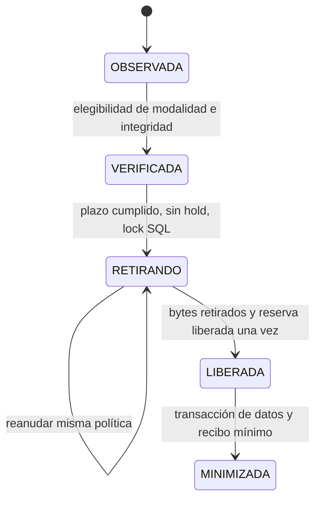

# Retención alternativa por ACK · V12 · checkpoint 26/10/2026

**Implementación autorizada; retirada real NO habilitada.** La aprobación de ingeniería permite implementar el modo de 72 horas; activar producción exige configuración explícita y validación institucional del riesgo residual.

Base: `b6ab36af4357f6852f035466b4653da97d267e00`. Implementación confirmada localmente: `f540249897788e3cc64c7990645a2b920b2f6fff`. Rama: `retencion-ack-72h-2026-10-26`. Último encargo: cierre local, **sin push, despliegue, cambios a SIGER, servicios, datos institucionales o banderas activas**.

## Dos modalidades, una recepción

| Modalidad | Elegibilidad adicional a integridad y ausencia de hold |
|---|---|
| `GARANTIA_INDEPENDIENTE` | Original y predeterminada: garantía independiente vigente/restauración acreditada y retención configurada desde observación válida |
| `ACK_RETENCION_LIMITADA_APROBADA` | Opt-in: primer ACK válido persistido hace al menos **72 horas**, referencia de política y aceptación explícita de riesgo; no exige respaldo individual |

PULL, reservas, streaming, COM/folio y ACK se mantienen. SIGER recibe sin el agente. No cambian documentos/firmas 1.0/1.1, canonicalización, UUID, recibos o significado de `GarantiaCustodia`. Las 110 comprobaciones E2E anteriores sin agente son evidencia histórica, no repetida en esta unidad.

No se fabrican garantías ni se presenta ACK como restauración. No hay fallback automático por ausencia o vencimiento de garantía. El agente no se modifica ni habilita.

## Primer ACK y V12

`first_ack_ms` se escribe con el reloj del servidor público **en la misma transacción que acepta el primer ACK validado**, bajo lock de fila. Duplicados retornan antes de modificarla y el SQL conserva una fecha existente. No se usa la fecha declarada por SIGER para anticipar elegibilidad.

V12 añade metadatos operativos equivalentes en H2/MySQL:

- `first_ack_ms` nullable en `citizen_submission` y `public_delivery`.
- `retirement_mode` y `retirement_policy_ref` en `custody_lifecycle` y `public_delivery`.
- Filas anteriores conservan modalidad `GARANTIA_INDEPENDIENTE` y referencia vacía.
- No cambia documentos, ACK, datos históricos o checksums V1–V11; no activa mantenimiento.

Sin fecha histórica, mantenimiento valida documento/ACK y registra **la observación actual**: las 72 horas empiezan ahí. No retrofecha usando el ACK. Una fecha imposible/futura bloquea.

## Controles, concurrencia y recuperación

El motor conserva locks SQL, intención durable, streaming y retirada reanudable. El modo ACK comprueba firmas, asociación del ACK, manifiesto, metadatos y hashes/tamaños de todos los originales FILE/BLOB. Las discrepancias de identidad declaradas en el documento también bloquean este modo: no se corrigen alterando el original firmado.



- Hold confirmado antes de `RETIRANDO` prevalece. Después se rechaza activarlo con 409, sin prometer conservar bytes retirados.
- Modalidad/referencia quedan fijadas al iniciar la retirada irreversible. Antes pueden cambiar con nueva verificación; después otra modalidad/referencia bloquea continuación. No revierte fases ni reutiliza evidencia de otra política.
- Reanudar exige la misma política autorizada de la intención. No editar fases/referencias por SQL para superar guardas.
- Ausencia sin intención concordante no es retirada correcta. Fallos tras unlink o liberación contable se reanudan sin doble descuento. Un fallo SQL al minimizar conserva payload y permite reintentar.
- Se conservan comprobantes, ACK y sello mínimo; se retiran archivos/derivadas, BLOB, nombres, personas, historial y payload. Consulta y repetición exacta del formulario completo siguen idempotentes.
- La cola histórica conserva su transacción de hold/minimización y GET de comprobante; el POST que devolvía el sobre personal mantiene 410 tras minimizar.
- Pendientes, cuarentenas, holds, errores de integridad, discrepancias o contabilidad se conservan aunque falte espacio.
- Borradores/temporales siguen sus reglas existentes y solo actúan con retirada habilitada; no son una vía para borrar Comunicaciones pendientes.

La evidencia alternativa usa el dominio local `ACK_RETENCION_LIMITADA_APROBADA_1` para una huella técnica vinculada a documento, ACK, fecha, manifiesto y referencia. **No es garantía firmada de respaldo.** Se conservan motivo `ACK_RETENCION_72H` y evento durable `RETIRADA_ACK_72H_INICIADA`, además de recibos/eventos existentes.

## Configuración y habilitación

Plantilla: [retencion-ack-72h.properties.example](../infra/retencion-ack-72h.properties.example). Perfil original: [capacidad-25gb.properties.example](../infra/capacidad-25gb.properties.example). Ejemplos no instalados.

```properties
# Predeterminado:
ciclo-vida.modalidad=GARANTIA_INDEPENDIENTE
ciclo-vida.online-habilitado=false
ciclo-vida.eliminacion.habilitada=false
# Alternativa solo en configuración privada aprobada:
# ciclo-vida.modalidad=ACK_RETENCION_LIMITADA_APROBADA
# ciclo-vida.ack-riesgo-aceptado=true
# ciclo-vida.aprobacion-ref=REFERENCIA_VERSIONADA_APROBADA
# ciclo-vida.retencion-post-ack=PT72H
```

Modo desconocido, referencia ausente, aceptación false o plazo alternativo distinto de 72 h rechazan configuración. No heredar PT24H del perfil original.

En el modo ACK, `ciclo-vida.garantias.trusted-keys` puede faltar/estar vacío; no exige claves del agente. Si se configura, se valida estrictamente. Sin esa confianza, el endpoint de garantías responde 503, nunca acepta una garantía sin firma. La modalidad original sigue exigiendo confianza independiente.

Procedimiento pendiente de autorización operativa, **no ejecutado**:

1. Validar responsable, referencia/versionado de aceptación, RPO/RTO, contingencia y respaldos generales disponibles. La referencia es una etiqueta auditable, no prueba criptográfica de aprobación.
2. Respaldar base/almacén coherentes y comprobar restore aislado; preservar claves históricas/HMAC. Inventariar disco, pendientes/holds; comprobar reloj, TLS y custodia SIGER.
3. Aplicar V12 con migrador autorizado y V1–V11 intactas. No migrar a ciegas ni arrancar código anterior sobre el esquema nuevo.
4. Seleccionar ACK, aceptación/referencia aprobadas y 72 h; activar programador con **eliminación false**. Observar plazos, métricas, holds y discrepancias. Históricos sin fecha reciben una ventana nueva conservadora.
5. Solo con autorización de la infraestructura, habilitar retirada acotada y comprobar reservas, recibos, minimización y disponibilidad SIGER. No requiere agente ni cambios a SIGER.
6. Atender alertas antes del agotamiento. SIGER indisponible conserva pendientes; cuotas/piso frenan nuevas admisiones.

`GET /operacion/v1/custodia` sigue autenticado, agregado y no-store. Añade `modalidadRetirada` y `retencionSegundos`; cada cola indica `garantiaRequeridaParaRetirada`. En ACK, `confirmadasEsperandoGarantia` es cero; cantidades de garantías presentes/ausentes/vencidas son informativas, no requisitos. No es un contador de elegibles: firmas, bytes y holds se verifican individualmente. No expone referencia de aprobación ni datos personales. Reserva contable, cuota y espacio físico siguen separados.

## Reversión

Poner `eliminacion.habilitada=false` detiene nuevas retiradas al cargar esa configuración; detener también el programador si procede. Editar un archivo no reconfigura un proceso sin su procedimiento de recarga/reinicio autorizado.

Antes de `RETIRANDO` puede volver a `GARANTIA_INDEPENDIENTE` con sus garantías/controles. Desde `RETIRANDO`/`LIBERADA`, otro modo/referencia bloquea hasta reanudar con la política original autorizada. Resolver esas intenciones primero; no forzar regresiones de estado.

**Reversión no reconstruye bytes.** Tras retirar/minimizar se recupera desde SIGER o respaldo válido. No hacer downgrade Flyway ni borrar V12. Conservar artefactos/configuraciones previos; comprobar compatibilidad antes de usarlos sobre esquema nuevo.

## Riesgo residual y 25 GB

ACK acredita COMMIT institucional y correspondencia documental, no una segunda copia independiente o recuperación de desastre. Tras retirar puede quedar una sola copia si no hay respaldo general válido. Corrupción, ransomware, pérdida del primario o backup incompleto podrían resultar irrecuperables; hashes detectan, no reconstruyen.

72 horas amplían la recuperación temporal, pero no sustituyen backup. Activación productiva exige validar/aceptar explícitamente ese riesgo. No se declara certificación, conclusión legal ni habilitación. Binlogs, snapshots y backups públicos necesitan su propia caducidad/restore aprobados; NULL/unlink no prometen borrado forense o encoger InnoDB inmediatamente.

Modelo existente, sin carga: 300 ingresos web/mes (cota de las 300 Comunicaciones totales de todos los canales), 24 h hasta ACK + 72 h públicas, llegadas uniformes y mantenimiento horario. Cuota candidata 6 GiB, piso 4 GiB; presupuesto anterior 22 GiB frente a 23,28 GiB de 25 GB decimales. No es medición física de la VM.

| Promedio MiB/ingreso | Archivos | Pico modelado binario/reserva |
|---:|---:|---:|
| 20 | 2 | 0,957 GiB |
| 100 | 2 | 4,160 GiB |
| 250 | 12 | 10,947 GiB: excede cuota |

25 GB pueden sostener cargas medias presupuestadas, no todo al máximo o una caída ilimitada. No se reducen formatos/límites ni se descartan pendientes. Atender cuota 80/95 %, margen preventivo y piso. Recibos/metadatos mínimos siguen creciendo lentamente: no se promete capacidad infinita.

El modelo `modelar-receptor-transitorio.py` conserva `ack_and_restore_hours`: aquí significa solo latencia a ACK, **sin afirmar restauración independiente**.

## Verificaciones y estado

| Verificación local | Resultado |
|---|---|
| Backend H2 completo sin carga | 309 seleccionadas: 307 correctas, 0 fallos/errores, 2 omisiones |
| Backend MySQL 8.4.11 aislado, misma selección | 309 seleccionadas: 307 correctas, 0 fallos/errores, 2 omisiones |
| Nuevos casos de política ACK | 25 correctos, incluidos en ambas baterías |
| V12 MySQL desde cero y desde V11 | Correctas; filas centinela/estados y checksums V1–V11 conservados |
| Migraciones históricas en Git | 22 archivos V1–V11 H2/MySQL idénticos al baseline |
| Frontend completo, lint y build | Correctos; dos workers |
| Python de respaldo/inventario | 9 + 7 correctas |
| Diff, enlaces y revisión de archivos privados | Correctos; sin contratos, agente ni frontend modificados |

Omisiones existentes: `MultimediaWorkersRealTest#transporteJavaInspeccionaRepresentacionesYAntivirusReales` y `RecuperacionProcesoTest#comprobanteConfirmadoSobreviveCaidaRealDeMySQLYUnaFallaNoSeAcepta`, por no habilitar workers reales ni reinicio destructivo de MySQL. `Carga*Test` no se selecciona, conforme al límite de estrés. Los XML antiguos excluidos no se suman a esta ejecución.

MySQL de regresión usa solo `robust_public_test` en el contenedor Linux existente, aplicación/migrador separados y credenciales privadas. Se mantiene la excepción HTTP/JDBC local explícita de ese laboratorio; no se cambia TLS institucional ni `VERIFY_IDENTITY` Windows. Las dos sondas de migración usan otros esquemas vacíos QA de la misma instancia, sin reiniciar ni reconfigurar el motor.

[Resumen sanitizado](RESULTADOS_RETENCION_ACK_72H_2026-10-26.json). JAR de build no instalado: SHA-256 `82cfeae55a8222004af3c685ec467c5f65269c2ad21abbe70696c4a09a888694`. Sin ejecución de CI remota porque no se publica.

Los 25 casos nuevos cubren configuración cerrada/ambas modalidades, borde de 72 h, duplicados/ACK inválidos, históricos sin fecha, FILE/BLOB, estados no confirmados, ausencia/corrupción, discrepancias firmadas, contabilidad, holds con transacciones/conexiones simultáneas, cambio concurrente de política, retirada interrumpida, reapertura BD/almacén, rollback de minimización y cuota.

La [sonda de migración](../scripts/qa/VerificarMigracionRetencion.java) se ejecutó en dos esquemas MySQL nuevos dedicados, sin clean/DROP: creación V1–V12 y actualización V11→V12. Comprobó checksums, centinelas, fase RETIRANDO y defaults; no retrofechó ACK. Centinelas sintéticos no enviados; ambos esquemas se conservan y solo su cuenta QA dedicada tiene acceso.

Repetir sonda: provisionar dos esquemas vacíos `robust_public_ack12_fresh_<epoch>` / `robust_public_ack12_upgrade_<epoch>` y cuenta `qa_ack72_<epoch>` solo sobre ellos. Compilar con Java 25 y classpath Maven del backend; ejecutar `cl.nexbyte.siger.qa.VerificarMigracionRetencion fresh` / `upgrade` con JSON privado por stdin (`user`, `password`, `fresh`, `upgrade`). Rechaza otros destinos o esquemas no vacíos. No subir JSON/volcados.

Regresión desde repositorio (MySQL solo con cinco variables `ROBUST_DB_*` privadas y `robust_public_test`; nunca esquema ciudadano):

```bash
cd formulario-publico/backend
mvn -B -ntp '-Dtest=*Test,!Carga*Test' verify
cd ../front
npm run lint
npm test -- --maxWorkers=2
npm run build
cd ../..
python3 scripts/qa/test_media_archive.py
python3 scripts/qa/test_media_storage_report.py
```

No se repiten proveedores gubernamentales, E2E institucional o estrés. Formulario conserva Linux/POSIX. Omisiones opcionales de workers reales/reinicio destructivo MySQL se registran, no cuentan como éxitos.

Evidencia privada: `.local/ack72-{h2,mysql}.log`, resúmenes/resultado de migración y raíces `~/.local/share/siger/ack72-qa-*`. JAR de `target` es build, no instalación. Sin cambios a bases ciudadanas, MySQL80 Windows, servicios, claves, agente o SIGER.

**Pendiente operativo:** riesgo/configuración del ambiente, backup/restore, despliegue/migración y habilitación gradual autorizados. No ejecutarlos desde este checkpoint. Código y evidencia quedan en commits locales revisables, sin publicación.
