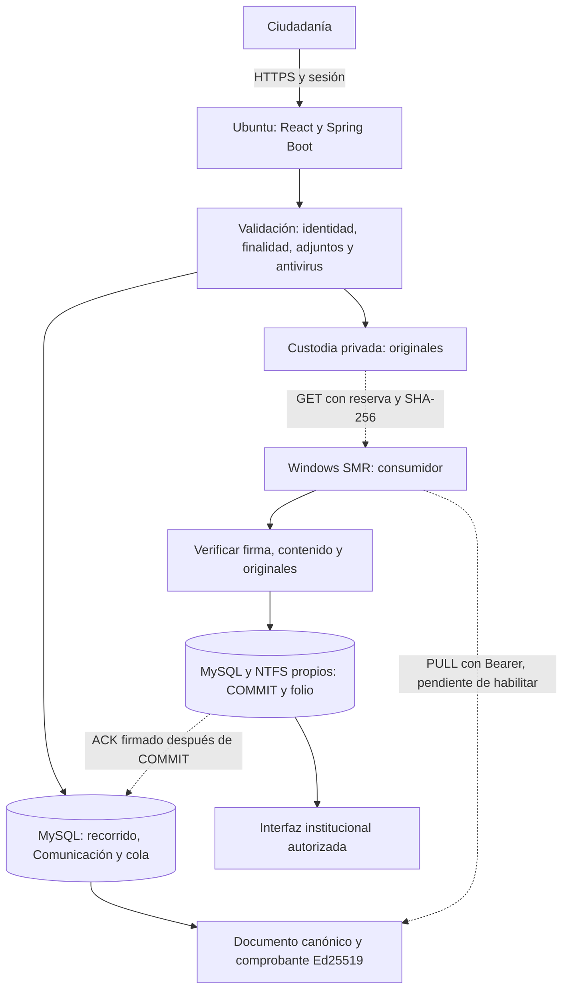

# Contrato efectivo del productor Formulario → SMR

Corte de inspección: 04/11/2026. Fuente compilada `c42bc4fb913c85001e01c6ba4c7b332a530ca448`. Leer primero [handoff](HANDOFF_CODEX_SMR_2026-11-04.md). Este manual describe código existente; no crea un protocolo ni autoriza operaciones productivas.

## Arquitectura y responsabilidades



La sesión ciudadana aporta el recorrido; el navegador no autoafirma autenticación ni procedencias. `RecepcionFormularioJdbc.recibir` normaliza contactos, bloquea borrador, valida datos y adjuntos, congela el recorrido y persiste documento/cola en transacción. La clave de envío UUID, recorrido, sesión y huella de solicitud sostienen la idempotencia. No aceptar el mismo UUID con otro contenido. Los originales multimedia FILE están fuera de SQL en custodia privada; el camino histórico puede conservar bytes en SQL. No usar rutas del ciudadano como rutas NTFS.

El documento firmado contiene antecedentes internos necesarios para la institución; las respuestas ciudadanas contienen estado y comprobante, no el agregado registral. Se firma custodia pública después de validar; no se inventa un COM institucional. La Comunicación queda recuperable cuando se habilita el control técnico y hay confianza ACK. Reiniciar Ubuntu no borra SQL/originales; las sesiones y borradores HTTP no son una garantía de persistencia institucional.

## API institucional exacta

Origen público: **https://formulario.defensorianinez.gob.cl**. Base:
`/integracion/v3/formulario-completo/entregas`.

Autenticación independiente: `Authorization: Bearer <credencial entregada privadamente>`, HTTPS con cadena y hostname válidos. Sin cookies, contraseña temporal ni CSRF ciudadano. No seguir redirecciones a login ni reenviar Bearer a otro host. No hay POST entrante a SMR exigido por este contrato.

| Operación | Método y sufijo | Solicitud | Respuesta |
|---|---|---|---|
| Reservar lote | POST `/reclamar` | Content-Type application/json; `X-Formulario-Versiones: 1.0,1.1`; `{"limite":1}` | 200 `{"entregas":[{"reserva":"UUID","venceEn":0,"intento":1,"entrega":{...}}]}`; vacío es `{"entregas":[]}` |
| Descargar original | GET `/{id}/adjuntos/{adjunto}` | `X-Reserva: UUID`; Range/If-Range opcionales | 200 o 206 con bytes |
| Metadatos del original | HEAD misma ruta | `X-Reserva: UUID` | 200, sin cuerpo; Range ignorado |
| Confirmar | POST `/{id}/confirmacion` | JSON `{"reserva":"UUID","recepcion":{"registro":{...},"comprobante":{...}}}` | 204 sin cuerpo |
| Notificar fallo | POST `/{id}/fallo` | JSON `{"reserva":"UUID","codigo":"TRANSITORIO"}` | 204 sin cuerpo |

`id` es UUID de Comunicación pública, no recorrido ni UUID institucional. `adjunto` es el UUID del descriptor firmado. No existe un GET institucional libre por RUN ni un filtro de reclamo por UUID/campaña.

Límite efectivo de lote **1..10**. Ausencia de X-Formulario-Versiones selecciona únicamente 1.0; valores admitidos 1.0 y 1.1, separados por coma sin espacios. Desconocidos o lista vacía: 400. Enviar exactamente `1.0,1.1`, no depender de normalizaciones del split Java. No confundir el campo **venceEn** de esta familia con **venceEnEpochMs** del histórico v3. Epoch de vencimiento en milisegundos UTC, reserva de **300000 ms / cinco minutos**. Cada nueva reserva tiene UUID y aumenta intento; no hay renovación de lease en la API. Empezar con lote 1.

### Códigos y transporte

401: Bearer ausente/incorrecto. 400: JSON/UUID/límite/versiones inválidos. 404: Comunicación/adjunto inexistente o no perteneciente. 409: reserva no vigente/reemplazada o ACK incongruente. 503: capacidad/servicio/control/confianza no disponibles o integridad interna inválida. Descargar puede devolver 429 (máximo cuatro respuestas concurrentes), 416 (rango inválido), 206 parcial. Errores de infraestructura, proxy o TLS requieren diagnóstico separado, no reinterpretarlos como lote vacío. No depender del texto del cuerpo de error para reintentar.

GET/HEAD: `Cache-Control: no-store`, ETag `"sha256-del-original"`, Accept-Ranges bytes, Content-Length y descarga `application/octet-stream`, Content-Disposition attachment, nosniff y CSP sandbox. GET admite un rango `bytes=inicio-fin`, `bytes=inicio-` o `bytes=-sufijo`; no múltiples. If-Range debe coincidir exactamente con ETag; si no coincide se devuelve recurso completo 200. HEAD describe siempre el completo. 416 incluye Content-Range `bytes */tamaño`. Reanudación es opcional en SMR: el consumidor existente descarga completo y acepta 200; no afirmar que ya implementa Range. Verificar siempre el hash del original completo antes de COMMIT/ACK, nunca solo el rango. No ejecutar Office/PDF activos dentro de la interfaz.

## Documento, personas y procedencias

`entrega = {comunicacion, sha256, huellaProcedencia, custodia}`.

| Estructura | Claves exactas y significado |
|---|---|
| comunicacion | version, id, recorridoId, tipo, recibidaEn, avisoVersion, aceptaCanalDigital, datos, personas, adjuntos |
| tipo | ADULTO_CU, ADULTO_DECLARADO o NNA; versión documental 1.0/1.1 es independiente del tipo |
| datos | campos (mapa texto→texto), personas (relaciones), instituciones, adjuntos (UUID) |
| relación en datos.personas | personaId, detalles (mapa texto→texto); referencia una persona interna |
| institución | nombre, tipo, rol, region, comuna; campos opcionalmente null |
| persona interna | id, rol, runNumero, runDv, modulo11, autenticada, estadoConsulta, consultadaEn, consultaRef, atributos, discrepancias |
| rol | PRESENTADOR, AFECTADO_NNA, ADULTO_RELACIONADO, PERSONA_SENALADA |
| valor de atributos/discrepancias | valor, codigo, fuente, nivel, observadoEn, evidencia; mapa por nombre de atributo |
| fuente | CLAVE_UNICA_USERINFO, SRCEI, DECLARACION_CIUDADANA, SIN_DATO |
| descriptor de adjunto | id, nombre, tamanio (bytes), sha256 (hex minúsculas), tipo (MIME), estado=VALIDADO |

`estadoConsulta` y valores/códigos son evidencia registral, no autenticación. Conservar null y códigos sin inventar semántica; `0000-00-00` no es fecha. ADULTO_DECLARADO permanece autenticada=false. Correcciones pueden dejar la declaración en atributos y el antecedente registral en discrepancias: no descartarlos ni sustituir fuentes al mostrar. No dividir nombres por espacios.

`campos` conserva las claves de la interfaz, sin convertirlas en un DTO reducido que pierda contenido. Para labels, condiciones, contactos y geografía reutilizar catálogos y `CamposFormulario.ts` del receptor, más las reglas del productor; no truncar relatos. Mapas: hasta 80 campos generales, 10 detalles por relación; hasta 29 relaciones, 20 instituciones y 12 adjuntos. Esos máximos no sustituyen restricciones de contenido/tipo/cuota del perfil multimedia. Documento 1.1 identifica capturas con adjuntos FILE; 1.0 conserva el camino histórico. No degradar ni volver a firmar históricos.

## Canonicalización, hashes y firmas

Para contenido: SHA-256 de UTF-8 de `SIGER_FORMULARIO_COMPLETO_1`, NUL, `CONTENIDO`, NUL, seguido del JSON compacto con claves de objetos ordenadas recursivamente. Se preserva orden de arrays, nulls, valores, Unicode y tipos. Para procedencia se cambia dominio a `PROCEDENCIA` y se serializa el mapa ordenado persona.id → `[persona.atributos, persona.discrepancias]`. No usar SHA del JSON bonito, JCS genérico ni la canonicalización de identidad histórica. Reutilizar CanonFormulario/EntregaCompleta.

`custodia = {algoritmo,keyId,payload,firma}`: Ed25519 sobre los bytes de payload, ambos base64url sin padding. Payload custodia: version=1.0, id, recibidaEn, tipoRecepcion=CUSTODIA_PUBLICA, huellaContenido, huellaProcedencia, emisor=FORMULARIO_PUBLICO_DDN, avisoVersion (en ese orden de record). Verificar keyId contra confianza externa; firma, representación reserializada canónica y todos los enlaces id/fecha/aviso/huellas. No confiar en una clave adjunta al mensaje.

ACK usa `RegistroInstitucional {registro, comprobante}`. Registro en orden de record: version, emisor, hecho, operacionPublicaId, comunicacionId, numeroFolio, folio, registradaEn, canalOrigen, sha256, huellaProcedencia. Emisor **SIGER_DDN**, hecho **COMUNICACION_REGISTRADA**. Mantener estos identificadores contractuales aunque la aplicación se llame SMR. Version ACK **1.0 para FORMULARIO_WEB_PUBLICO (ambos adultos)**, **1.1 para FORMULARIO_WEB_NNA**. No derivarla de comunicacion.version. numeroFolio>=1, sufijo decimal de folio igual al número; formato `[A-Z][A-Z0-9]{1,15}-[0-9]{1,19}`. UUID institucional distinto del UUID técnico; guardar el vínculo y folio definitivo estable.

El comprobante ACK tiene las mismas cuatro claves, payload es JSON UTF-8 compacto del registro en orden de record, no orden alfabético. Ed25519 sobre esos bytes; base64url sin padding, firma de 86 caracteres. El productor verifica firma con confianza ACK externa, igualdad de registro con payload y correspondencia de operación, hashes y canal. COMMIT de SQL y originales durables **antes de enviar ACK**. No registrar una Comunicación como Caso automáticamente.

## Estados, errores e idempotencia

| Estado productor | Significado y transición |
|---|---|
| PENDIENTE | Recepción SQL durable; ciudadano ve PENDIENTE_REGISTRO_SIGER; se puede reservar cuando se habilite PULL |
| RESERVADA | Lease activa; descarga no es todavía registro ni ACK. Lease vencida puede reclamarse con nuevo token |
| CONFIRMADA | ACK institucional válido persistido; ciudadano ve REGISTRADA_SIGER. Sale de pendientes |
| CUARENTENA | Revisión operativa requerida; no es eliminación ni un rechazo institucional definitivo al ciudadano |

No hay estado SQL separado DESCARGADA: el consumidor registra su progreso. Fallo TRANSITORIO, RECEPTOR_NO_DISPONIBLE o CONFIRMACION_AMBIGUA vuelve a PENDIENTE con demora `min(300000, 1000 << min(intento,9))` ms. CONTRATO_INVALIDO o intento>=10 llevan a CUARENTENA; al reclamar intento>10 también cuarentena INTEGRIDAD_O_LIMITE. Fallo requiere reserva coincidente; el método de fallo no comprueba el vencimiento como sí lo hacen descarga/confirmación. Repetición del mismo fallo fuera de RESERVADA es idempotente si coincide last_error. No reintentar corrupción indefinidamente ni manipular SQL para sacar cuarentena.

ACK idéntico ya aceptado devuelve 204 aunque haya vencido la reserva; ACK diferente produce 409. Antes del primer ACK exige token vigente. Guardar reserva y ACK pendiente duraderamente antes de transmitir. Si se pierde respuesta tras COMMIT, conciliar con el mismo ACK: no crear otro UUID, documento o folio. Si otro token reemplazó al antiguo y da 409, esperar nueva entrega, validar mismo id/hash y actualizar solo reserva; reutilizar registro firmado original. Tras fallo de MySQL/NTFS no emitir ACK. Confirmar no elimina inmediatamente originales; retirada/garantías son otro proceso y actualmente eliminación está apagada.

## Fuentes normativas de esta lectura

- [IntegracionFormularioController.java](https://github.com/chashmdai/formulario-web/blob/c42bc4fb913c85001e01c6ba4c7b332a530ca448/formulario-publico/backend/src/main/java/cl/nexbyte/siger/formulario/IntegracionFormularioController.java)
- [RecepcionFormularioJdbc.java](https://github.com/chashmdai/formulario-web/blob/c42bc4fb913c85001e01c6ba4c7b332a530ca448/formulario-publico/backend/src/main/java/cl/nexbyte/siger/formulario/RecepcionFormularioJdbc.java)
- [EntregaFormulario.java](https://github.com/chashmdai/formulario-web/blob/c42bc4fb913c85001e01c6ba4c7b332a530ca448/formulario-publico/backend/src/main/java/cl/nexbyte/siger/formulario/EntregaFormulario.java)
- [CanonFormulario.java](https://github.com/chashmdai/formulario-web/blob/c42bc4fb913c85001e01c6ba4c7b332a530ca448/formulario-publico/backend/src/main/java/cl/nexbyte/siger/formulario/CanonFormulario.java)
- [DatosFormulario.java](https://github.com/chashmdai/formulario-web/blob/c42bc4fb913c85001e01c6ba4c7b332a530ca448/formulario-publico/backend/src/main/java/cl/nexbyte/siger/formulario/DatosFormulario.java)
- [IdentificacionCiudadana.java](https://github.com/chashmdai/formulario-web/blob/c42bc4fb913c85001e01c6ba4c7b332a530ca448/formulario-publico/backend/src/main/java/cl/nexbyte/siger/formulario/IdentificacionCiudadana.java)
- [ContactosFormulario.java](https://github.com/chashmdai/formulario-web/blob/c42bc4fb913c85001e01c6ba4c7b332a530ca448/formulario-publico/backend/src/main/java/cl/nexbyte/siger/formulario/ContactosFormulario.java)
- [ValidacionFormulario.java](https://github.com/chashmdai/formulario-web/blob/c42bc4fb913c85001e01c6ba4c7b332a530ca448/formulario-publico/backend/src/main/java/cl/nexbyte/siger/formulario/ValidacionFormulario.java)
- [ComprobanteDigital.java](https://github.com/chashmdai/formulario-web/blob/c42bc4fb913c85001e01c6ba4c7b332a530ca448/formulario-publico/backend/src/main/java/cl/nexbyte/siger/robustez/ComprobanteDigital.java)
- [ComprobanteInstitucional.java](https://github.com/chashmdai/formulario-web/blob/c42bc4fb913c85001e01c6ba4c7b332a530ca448/formulario-publico/backend/src/main/java/cl/nexbyte/siger/robustez/ComprobanteInstitucional.java)
- [TransferenciaPrivada.java](https://github.com/chashmdai/formulario-web/blob/c42bc4fb913c85001e01c6ba4c7b332a530ca448/formulario-publico/backend/src/main/java/cl/nexbyte/siger/multimedia/TransferenciaPrivada.java)
- [IntegracionSecurity.java](https://github.com/chashmdai/formulario-web/blob/c42bc4fb913c85001e01c6ba4c7b332a530ca448/formulario-publico/backend/src/main/java/cl/nexbyte/siger/entrega/IntegracionSecurity.java)

Documentos complementarios: [multimedia](../contratos/formulario-completo-multimedia-v1.1.md), [custodia completa](CUSTODIA_FORMULARIO_COMPLETO.md), [registro v3](../contratos/registro-comunicacion-v3.md). Sus estados de publicación históricos no prevalecen sobre la instalación actual. `identidad-componentes-v1.1.md` describe otro algoritmo del sobre histórico; **no aplicarlo al hash del formulario completo**.

## Ejemplos completos exclusivamente sintéticos

Vectores 1.0 y 1.1 en [smr-ejemplos](smr-ejemplos/README.md), con originales y claves exclusivamente públicas de prueba. Criptografía comprobada offline, sin instalar confianza ni enviar solicitudes. La reserva está vencida deliberadamente; firmas no corresponden a identidades productivas. Son escenarios independientes: no ingresar ambos UUID repetidos en la misma base. No son un permiso de campaña.

### Respuesta PULL 1.1

```json
{
  "entregas": [
    {
      "reserva": "30000000-0000-4000-8000-000000000001",
      "venceEn": 1793793900000,
      "intento": 1,
      "entrega": {
        "comunicacion": {
          "version": "1.1",
          "id": "10000000-0000-4000-8000-000000000001",
          "recorridoId": "20000000-0000-4000-8000-000000000001",
          "tipo": "NNA",
          "recibidaEn": "2026-11-04T12:00:00Z",
          "avisoVersion": "NNA_LAB_1",
          "aceptaCanalDigital": false,
          "datos": {
            "campos": {
              "nna-region": "13",
              "nna-primary-method": "unsafe",
              "nna-story": "Relato sintetico completo"
            },
            "personas": [],
            "instituciones": [],
            "adjuntos": [
              "40000000-0000-4000-8000-000000000001"
            ]
          },
          "personas": [
            {
              "id": "presentador-nna",
              "rol": "PRESENTADOR",
              "runNumero": null,
              "runDv": null,
              "modulo11": false,
              "autenticada": false,
              "estadoConsulta": "NO_HABILITADO",
              "consultadaEn": null,
              "consultaRef": null,
              "atributos": {
                "primerNombre": {
                  "valor": "PERSONA",
                  "codigo": null,
                  "fuente": "DECLARACION_CIUDADANA",
                  "nivel": "DECLARADO_NO_CONTRASTADO",
                  "observadoEn": "2026-11-04T12:00:00Z",
                  "evidencia": "50000000-0000-4000-8000-000000000001"
                },
                "primerApellido": {
                  "valor": "SINTETICA",
                  "codigo": null,
                  "fuente": "DECLARACION_CIUDADANA",
                  "nivel": "DECLARADO_NO_CONTRASTADO",
                  "observadoEn": "2026-11-04T12:00:00Z",
                  "evidencia": "50000000-0000-4000-8000-000000000001"
                },
                "edad": {
                  "valor": "12",
                  "codigo": null,
                  "fuente": "DECLARACION_CIUDADANA",
                  "nivel": "DECLARADO_NO_CONTRASTADO",
                  "observadoEn": "2026-11-04T12:00:00Z",
                  "evidencia": "50000000-0000-4000-8000-000000000001"
                }
              },
              "discrepancias": {}
            }
          ],
          "adjuntos": [
            {
              "id": "40000000-0000-4000-8000-000000000001",
              "nombre": "original-sintetico.txt",
              "tamanio": 44,
              "sha256": "8de2a04bbb8f3c6ce2fa5c941daf798bd8ad0ee73e3fe04ada1b6829926ef5bb",
              "tipo": "text/plain",
              "estado": "VALIDADO"
            }
          ]
        },
        "sha256": "bccac2446b7cd6f2a1d8af086622e46274aebf855dcefabd704252a138de10dc",
        "huellaProcedencia": "4fd1dd380ac13cf8b1eaba03e8212be44711560cdb35405a32baf07340e30dc7",
        "custodia": {
          "algoritmo": "Ed25519",
          "keyId": "FORM_FIXTURE_PUBLIC",
          "payload": "eyJ2ZXJzaW9uIjoiMS4wIiwiaWQiOiIxMDAwMDAwMC0wMDAwLTQwMDAtODAwMC0wMDAwMDAwMDAwMDEiLCJyZWNpYmlkYUVuIjoiMjAyNi0xMS0wNFQxMjowMDowMFoiLCJ0aXBvUmVjZXBjaW9uIjoiQ1VTVE9ESUFfUFVCTElDQSIsImh1ZWxsYUNvbnRlbmlkbyI6ImJjY2FjMjQ0NmI3Y2Q2ZjJhMWQ4YWYwODY2MjJlNDYyNzRhZWJmODU1ZGNlZmFiZDcwNDI1MmExMzhkZTEwZGMiLCJodWVsbGFQcm9jZWRlbmNpYSI6IjRmZDFkZDM4MGFjMTNjZjhiMWVhYmEwM2U4MjEyYmU0NDcxMTU2MGNkYjM1NDA1YTMyYmFmMDczNDBlMzBkYzciLCJlbWlzb3IiOiJGT1JNVUxBUklPX1BVQkxJQ09fREROIiwiYXZpc29WZXJzaW9uIjoiTk5BX0xBQl8xIn0",
          "firma": "xbingU5RYGurM4vOKpPd0HkcI4fuAj3dZzEZ6CyrAoJD1NvqBD4TUUWDqqa9qCi_ZCxtrzrqnJ-zLpemPfXIBA"
        }
      }
    }
  ]
}
```

### ACK correspondiente (NNA, por eso version=1.1)

```json
{
  "reserva": "30000000-0000-4000-8000-000000000001",
  "recepcion": {
    "registro": {
      "version": "1.1",
      "emisor": "SIGER_DDN",
      "hecho": "COMUNICACION_REGISTRADA",
      "operacionPublicaId": "10000000-0000-4000-8000-000000000001",
      "comunicacionId": "60000000-0000-4000-8000-000000000001",
      "numeroFolio": 1,
      "folio": "COM-000001",
      "registradaEn": "2026-11-04T12:00:00Z",
      "canalOrigen": "FORMULARIO_WEB_NNA",
      "sha256": "bccac2446b7cd6f2a1d8af086622e46274aebf855dcefabd704252a138de10dc",
      "huellaProcedencia": "4fd1dd380ac13cf8b1eaba03e8212be44711560cdb35405a32baf07340e30dc7"
    },
    "comprobante": {
      "algoritmo": "Ed25519",
      "keyId": "SMR_FIXTURE_ACK",
      "payload": "eyJ2ZXJzaW9uIjoiMS4xIiwiZW1pc29yIjoiU0lHRVJfREROIiwiaGVjaG8iOiJDT01VTklDQUNJT05fUkVHSVNUUkFEQSIsIm9wZXJhY2lvblB1YmxpY2FJZCI6IjEwMDAwMDAwLTAwMDAtNDAwMC04MDAwLTAwMDAwMDAwMDAwMSIsImNvbXVuaWNhY2lvbklkIjoiNjAwMDAwMDAtMDAwMC00MDAwLTgwMDAtMDAwMDAwMDAwMDAxIiwibnVtZXJvRm9saW8iOjEsImZvbGlvIjoiQ09NLTAwMDAwMSIsInJlZ2lzdHJhZGFFbiI6IjIwMjYtMTEtMDRUMTI6MDA6MDBaIiwiY2FuYWxPcmlnZW4iOiJGT1JNVUxBUklPX1dFQl9OTkEiLCJzaGEyNTYiOiJiY2NhYzI0NDZiN2NkNmYyYTFkOGFmMDg2NjIyZTQ2Mjc0YWViZjg1NWRjZWZhYmQ3MDQyNTJhMTM4ZGUxMGRjIiwiaHVlbGxhUHJvY2VkZW5jaWEiOiI0ZmQxZGQzODBhYzEzY2Y4YjFlYWJhMDNlODIxMmJlNDQ3MTE1NjBjZGIzNTQwNWEzMmJhZjA3MzQwZTMwZGM3In0",
      "firma": "Nt1x4SOtrUh1NoDFF9dFv3712vcCyk4AbA7G1hTnZS7oGYaMjQyCN6SRWZl9MM8RgTbEvuNDf9FrcWsywYbjCQ"
    }
  }
}
```
