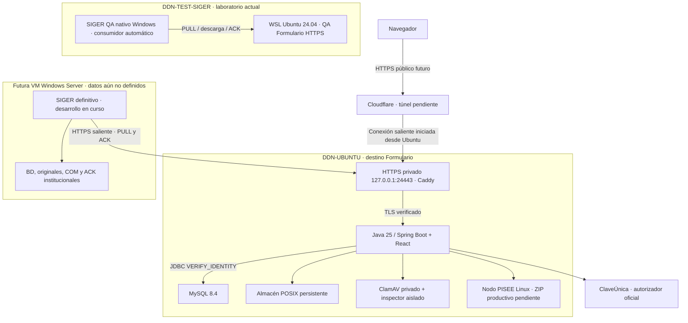

# Traspaso del Formulario Público a DDN-UBUNTU — GATE H1

**Actualización 02/11/2026:** [modo de instalación cerrado sin CU ni confianza ACK](ARRANQUE_CERRADO_UBUNTU_2026-11-02.md). Los requisitos originales siguen vigentes al habilitar cada integración.

**Fecha: 01/11/2026. Estado: candidato preparado en Git; no instalado en DDN-UBUNTU por esta unidad.** Esta es la entrada para una sesión nueva sin acceso al historial del chat. Leer después el [manual de instalación](INSTALACION_UBUNTU_DOCKER.md), las [integraciones](INTEGRACIONES_UBUNTU.md) y la [evidencia H1](VERIFICACION_GATE_H1_2026-11-01.md).

## Responsabilidad y alcance

El Formulario recibe, valida, firma y custodia transitoriamente Comunicaciones. SIGER institucional registra COM y conserva definitivamente el ingreso y los originales. SIGER inicia PULL HTTPS, verifica/persiste, hace COMMIT y devuelve ACK firmado. El agente independiente es opcional para recepción; su garantía es necesaria únicamente en la modalidad de retirada que la exige. No hay conexiones entrantes del Formulario a SIGER ni acceso público a su BD/archivo.

La preparación H1 no habilita ciudadanía, no crea túneles/DNS, no migra laboratorios existentes, no cambia infraestructura Ubuntu y no modifica SIGER. Las instalaciones futuras se ejecutan por GATES aprobados con evidencia y rollback. No repetir desarrollo ni inferir habilitación productiva de un push, CI o del antiguo “96 %”.

## Tres máquinas y topología

| Equipo | Información acreditada / límite |
|---|---|
| DDN-TEST-SIGER | Windows Server 2022 con WSL de desarrollo y SIGER QA. El WSL no constituye una tercera máquina. Conservar la QA actual y su integración automática; no migrarla con estos comandos. |
| DDN-UBUNTU | Informe aportado por el responsable: host `ddn-ubuntu`, LAN `192.168.100.14/24`. Ubuntu 26.04.1 LTS / kernel 7.0.0-42-generic; i5-13400, ~14 GiB RAM útil, swap 4 GiB. Revalidar in situ en H2. |
| Futura VM Windows Server | Alojará SIGER. Nombre, IP, versión final, cuentas, rutas, respaldo y fecha de migración aún no definidos porque su desarrollo no termina. **No bloquea preparar el Formulario**; se completan al integrar ese destino. No inventar ni montar su archivo en Ubuntu. |

Fuente de Ubuntu: `Informe_Estado_DDN-UBUNTU_2026-11-01.md` suministrado por el usuario. Los datos de esa fuente son un reporte recibido, no una inspección remota ejecutada durante H1. Su huella se registra en la evidencia. No se incorporan credenciales ni el paquete institucional privado.

### DDN-UBUNTU no está vacío

Conservar el GATE 4A existente: ocho contenedores activos, dos detenidos; imágenes históricas del Formulario, dos MySQL 8.4.11 y pruebas TLS/multimedia. Volúmenes `ddn-tls-integration_mysql-data` y `siger-mysql-lab_mysql-lab`. Orquestador existente `ddn-formulario-lab.service` y `/usr/local/sbin/ddn-formulario-lab-start`; no deshabilitarlo ni sustituirlo silenciosamente. Recepción/PULL de esos esquemas están cerrados.

El HTTPS `localhost:8443` de GATE 4A está dentro de una red/namespace compartido; no asumir que es un origen accesible por cloudflared del host. La propuesta nueva publica solo `127.0.0.1:24443` y utiliza proyecto/directorio/volumen propios. Antes de usar ese puerto, comprobar que está libre.

El SSD físico es de ~477 GiB; la raíz tiene ~98 GiB útiles, ~29 GB usados y ~65 GB disponibles según el informe. Quedan ~374 GiB del VG sin asignar. **25 GB no describe el disco actual de DDN-UBUNTU**: sigue siendo un escenario de capacidad restrictiva documentado, sujeto a carga/retención. No ampliar LVM ni podar Docker como parte de H1. SO, Docker y `/srv/ddn-formulario` comparten filesystem.

SSH22 funciona en LAN, pero falta acreditar autenticación por clave/fingerprint y política final. UFW actual no debe cambiarse. cloudflared está instalado; egreso TCP7844 probado, UDP sin acreditar; **no existe túnel operativo, DNS ni publicación ciudadana**. Certificados de origen, acceso Cloudflare y autorización de tratamiento de datos deben validarse antes de publicar.

## Estado funcional comprobado antes de H1

- Adultos con/sin CU, identificación extranjera declarada, NNA individuales/grupos, consultas, promoción, vulneración, preferencias, contactos, validación/revisión y adjuntos. Ver [validación institucional](VALIDACION_INSTITUCIONAL_2026-10-31.md).
- Países con buscador y territorio: catálogos compartidos por frontend/backend. El build Docker H1 incorpora ambos y comprueba su presencia dentro del JAR.
- Revisión por secciones; confirmación con sondeo cada cuatro segundos, folio/comprobante al recibir ACK, reintento sin reenviar. Spinner respeta movimiento reducido. Ver [ajustes del 01/11](AJUSTES_REVISION_CONFIRMACION_CU_2026-11-01.md).
- Integración automática QA acreditada hasta COM-002500; la QA recibió posteriormente COM-002501. Estas evidencias pertenecen al laboratorio, no al destino Ubuntu.
- ClaveÚnica llega al autorizador oficial. El proveedor mostró `Redirect URI Error` mientras se registra la URI. OAuth callback/token/userinfo/sesión/logout conservados y probados con proveedor controlado; aceptación final productiva pendiente.
- PISEE/SRCeI DEV fue validado acotadamente en unidades anteriores. El nodo productivo no se ha recibido; no afirmar conectividad productiva.
- Custodia, firma Ed25519, idempotencia, documentos completos `1.0/1.1`, ACK, retención/hold y retirada reanudable implementados. Flyway V1–V12 intacto.

## Archivos vigentes para instalar

| Recurso | Uso |
|---|---|
| [Dockerfile](../Dockerfile) | Build multietapa Node24 → Maven/Java25 → JRE25. React y catálogos dentro del JAR. Bases de build fijadas por digest; dependencias apt siguen sus repositorios y se registra digest final. |
| [Compose integrado](../infra/ubuntu/compose.yml) | MySQL8.4.11, aplicación, HTTPS Caddy2.11.7, inspector y ClamAV. No utiliza los volúmenes de laboratorio. |
| [Preparación privada](../scripts/ubuntu/preparar.py) | Solo destino nuevo, sin enlaces/Git; genera claves/CA privadas, secretos y cuentas separadas. Exige credenciales CU y confianza pública ACK entregadas por sus responsables. No arranca ni migra. |
| [Configuración](../infra/ubuntu/application.properties.example) | Variables por dominio y montajes secretos; recepción/PULL cerrados; PISEE/Graph/mantenimiento/retirada deshabilitados. |
| [PISEE opcional](../infra/ubuntu/compose.pisee.yml) | Contenedor sin puerto publicado, solo tras revisar el ZIP futuro. No forma parte del arranque normal. |
| [Estado agregado](../scripts/ubuntu/estado.py) | HTTPS local autenticado, sin mostrar tokens ni datos ciudadanos. |
| [Respaldo/restauración](../scripts/linux/media-archive.py) | Base y almacén coherentes, manifest/hashes, restore a destinos nuevos. Requiere ventana con app detenida; no borra orígenes. |

## GATES que seguirá la nueva sesión

1. **H2 — Inspección de destino.** Leer `AGENTS.md`, status/diff/remoto y este documento. Inventariar servicios, volúmenes, puertos, permisos POSIX, memoria/disco, SSH/fingerprint y backup del laboratorio actual. No detener nada. Dejar evidencia comparada con el informe recibido.
2. **H3 — Preparación privada.** Acordar directorios/proyecto/puerto libres, responsables de claves/trust, credenciales CU, CA y copia externa. Construir imágenes desde el SHA candidato, registrar sus digests. Preparar destino nuevo y validar Compose/PKI sin publicar.
3. **H4 — Persistencia nueva.** Crear únicamente el MySQL/volumen nuevos. Migrar explícitamente con cuenta DDL; verificar doce migraciones, TLS y permisos DML del runtime. Nunca ejecutar Flyway repair ni alterar checksums/aplicar este procedimiento a esquemas GATE4A.
4. **H5 — Arranque cerrado y recuperación.** Firmas AV actualizadas, Landlock/seccomp comprobado, cadena completa HTTPS→Spring→MySQL, recursos del JAR, datos sintéticos y backup/restore a otro destino. Mantener controles cerrados. Calificar reinicio, memoria/espacio, RPO/RTO y responsables.
5. **H6 — Integraciones autorizadas.** Registrar/verificar CU real y logout; recibir/inventariar ZIP PISEE productivo, certificados y conectividad. No hacer pruebas masivas ni reutilizar DEV en producción. La futura VM SIGER puede seguir pendiente.
6. **H7 — SIGER destino y acceso de revisión.** Completar datos de la VM Windows cuando existan. Intercambiar claves públicas/tokens fuera de Git, configurar PULL saliente, verificar originales/COMMIT/ACK con sintéticos. Coordinar consumidor/leases y no mantener dos escritores sobre un almacén.
7. **H8 — Publicación y operación.** Aprobación explícita de TI/responsable, Cloudflare/certificados/DNS, seguridad/privacidad/monitorización y restore externo acreditados. Habilitación ciudadana y mantenimiento/retirada son decisiones separadas; ninguna se deriva automáticamente de H1–H7.

Detener solo el GATE afectado si falta evidencia, conservar recursos y documentar el punto exacto. No reiniciar el proyecto ni rehacer integraciones para avanzar.

## Riesgos y dependencias que siguen abiertos

Certificación/registro definitivo CU; ZIP/servicio PISEE productivo; red y destino definitivo SIGER; credenciales/trust por ambiente; túnel/DNS/autoridad de acceso; respaldo externo y restore físico; energía/UPS y operación; calificación de máximos multimedia, rendimiento y capacidad. El medio independiente del agente sigue sin acreditarse. La alternativa ACK72h sigue opt-in y requiere activación/riesgo explícitos. Ninguna retirada se habilita aquí.

El [plan de hardening diferido](PLAN_HARDENING_PRODUCCION_DIFERIDO.md) y las [reglas de retención V12](RETENCION_ACK_72H_2026-10-26.md) siguen vigentes. Este handoff evita depender del chat; ante diferencias de infraestructura, prevalece el inventario real documentado en el siguiente GATE.
